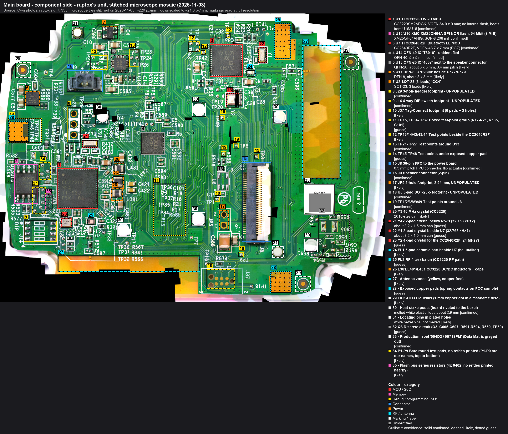
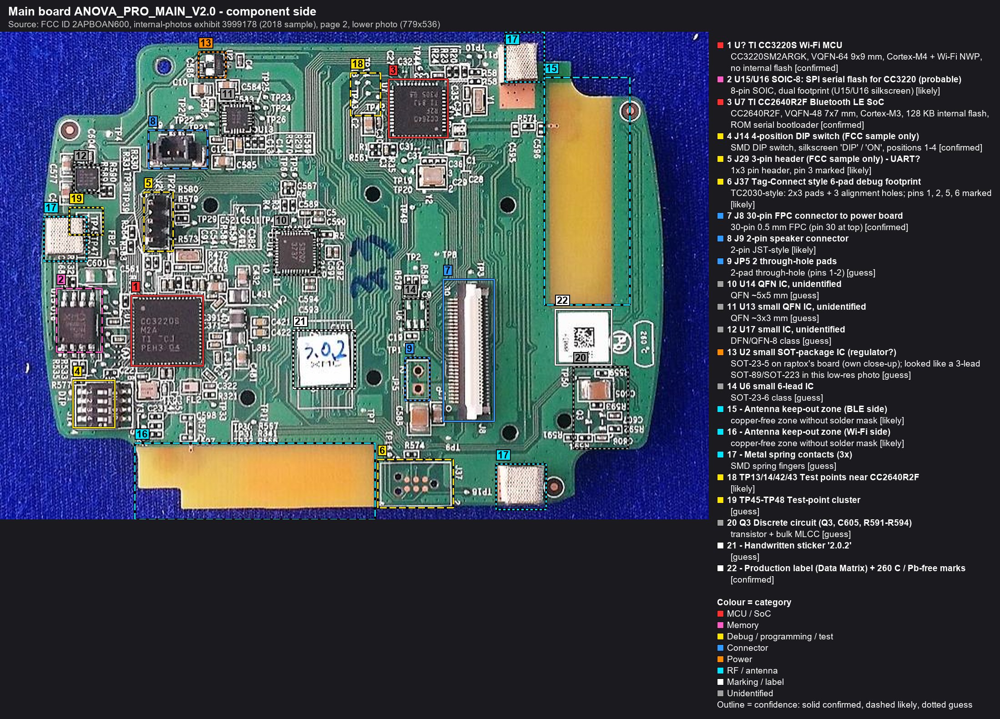
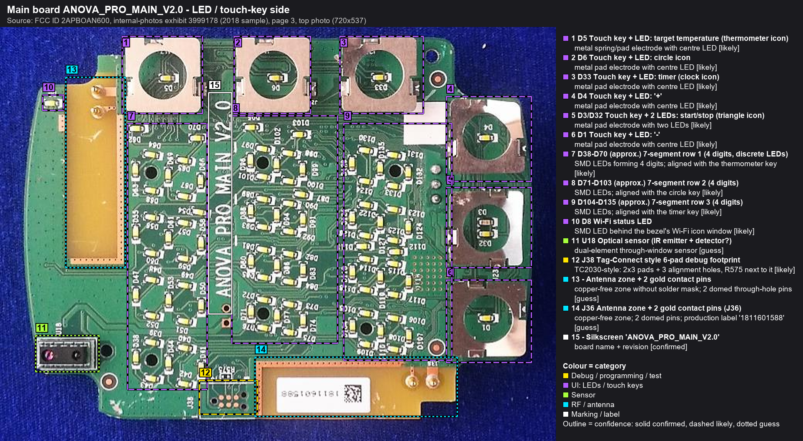
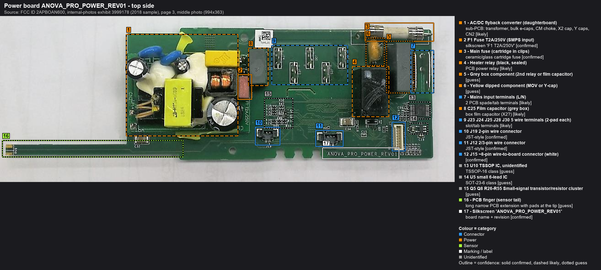
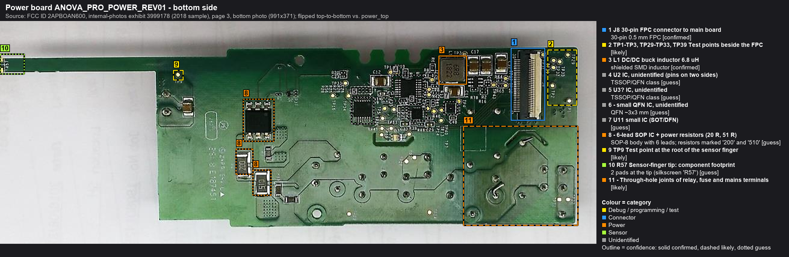
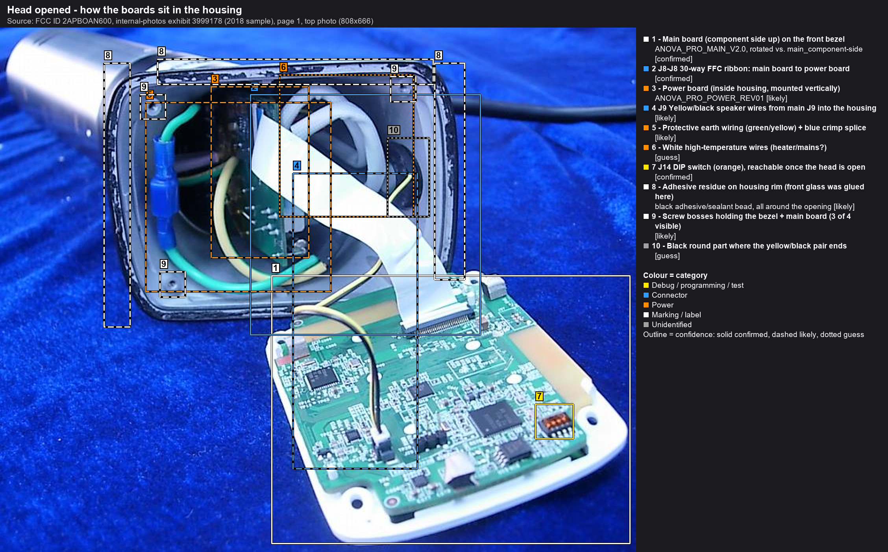
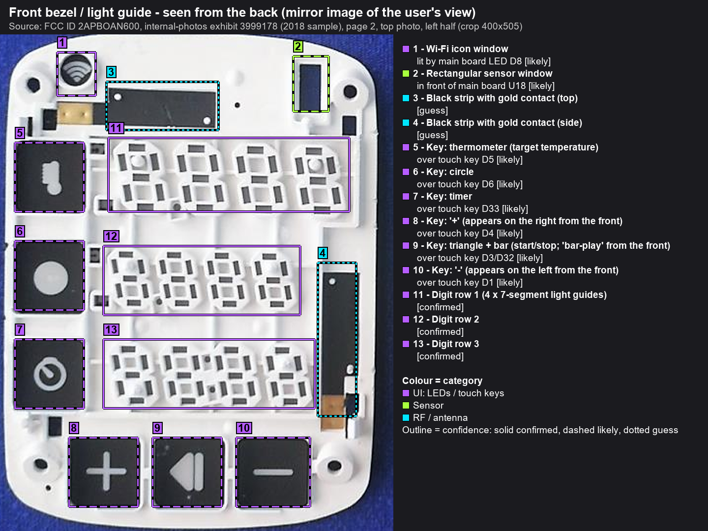

# Anova Precision Cooker Pro: reverse engineering & firmware recovery

> **Public export.** This repository is a periodic export of a private working repo. Issues and pull
> requests are welcome, but changes are made upstream and arrive with the next sync. The unit's serial
> number and the support ticket number are withheld; see "Legal and safety" below.
> Last sync: 2026-11-04.

Reverse-engineering notes, tools and recovery work for the **Anova Precision Cooker Pro (AN600)**.
The end goal is to **get a unit that died after an interrupted OTA firmware update cooking again**: by fixing
its original main board if that can reasonably be done, otherwise by building our own. Later phases add diagnostics software.

**Any%.** My update stopped at 75 %; yours may have frozen on another number, so this project goes by Any%.
Speedrunners know the category: finish, by whatever route works. We'll get there.

> Not affiliated with or endorsed by Anova Applied Electronics, Inc. (Anova Culinary). Everything here is at your own risk.
> The power board carries **mains voltage**. Never open or probe a unit that is plugged in.

## Why

I paid what a premium product from a premium brand costs, about $450, and expected exactly that. The cooker died
right after a firmware update was interrupted. Not dropped, not flooded, not abused: the update stalled at 75 %, and
after a power cycle the unit was dead. No beep, no display, nothing. I have no doubt the update killed it: it was the only event, the timing matches, nothing else happened.
By this repo's own standard that stays "likely" until the first measurement rules out a coincidental power-supply
failure, and that measurement is the first job on the bench.

In my view that should not be possible in 2026. A $10 smart plug routinely survives a botched update: it keeps the
old firmware until the new one has proven itself. The Wi-Fi chip in this cooker even has that mechanism built in
(TI documents an OTA rollback for it). Yet here we are.

I'll own my part. The cooker worked perfectly, and I updated it anyway. I work in IT, where update discipline is
drilled into you, and I also know the older rule: if it isn't broken, don't fix it. So yes, I pressed the button.
But in my book, a vendor that offers updates is responsible for what an interrupted one does. The hardware that
lets a device survive a botched update is a second copy of the firmware in flash, a dollar's worth of memory at
most. This cooker has 8 MiB of flash, and its chip's maker documents a rollback mechanism for exactly this case
([recovery-strategy.md](docs/firmware/recovery-strategy.md)). It didn't save my cooker. Finding out why is part of
this project.

And that is the most interesting question in this whole story. The mechanism exists on this very board, so there are
only three ways to end up here: the firmware doesn't use it; or the update touched something it doesn't cover (the
BLE chip, the file system itself); or the failure isn't in the Wi-Fi chip at all. The flash dump will tell. Whichever
answer it is, it goes here, with the evidence.

Anova's answers so far (ticket opened 2026-10-29): leave it plugged in overnight; then that the unit is out of
warranty; then 10 % off a new one. For perspective: 10 % is the usual newsletter sign-up discount on Anova's own
site, and the Pro itself has sold at about half price in seasonal promotions (Amazon US, Black Friday 2020;
[sources](docs/references.md#anova)). On 2026-11-01 I asked for one of four things: a firmware image with recovery
instructions, a replacement main board at my cost, a mail-in reflash, or a refurbished unit. I'm waiting for the
reply. The whole exchange is on record, word for word: [correspondence](docs/correspondence.md). To me, a discount on
a replacement isn't support, it's a sales offer.

It's sad, and I feel tricked: a premium price should buy an update process that can't kill the device. I'd rather
spend thousands of euros on debugging hardware, beta boards and DIY electronics than buy a new Anova. Spent on
tools so far: about €545, two days in ([list](docs/hardware/bench-setup.md#spent-so-far-2026-11-02)).

So I'll keep at this until this dead Pro cooks again, whatever it takes. If Anova helps: good, cheaper for me, and I'll
say so here. If not, make no mistake, the cooker will cook. Everything I learn on the way is in this repo, so the next
person with a dead one doesn't start from zero.

This repository stays online, whatever the outcome. I will not delete it. It documents the progress and the process as
they happen: every change upstream is published within seconds. The public repository is a snapshot by design, the
current state and nothing else; the dated record is the [timeline](docs/timeline.md), and when a statement of
substance about the cooker turns out wrong, the correction goes there with its date. It is what it is.

raptox

## What this project wants

1. **This cooker cooking again.** By fixing its original main board if that can reasonably be done, otherwise with
   a replacement board of our own design. Nothing here waits on anyone.
2. **A documented recovery path for every Precision Cooker Pro that fails the same way.** Everything learned here is
   public under an open licence ([LICENSE.md](LICENSE.md)), so the next owner starts from this page, not from zero.
3. **From Anova, any of the four things asked on 2026-11-01:** a firmware image with recovery instructions, a
   replacement main board at my cost, a mail-in reflash, or a refurbished unit. Or, better for every owner: an
   official, documented recovery procedure for units out of warranty. Help gets credited here, in full.

How the work is done: read-only first, a verified backup before any write, every claim with a confidence label and
a source, every step in the [timeline](docs/timeline.md). This project documents a repair. It distributes no firmware
and publishes no way around any protection (see [Legal and safety](#legal-and-safety)).

## The patient

| | |
|---|---|
| Model | Anova Precision Cooker Pro, type **AN600-20** (EU, 220-240 V) |
| FCC ID | [`2APBOAN600`](https://fccid.io/2APBOAN600) (granted 2018-09-16, tested as AN600-10 / 120 V) |
| Symptom | OTA update via the Anova app stalled at 75%. After a power cycle the unit is completely dead: no beep, no display, no LEDs. |
| Reference | A second, **working** Precision Cooker Pro is available for read-only comparison. |

Full story: [docs/incident.md](docs/incident.md). Everything since then, dated: [docs/timeline.md](docs/timeline.md).
The narrative, in instalments: [blog](blog/index.md).

**Website:** <https://cooked.raptox.be/>, rebuilt from this repo on every push.

## What's inside

From raptox's unit (main board, 2026-11-01) and the FCC photos (everything else).

| Board | Key parts |
|---|---|
| **Main board** `ANOVA_PRO_MAIN_V2.0` | **U1 TI CC3220S** Wi-Fi MCU, boots from **U15/U16 XMC XM25QH64A** (8 MiB SPI NOR, SOP-8 208 mil) · **U7 TI CC2640R2F** BLE MCU (internal flash) · unidentified U14 `T3018` (QFN-40), U13 `4637` (QFN-20, next to the speaker) · debug: J29 (1x3, empty), J14 (4-way DIP footprint, empty), Tag-Connect J37/J38, TP groups · 30-pin FPC J8 to the power board · J9 speaker · 6 touch keys, about 135 discrete LEDs forming 3 x 4 seven-segment digits |
| **Power board** `ANOVA_PRO_POWER_REV01` | AC/DC flyback daughterboard (F1 T2A/250V) · heater relay · main fuse · DC/DC buck (6.8 uH) · several unidentified ICs · 30-pin FPC J8 · wire terminals for heater/pump/sensors · PCB "finger" that probably carries the water-temperature sensor |

Details: [docs/hardware/overview.md](docs/hardware/overview.md) ·
[main board](docs/hardware/main-board.md) · [power board](docs/hardware/power-board.md) ·
[component list](docs/hardware/components.md) · [opening the head](docs/hardware/disassembly.md) ·
[bench setup & debugging](docs/hardware/bench-setup.md) · [photo log](docs/photos.md)

## Annotated photos

**raptox's unit**, main board component side, stitched from 335 microscope frames (2026-11-03):

At 100 % (229 px/mm): the zoomable [mosaic viewer](docs/mosaics.md) or the
[lossless PNG](https://github.com/BartBourgeois/Anova-DIY/releases/download/mosaics/2026-11-03_main_component-side_mosaic.png).

The first phone photo of the same side (2026-11-01): [annotated](images/annotated/main_component-side_own.png).

**All photos in this project are our own unless marked otherwise.** The images below marked "FCC" come from the
public FCC filing for this product (FCC ID 2APBOAN600, internal-photos exhibit 3999178, 2018 sample) and carry that
source in their legend.

FCC sample (2018), source: FCC ID 2APBOAN600, exhibit 3999178:

| | |
|---|---|
|  |  |
| Main board, component side | Main board, LED / touch side |
|  |  |
| Power board, top | Power board, bottom |
|  |  |
| Head opened (assembly) | Front bezel (from the back) |

Box colour = category, outline = confidence (solid confirmed, dashed likely, dotted guess).
Click an image for its callout table.

## Roadmap

Two cases, both planned, in [docs/roadmap.md](docs/roadmap.md): Anova helps (unlikely; documented in full if it
happens, and the repair part ends there), or we do it ourselves, all the way, with every step the tools allow. Either
way the project doesn't stop at the point of no return, which has passed.

The headline steps of the do-it-ourselves case: **4K microscope imaging of every board**, tile by tile, into
measurable mosaics; transillumination for the inner copper layers; **reverse-engineering the schematics**, net by net,
since Anova's are confidential in the FCC filing; logic analyser and UART on the boot sequence; a verified dump of the
flash; rehearsals of every write on a known-good chip; and, if the board can't be fixed, a board of our own. The
phase view below is the short version.

| Phase | Goal | Status |
|---|---|---|
| 0 | Document hardware from the public FCC filing | **done (first pass)** |
| 1 | Open the dead unit: own high-res photos, read chip markings, measure supply rails; compare (read-only) with the working unit | **in progress**: opened, main board photographed, markings read; main board's component side stitched from microscope frames at about 229 px/mm ([photo log](docs/photos.md#2026-11-03-microscope-mosaic-main-board-component-side)); next: the other sides and backlight; rails and power board todo |
| 2 | Find and map debug interfaces: J29, J37/J38 (Tag-Connect), DIP J14, test points; CC3220 SOP straps, UART, JTAG/SWD; CC2640R2F cJTAG. Identify power-board U2 (MCU?) and map the J8 pinout unpowered. Draw the schematics from the images and the continuity map. | **started**: J8 pin numbering and top-layer first hops from the mosaic; continuity mapping next |
| 3 | **Back up first**: full read-only dump of the CC3220 serial flash (and of the CC2640R2F flash if readable), read twice and hash-verified | todo |
| 4 | Analyse the dumps: SimpleLink filesystem layout, OTA state, which chip the failed update targeted | todo |
| 5 | Recovery: RET_FACTORY_IMAGE / UARTLOAD / reflash, depending on Phase 4 | todo |
| 6 | Diagnostics software (UART console, flash-dump parser, BLE/Wi-Fi local API client, ...) | later |
| B | If the board can't reasonably be fixed: our own main board (ESP32-S3, headless first), or our own firmware on the original CC3220 | **committed fallback** ([plan B](docs/plan-b-custom-mainboard.md)) |

The recovery reasoning lives in [docs/firmware/recovery-strategy.md](docs/firmware/recovery-strategy.md).

Phases 1-2 are run as an **open exploration**: no gates, every tool used to learn as much as it can, route chosen
only when the findings make it obvious.

## Legal and safety

- **Not affiliated.** Anova and Precision Cooker are trademarks of Anova Applied Electronics, Inc., used here only
  to identify the product. This project is not affiliated with, endorsed by or sponsored by Anova.
- **Own device, for repair.** Everything here comes from examining a device raptox owns, from public FCC filings and
  from public chip-maker documentation (TI). The aim is to repair it. The procedures described are the ones TI
  documents for its own chips; in the author's reading (not legal advice), nothing here circumvents a technical
  protection.
- **Never distributed:** Anova firmware, flash dumps or fragments of them; keys, certificates or credentials; anything
  that gives access to Anova's servers; Anova's user manual; the FCC exhibit PDFs themselves (public at
  [fccid.io/2APBOAN600](https://fccid.io/2APBOAN600), SHA-256 in [docs/references.md](docs/references.md)).
- **Statements about Anova** are dated facts from the support correspondence, quoted word for word on the
  [correspondence page](docs/correspondence.md) or paraphrased, or opinions labelled as such. Anova staff are never named.
- **Safety, no warranty.** The power board carries mains voltage, which can kill. Opening the unit voids its warranty
  and its CE/FCC certification, radio included; a modified unit is not a certified appliance. Never leave a modified
  heater unattended. Everything here is at your own risk, without warranty or liability of any kind
  ([LICENSE.md](LICENSE.md), at the root of the public repo).
- The author is an engineer, not a lawyer. This is engineering documentation, not legal advice.
- The full statement of the bounds this project works within, for the United States, for Belgium and the EU, and for
  everywhere else: [docs/legal.md](docs/legal.md).

## Sources

Hardware information comes from raptox's own unit and the public FCC filing for `2APBOAN600` (the schematics and block
diagram are confidential and not available). See [docs/references.md](docs/references.md).
