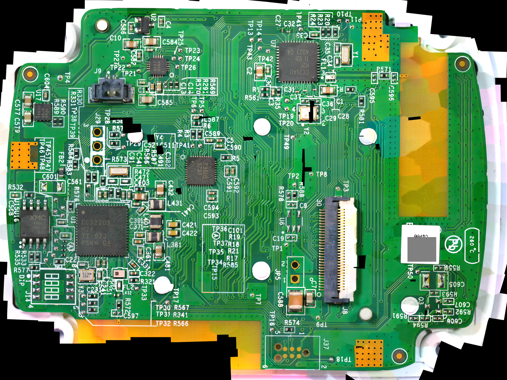

# Day three: 335 frames of one circuit board

Tuesday's parcel was the digital microscope. By the end of the evening the main board's component side existed as
one stitched image of about 229 pixels per millimetre, sharp enough to read every reference designator on the board.

<!-- more -->

## 1080p is the ceiling, and that's fine

First surprise: over USB the microscope streams at most 1920x1080. Full resolution only goes to its memory card.
Asking it for 4K over USB didn't fail politely: it hung the camera until the cable was unplugged. So the capture
tool now asks only for the sizes the camera advertises. The rest of what's known about the thing, quirks included,
is on the [microscope](../../docs/microscope.md) page.

The ceiling turned out not to matter. A circuit board doesn't have to fit in one frame. Shoot it in overlapping
tiles at high magnification and stitch them, and the resolution is whatever you're patient enough for. The stitching
software is a project of its own.

## The mosaic

344 tiles in about an hour, 40 % overlap, the board still on its bezel with the flat cable out. 335 of them stitched
into one image of 22635 x 16731 pixels. The scale was measured on the chips' pad rows, whose pitch is known from the
datasheets: 229.4 pixels per millimetre, holding within half a percent from one side of the board to the other. The
board itself is about 90 x 66 mm.

It's in a [zoomable viewer](../../docs/mosaics.md) at full resolution. The production label's 2D code is greyed out
there and in every other published image, because it may carry a serial number.

## What it reads that the phone couldn't

Three of my day-one readings were wrong, and are corrected in the [timeline](../../docs/timeline.md#corrections).
U13's second line reads `838A` or `B38A`, not `638A`. U2 has three leads, not five. And U6 isn't a fitted part at
all: it's an empty footprint, like the debug parts that were never fitted on this board.

The 30-pin connector J8 has its marks: a printed circle beside pin 1 and a `30` at the other end. The positions of the
fiducials, the heat stakes and the connectors are measured. That's the start of a mechanical spec for a board of our
own, if it comes to that. Details on the [main board](../../docs/hardware/main-board.md) page.

## A guess, written down

The mosaic also shows the top layer of copper under the green solder mask. Around J8, pins 1-6 sit on one copper pour
together with a big capacitor, which smells like a supply. Other pins drop into the board through vias, or show no
copper at all. From that I wrote down which pins should be supply and which ground, as a sheet to check with the
meter. Writing the guess down first is the point: tomorrow the meter grades it.

The break-out board for the flat cable arrived the same evening.
