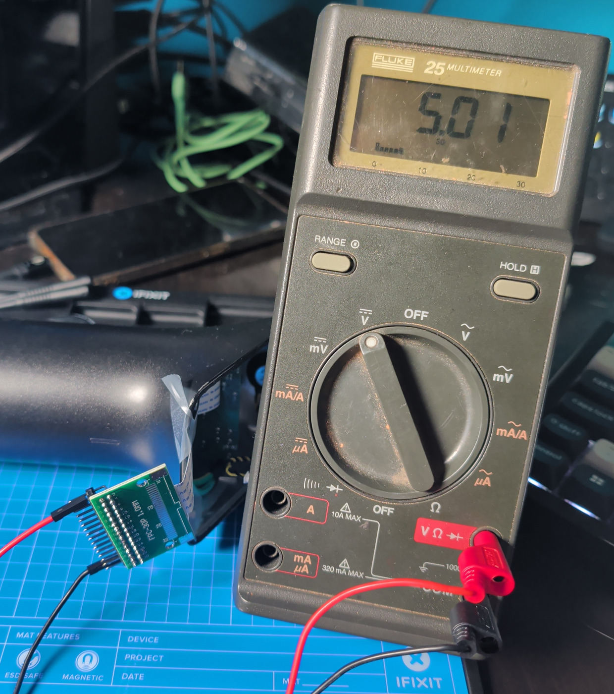

# Day four, late: the power board is fine

One number, late in the evening: 5.01. The power board delivers its 5 V, and the hunt moves to the main board.

<!-- more -->

## The question

Since day two the working assumption has been that the power board is fine and the problem sits after the 30-pin
flat cable. That morning the regulator on the main board had predicted what should arrive on that cable: about 5 V,
on pins 1-6. One measurement tests both.

## The measurement

Head open, the main board out. The cooker's own flat cable, still plugged into the power board at the other end, went
into the second break-out board. The cooker was plugged in, and a battery multimeter sat on the break-out's header,
pins 1-6 against pin 30.

5.01 V.

A word on safety, because this one is different. The power board sits at mains potential, and this is the only
measurement in the whole procedure taken with the cooker plugged in and the head open. Only the low-voltage end of the
cable was touched, with a battery meter, and nothing on the power board itself. It's written up step by step in
[bench setup](../../docs/hardware/bench-setup.md#step-1a-measure-the-j8-supply-in-the-cooker-one-time-with-care). It
isn't one to copy casually.

## What it means

The mains side, the fuse and the 5 V supply all work on the dead unit, and the 5 V travels the whole cable. The
regulator's prediction was right.

Put that next to the radio check. With the main board connected, the dead cooker shows nothing on Bluetooth or Wi-Fi.
The working cooker shows up in the same phone scan; the dead one doesn't. So the main board gets its power and still
does nothing. The fault most likely sits on the main board (`likely`), which is where an interrupted firmware update
would leave it.

What it doesn't settle: only the meter was on the line, so the supply carried no load. It could still sag once a board
draws current. A 47 Ω resistor on the supply pins, about 100 mA, answers that. And the main board's own 3.3 V
regulator hasn't been measured yet.

## Dump first

The main board won't be powered again until its flash has been read out and backed up. The flash is the one thing
nothing else can restore, and any power-up lets the Wi-Fi chip run whatever is on it. The chip clip arrives tomorrow,
and the routine gets rehearsed on a spare chip first.

While the hardware waits, the software doesn't. An ESP32 probe for both break-outs is written: it records what every
free pin of the connector does from the moment power comes on, and it never drives a pin
([j8probe](../../tools/j8probe/README.md)). Nothing in it is connected yet.

Running tally for the connector: 6 supply pins at 5.01 V, 7 ground, 3 filtered lines, 14 to go
([J8](../../docs/hardware/j8.md)).
