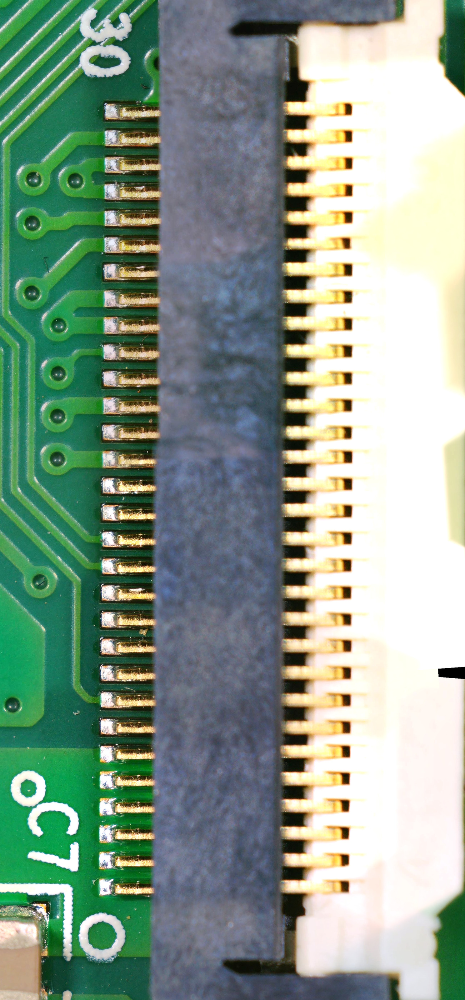

# Day four: thirty pins, and where the power comes in

The plan for today was two questions. Can a schematic be read off photos? And where does the main board get its
power? The first got a "yes, up to a point". The second got a prediction in the morning and a meter in the evening,
and they agreed.

<!-- more -->

## Reading copper off a photo

At 229 pixels per millimetre the copper under the solder mask is visible. Raise the contrast on lightness only and
every trace on the top layer can be followed. Copper also reads a little yellower than bare board, so it can be
separated by colour. A test where the answer was already known: the Wi-Fi chip's four flash lines (clock, data out,
data in, chip select), whose pins are in TI's datasheet. All four show up. Each one runs through a small series
resistor to a bare test pad, on its way to the flash chip (`likely`: the last stretch runs partly under the flash
chip, so the meter closes it).

The photos stop at the vias. The footprint for the boot-mode switch and the Wi-Fi chip's own boot-mode pins both drop
into the inner layers within a few millimetres, so those connections are for the meter. The first nets are in the
[nets table](../../docs/hardware/nets.md).

## The supply, from the chips

The regulator U17 reads `59800 / ADJB`. I had read it as `S9800 / A0J8` yesterday. Against the manufacturer's marking
diagram it's an onsemi NCP59800, an adjustable 1 A low-noise regulator. It accepts 2.2 to 6.0 V at its input. The
Wi-Fi chip, the flash and the Bluetooth chip all run on 3.3 V, and there's no switching regulator on the board. So
the 30-pin cable most likely brings about 5 V, and the copper pour on pins 1-6 is where it lands. That was the
prediction, written down before measuring (`likely`, [supply](../../docs/hardware/nets.md#supply)).

It changes the bench plan too. Nothing above 6 V ever goes near those pins. The old idea of feeding 3.3 V straight
onto the logic rail is dropped: with the regulator's input unpowered, that drives it backwards beyond its absolute
maximum.

## The meter

In the evening the head came off the cooker and went onto the ESD mat, on its bezel. The cooker's own flat cable was
unplugged from the main board, and the break-out went in its place with a short cable. Nothing powered, just a
multimeter's continuity beeper on the break-out's header ([bench photos](../../docs/photos.md#2026-11-04-bench-break-out-a-on-the-main-board-j8)).

- **Pins 1-6** ring through to JP5, an empty two-pin header beside the connector. JP5 pin 1 rings through to the
  regulator's input. The prediction holds, as far as connections go. The voltage itself isn't measured yet.
- **Ground:** JP5's other pin rings to the flash chip's ground pin, and so do pins 10, 11, 17, 19, 22, 23 and 30.
  They're spread between the signal pins, not bunched next to the supply.
- **No short** between supply and ground.
- **Pins 24, 25 and 26** give a short beep and then go quiet: a capacitor charging. They're three separate lines,
  each with a capacitor and a resistance to ground. My first guess is filtered inputs (`guess`).

So JP5 is the main board's power header. Pin 1 is the supply, pin 2 is ground, and the board can be fed on the bench
without the power board, without touching mains.

## How the guess did

Of the pins I had guessed as ground from the photo, 10, 11, 22 and 30 were right. 7, 9, 12, 18, 20 and 24 were wrong.
Pins 17, 19 and 23, which I'd read as signals dropping to vias, are ground: their vias go straight to the ground
plane. The photos suggest, the meter decides. That's why the guess was written down before measuring.

Running tally for the connector: 6 supply, 7 ground, 3 filtered lines, 14 to go. They're either signals or not
connected. The pin-by-pin table is [J8](../../docs/hardware/j8.md).

## What's next

The first power-up through JP5: 5.0 V from the bench supply, current limited to 100 mA and then 500 mA, watching the
3.3 V rail and the current. Or dump the flash first, since the chip clip arrives tomorrow. I haven't decided yet.
Either way, nothing gets written to anything until the dump exists twice with the same hash.
