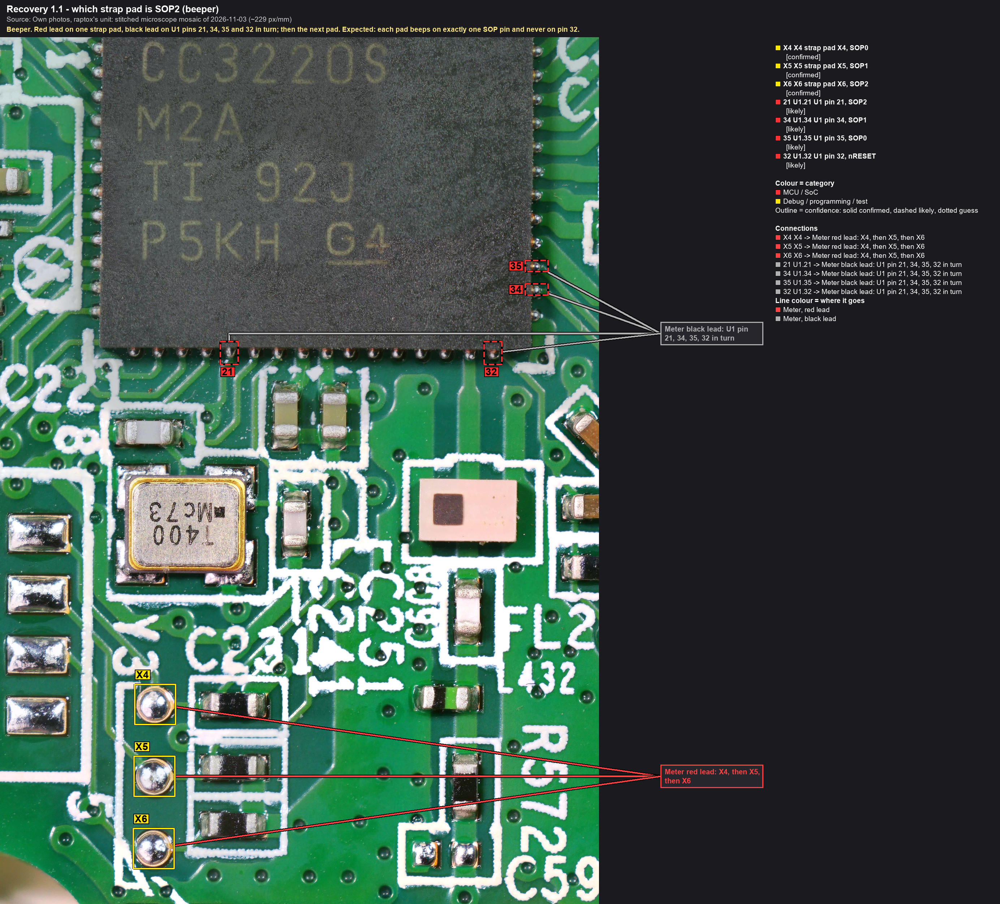

# Day five, at the bench: boot straps and a serial port

The main board stayed unpowered all day, and the multimeter did the work. By the evening the flash bus, the Wi-Fi
chip's boot-mode straps and the serial header all had a name and a measured place. One reading still doesn't add up.

<!-- more -->

## Unpowered is fine

Yesterday's rule was nothing physical until the flash is backed up. Read today as: unpowered meter checks go ahead,
while power-ups and anything that drives a pin wait. A continuity beeper pushes a tiny current (around a milliamp on a
typical meter), far less than the chips need to start.

## Test points and bare pads

- **Test points:** TP1 is on the 5 V input; TP2, TP3, TP4, TP7, TP8 and TP9 are ground. TP18 is on pin 2 of J37, the
  footprint for a Tag-Connect debug cable. On the microscope image three of the 30-pin connector's signal lines run to
  the Bluetooth chip's corner, not to the Wi-Fi chip. TP13, in that corner, isn't one of their ends; where they do end
  is still for the meter ([test points](../../docs/hardware/testpoints.md)).
- **The flash bus, end to end:** clock, chip select and both data lines run from the Wi-Fi chip's pins 11-14 through
  their bare pads to the flash pins the datasheet names, exactly as the photo tracing had them the day before. The
  flash runs on the 3.3 V regulator's output, and its HOLD pin is pulled up with about 10 kΩ, so nothing on the board
  pauses it.
- **The other bare pads:** four are the Wi-Fi chip's general-purpose SPI port (GPIO14-17, which can also be a UART or
  I2C), and the ninth is its JTAG input TDI. A flash bus and a JTAG line in one cluster of pads looks like the
  footprint of a factory programming fixture (`guess`; [nets](../../docs/hardware/nets.md#bare-round-pads-p1-p9)).

## The boot-mode straps

J14 is an empty footprint for a four-way DIP switch. Three of its positions share one feed on one side. On the other
side each runs to its own pad, with a capacitor to ground. The fourth position is wired to nothing.

The three pads, named X4, X5 and X6 here, ring to the Wi-Fi chip's pins 35, 34 and 21: its boot-mode straps SOP0,
SOP1 and SOP2. The ohms range says the same a second way. To ground the pads read 100 kΩ, 100 kΩ and 2.68 kΩ, the
pull-down values TI recommends for those three straps. The shared side reads about 270 Ω to the 3.3 V rail, not to the
5 V input, so a closed switch can't put 5 V on the chip. The same reading shows no short on the 3.3 V rail (`likely`).

Why it matters: these straps decide what the Wi-Fi chip does at power-on. SOP2 alone starts its serial boot loader,
the way in for the backup. SOP1 and SOP0 together start a factory restore, which is a write. With one pad per strap
the first can be set on its own, and the second pair kept apart until the backup exists
([test points](../../docs/hardware/testpoints.md#j14-strap-pads-x4-x5-x6)).

## The serial header

J29 is the empty three-hole header beside the Wi-Fi chip. Hole 3 is ground. Holes 1 and 2 run to test points TP29 and
TP28, and on to the chip's pins 55 and 57, the pins TI's boot loader talks on (`likely`). That's the shape of a serial
port.

Then the puzzle. Each hole reads about 192 kΩ to its chip pin, where a series resistor of a few hundred ohms was
expected. In diode mode each hole shows a chip pin's junction directly (0.7 V one way, 1.5 V the other), so each hole
is a live line. But a junction that close to the hole doesn't fit a 192 kΩ part between the hole and the chip. Either
another part sits on the header's side, or both readings landed on the chip's neighbouring pin, a supply pin. A
re-check under the microscope decides ([chapter 1](../../docs/recovery/01-meter-checks.md#5-diode-mode-on-the-j29-holes)).

It isn't academic. 192 kΩ in series would be far too weak for the boot loader's fast link, so the backup through J29
would need its probes on the chip's side of whatever that is.

## Probes for now

The DIP switches for J14 arrived today. For now the bench sessions run on spring probes, and every powered session
starts with a drill: all seven probes placed and checked with the beeper. Once the connectors are in, the plan is a
polarised two-pin connector on the power header JP5, a three-pin one in J29, and the switch on J14, soldered with every
position off ([bench kit](../../docs/hardware/bench-setup.md#bench-kit)). The combination that would restore the
factory image stays off until the flash is backed up.

## Tally

Measured on the main board, unpowered: the 30-pin connector's supply and ground, the flash bus, the three boot straps
with their pull-downs, the serial header's ground and its two lines, nine bare pads and eleven test points. Still
open: the 192 kΩ, J37's pinout, and where the connector's signal lines end on the Bluetooth chip. The other half of
the day, the update itself, is in [the other post](2026-11-05-the-update-from-the-other-end.md).
