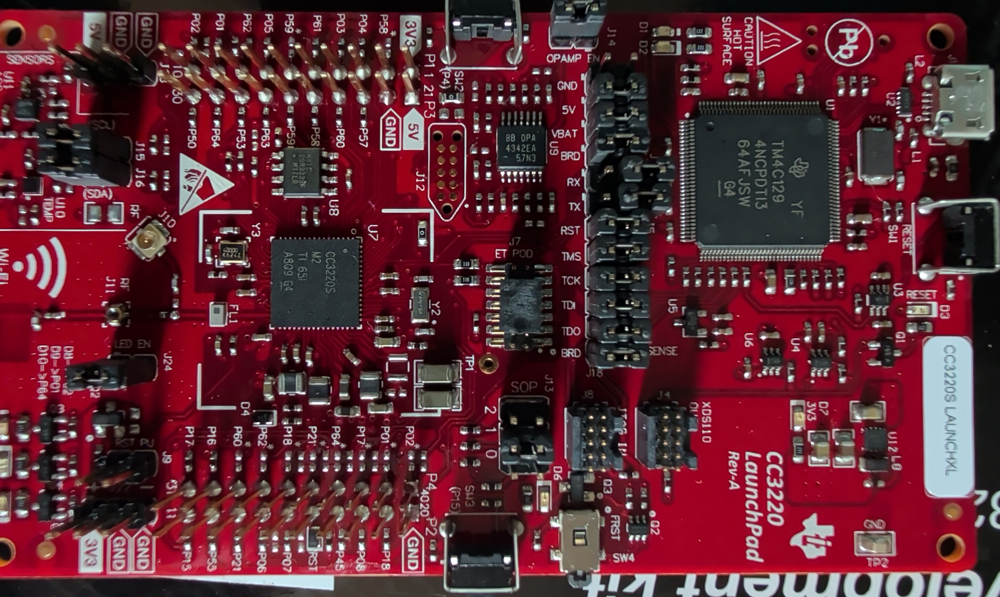

# Day five: the update, from the other end

Day five had two halves. One was at the bench with the meter ([the other post](2026-11-05-at-the-bench-straps-and-a-serial-port.md)).
This one went to the update itself: the app that started it, the package it was installing, and what a repair has to
keep so that this unit stays this unit.

<!-- more -->

## The app holds no firmware

The Anova app for Android, the same version (3.6.7) that ran the failed update, was unpacked and read. Nothing of it
was run. There is no cooker firmware anywhere in it. For a Pro, the app asks Anova's servers for a download link and
passes that link to the cooker, and the cooker fetches the update itself over Wi-Fi.

It also settles where the 75 % came from. For a Pro, the app's update screen gets no progress number from the cooker.
The 75 % was on the cooker's own display. So the cooker's firmware was running, and drawing its progress, up to that
point (`likely`). Whatever failed, the unit was alive while it updated.

How the app talks to a Pro, from the same reading: cooking commands and the cooker's status go through Anova's cloud,
never over the home network. The phone reaches the cooker directly only during setup, over Bluetooth and over a
temporary access point the cooker opens itself. How the cooker talks to the cloud isn't in the app.

## The package

Asked the way the app asks, Anova's update service names Pro firmware 3.3.35 as current, a file last changed in January
2022. Two certificate packages the app can send a Pro before the firmware date from 2019. Nothing there changed around
the time of the failed update. Which package this unit was installing isn't known.

The firmware package is a standard TI update bundle, and it writes three things at once: the Wi-Fi chip's
application, the **whole** flash image of the Bluetooth chip, and the Wi-Fi radio's service pack. So an interrupted
update could have damaged any of the three, not just the Wi-Fi chip's application. Both chip images are unencrypted
and carry the maker's signature. The firmware itself stays private: it is never republished here, in any form.

## Two brains

The structure of both chips' firmware was mapped, read-only. The two chips split the work and talk over an internal
serial link. The Bluetooth chip is the real-time controller: pump, heater, touch panel, sensors. The Wi-Fi chip is the
cloud side: it fetches the cooking job, runs the update, drives the lights and plays the sounds (`likely`, from the
firmware's structure).

That matters for the symptom. The start-up beep is the Wi-Fi chip's job, so a unit with no beep and no lights points
at the Wi-Fi chip not running its application, or at no power reaching it, more than at the controller. The power
board delivers its 5 V ([day four](2026-11-04-the-power-board-is-fine.md)); the main board's own 3.3 V hasn't been
measured under power yet. A lead, not a finding: the backup and the first bench boot will test it.

## The backup route, three times in one day

The flash backup is still the first job, and its route changed twice today.

- **Morning:** the flash turned out to run on the 3.3 V regulator's output. A clip programmer powering the flash
  would drive that regulator backwards, so the board would have to be fed at its power header, with the Wi-Fi chip
  held in reset.
- **A little later:** simpler and safer, I decided to take the flash chip off the board and read it in an adapter.
- **Afternoon:** the Wi-Fi chip's own boot loader can read the whole flash out over the three-hole serial header J29,
  with the flash left in place, and an open-source client for that boot loader exists. In boot-loader mode the chip's
  network side doesn't run, so nothing can change the flash before it's backed up. A normal boot could (a rollback,
  a commit, a watchdog). So the order is fixed now: the boot-loader session and the backup come first, before the
  board ever boots normally. Desoldering stays as the fallback.

Whether the boot loader does all that on a chip in production mode isn't known yet (`unverified`). That's what the
rehearsal board is for.

## A rehearsal board

TI's CC3220S LaunchPad arrived: a development board with the same Wi-Fi chip family, its own serial flash, a jumper
block for the boot-mode straps and a built-in debug probe. Every step gets rehearsed on it before the cooker: the
boot-loader connection, the flash read twice and checked against a clip read of its own flash chip, and the steps a
repair would take.

## What a repair has to keep

The flash holds more than the firmware. The unit's network address and its cloud identity live there too. From TI's
documentation and its support forum, they survive a file-by-file replacement of the application, but not a factory
restore and not a full reprogramming (`likely`; still to be checked against TI's own PDFs). So the plan, once the
backup exists and if the application file is what broke: replace that one file through the boot loader, with the
maker's own signed file, and nothing else. The factory restore through the boot straps has been on the list since day
one. It would cost the unit its identity, so it moves down.

## The handbook

All of this is now a [recovery handbook](../../docs/recovery/index.md): one chapter per bench session, each step with a
picture of the board, the points boxed, a line from each point to the meter lead, supply terminal or adapter pin it
goes to, and the reading to expect. Chapter 1, the meter checks, is mostly done; the other post has the results.

## What's next

The meter checks finish, then the rehearsal on the LaunchPad, then the backup: twice, with the same hash, and a copy
off the machine. Nothing gets written to the cooker before that.
