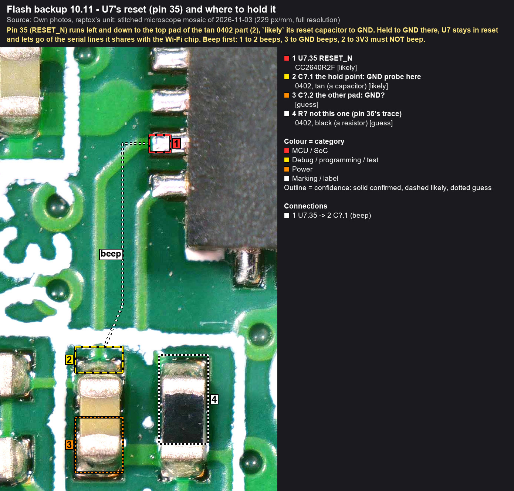

# Day six: it cooks again

On the evening of 6 November my Anova Precision Cooker Pro held a water bath at 54 °C for ten minutes, and the
water's temperature, checked on its own, agreed with the display. Nine days earlier a firmware update had stalled on
that display at 75 %. The next morning the cooker was dead: no beep, no display, no lights. Six days at the bench
later it cooks again, on its original main board, with the current firmware and its own sounds, settings and cloud
identity. Any%: finished.

<!-- more -->

## The run

| Split | When | What |
|---|---|---|
| Start | 28 Oct, 17:52 | The update stalls at 75 %. The home router's records show the cooker's last Wi-Fi traffic. |
| Dead | 29 Oct | After a power cycle: no beep, no display, no lights. Support's advice: leave it plugged in overnight. |
| Opened | 1 Nov | The glass cut free, the main board out, the chips read. This project starts. |
| Mapped | 3 to 5 Nov | The main board stitched from 335 microscope frames. The supply, the flash bus, the boot straps and the serial header measured. Anova's app and the update package examined. |
| Power board | 4 Nov | 5.01 V on the 30-pin connector: the power board is fine. |
| Rehearsed | 5 and 6 Nov | Every step tried first on TI's development board, which has the same Wi-Fi chip. |
| Backed up | 6 Nov | Both chips' flash read twice, the same checksum each time, a copy kept off the bench PC. |
| Found | 6 Nov | The Wi-Fi chip had locked itself. |
| Fixed | 6 Nov | Reprogrammed through its own boot loader, the lock cleared. |
| Cooking | 6 Nov | The panel, Wi-Fi, the app, and 54 °C on point. |

The dated record of all of it, with the evidence, is the [timeline](../../docs/timeline.md).

## What was wrong

On day one the puzzle was this: the Wi-Fi chip has a documented rollback for interrupted updates, so how can an
interrupted update leave the cooker completely dead? There were three possible answers. The firmware doesn't use the
rollback. Or the update hit something the rollback doesn't cover. Or the fault isn't in the Wi-Fi chip's firmware at
all.

The backups ruled out most of it. The flash held the interrupted update half done, in a state the chip's own
safeguard undoes at the next power-up: nothing fatal in the files. The Bluetooth chip still held, byte for byte, the
firmware that the cooker's flash lists as installed, so the update never reached it. And the power board was
delivering its 5 V.

The answer came from the Wi-Fi chip itself, once its boot loader answered: **its security-alert counter stood at its
limit.** The chip maker's security model counts security violations, such as a failed signature check or a
protected file accessed without its token. At the limit the chip locks and refuses to run until it is reprogrammed.
A chip that runs nothing plays no beep, lights no lights and joins no network, which is exactly what this cooker
did (`likely`).

What raised those alerts, and whether the interrupted update did, isn't known yet. That is now the open question.

## How it was fixed

Only the chip maker's documented ways in were used. Nothing was bypassed.

1. **The backups first.** The Wi-Fi chip has no flash of its own: it runs from an 8 MiB flash chip next to it. That
   chip was read in circuit with a clip while the Wi-Fi chip was held in reset at a test point. It was read twice,
   with the same checksum, and copied off the bench PC
   ([flash backup handbook](../../docs/flashbackup/index.md)). The Bluetooth chip, whose flash is inside the chip,
   was read through its two-wire debug port, with the debug probe built into TI's development board. Also twice,
   also identical ([page 10](../../docs/flashbackup/10-cooker-u7.md)).
2. **A way in.** The three empty holes next to the Wi-Fi chip are its boot-loader serial port. Making it answer took
   most of the evening, for two reasons. The holes are the other way round from what the first meter readings
   suggested. And the Bluetooth chip shares the same two lines and talks on them from power-up. Held in reset at its
   reset capacitor, the Bluetooth chip let go of the line. With the boot strap set, the Wi-Fi chip's built-in boot
   loader answered.

    

3. **The diagnosis.** The boot loader reports the chip's state without changing anything. The counter stood at
   the limit.
4. **The image.** It was built offline with the chip maker's own tool, from two parts:
    - the current firmware, the version the update had been installing, exactly as Anova's update package delivers it
    - the unit's own files from the backup: its sounds, its cloud identity and its settings

    It was checked file by file before anything was written. Writing it through the boot loader took 26 seconds,
    and afterwards the counter read zero.

5. **The first boot** went into a reset loop. The firmware was fine; the bench supply wasn't giving enough current.
   Starting Wi-Fi draws short bursts of current, well above the 0.5 A the supply allowed. With 1 A, and the supply
   on more than one pin of the connector, it came up.
6. **The cooker.** Reassembled and plugged in, the buttons and the display respond, and a cook can be set and
   started from the panel. For the first couple of minutes the long press for pairing did nothing, `likely` because
   the new firmware was updating the Bluetooth chip first. After that, Wi-Fi and the app paired as they should. Then
   came the test cook: 54 °C for ten minutes, with the water's temperature checked. On point.

## What it took

Tools so far: about €640 ([the list](../../docs/hardware/bench-setup.md#spent-so-far-2026-11-02)). The cooker cost
about $450.

The ground rules held the whole way:
- nothing was written before both chips had a verified backup
- the working second unit was never touched
- the power board was never probed while plugged in
- every claim on this site carries a confidence label

Back up first was the rule that tested my patience. With the image built, I wanted to skip the Bluetooth chip's
read and flash straight away. I read it anyway. It showed that chip was fine and narrowed the search to the Wi-Fi
chip. Research is important.

## If yours died the same way

The route above worked on one unit. It isn't a guide for every unit yet, but every piece of it is documented:

- the [flash backup handbook](../../docs/flashbackup/index.md): the clip read of the flash chip, and the Bluetooth
  chip's debug read
- the [recovery handbook](../../docs/recovery/index.md): the meter checks, the boot-loader session, the first boot,
  with what actually happened on 6 November at the top
- the [timeline](../../docs/timeline.md): every finding, dated

The reading that tells you whether yours is the same case is the Wi-Fi chip's security-alert count. The boot loader
reports it without writing anything. Back up first anyway. The firmware isn't published here and won't be: it's
Anova's.

## What's next

The repair was the urgent part. The rest of the [roadmap](../../docs/roadmap.md) goes on, past the point of no
return:
- what raised the alerts
- the 30-pin interface between the two boards, pin by pin
- the link between the two chips, decoded with the logic analyser when it arrives later this month
- the chips nobody has identified yet
- the schematics

For now, it cooks.
