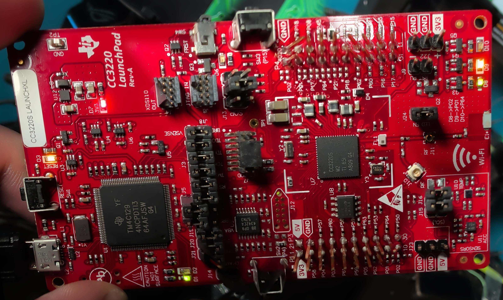

# Night five: a stand-in on the bench

The cooker stayed in its box. All evening and past midnight the work went on a stand-in: TI's development board
with the same Wi-Fi chip, where a mistake costs nothing. It answered the question the last post left open, whether
the chip's boot loader behaves the same on a production chip. It doesn't, and that changes the plan.

<!-- more -->

## Talking to the chip

On USB, the board's demo program printed its versions and its network address on the serial port at 115200 baud,
then opened a Wi-Fi access point of its own. One surprise in the box: the boot-mode jumpers ship set for a normal
start with the serial loader on standby, not all open as the handbook had assumed. The handbook was corrected before
anything was moved.

The chip's built-in boot loader was the planned route for the cooker's backup. The open-source client for it took
this chip for its older sibling and refused it. The chip maker's programming guide shows the difference, and the
project's wrapper now follows the documented procedure for this chip. After that the whole 4 MiB flash read out
three times with the same checksum.

## A chip that writes when it shouldn't

One read came back different in two blocks. The cause: when the chip's network processor misses the "stay in the
loader" signal at the right moment, it starts its own firmware instead, recalibrates its radio and saves the result.
Harmless data, but a write, and on the cooker it would land before the backup. Holding the signal across the whole
start-up window, instead of a short pulse, caught it 20 times out of 20.

## The cooker's firmware, on another board

With a backup of the board's flash in hand, the Wi-Fi chip's firmware from the cooker's official update was
installed on it, offline: no network credentials, no internet. The chip accepted the maker's signature and ran it.
Was it really the cooker's firmware, and not some default? The files it created on its first start settled that:
two of them have names that occur only in the cooker's firmware, in none of the chip maker's software. One of them is
the firmware's own record of updates.

The firmware itself stays private, as it has from the start.

## A counter that remembers

The chip keeps a persistent tamper counter. Asking it about a protected file without that file's access token adds a
strike, and at three strikes (the default) it locks until it is reprogrammed. One careless query added a strike on
the development board. Harmless there: reprogramming clears it, and that was confirmed by doing it. On the cooker it
would not be harmless, so the project's tools now refuse that kind of query outright.

The least destructive repair was rehearsed the same evening: the firmware image alone, written as one file, the way
the chip maker's own tool writes it. Accepted, no strike, and only that file changed. Written the way the open-source
client does it, it would have cost a strike and left a broken image.

## Production mode closes the door

The cooker's chip is, in all likelihood, in production mode, the setting for shipped products. So the development
board got the same firmware as a production image. Its boot loader still answers, and still reports the chip's
network address, its mode and its tamper count. But it refused to read the flash, from the very first block, and
refused to read or write single files. No strikes from any of it.

That settles the backup route. Not through the chip: with a clip on the flash chip while the Wi-Fi chip is held in
reset, or with the flash chip off the board. It also rules out the one-file repair on a production chip. What's left
is a full image, or the chip's own factory restore if the cooker has a factory image to restore.

One correction on the way, made the same night: a miscount of the tool's output first made it look as if production
mode allowed about fifty blocks per power-up. A recount showed none. The working log keeps both, the error and its
correction.

## Half of a raw copy is readable

A raw copy of the flash turns out to be half plain. Ordinary files lie in it exactly as written; the protected ones
are encrypted with a key that lives inside the chip. A small parser now lists every file in such a copy, with its
spare copy and their sequence numbers, and pulls out the ordinary ones. On the development board it found the
firmware's update record and showed which copy of the firmware image is the live one.

For the cooker that means the backup copy alone should show where the update stopped at 75 %, without asking the
chip.

## What's next

A clip reader is on its way. Its first job is the development board's flash, as a test; then the cooker's, twice,
with the same checksum, and a copy off the machine. The parser reads it, and only then is a repair chosen and
rehearsed on the stand-in, in production mode. A second development board, for the cooker's other chip, is on order
but won't arrive before January.
