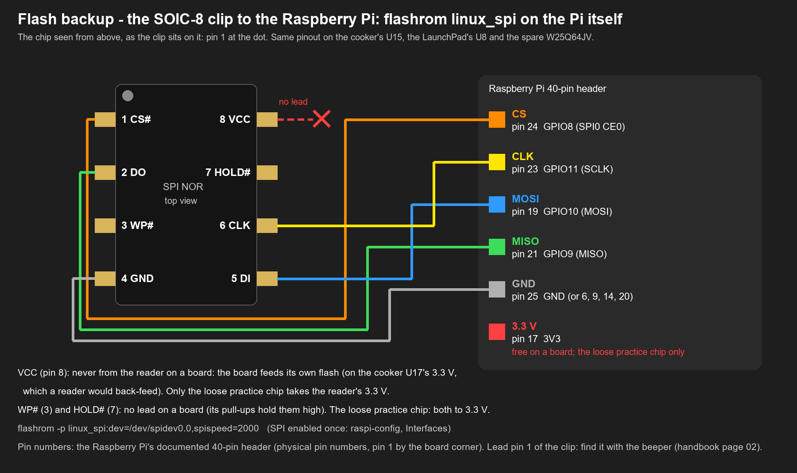
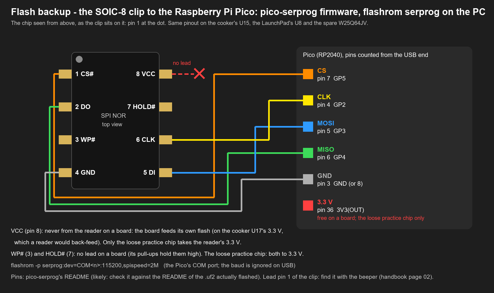
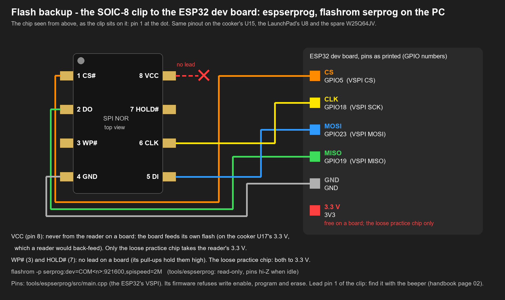
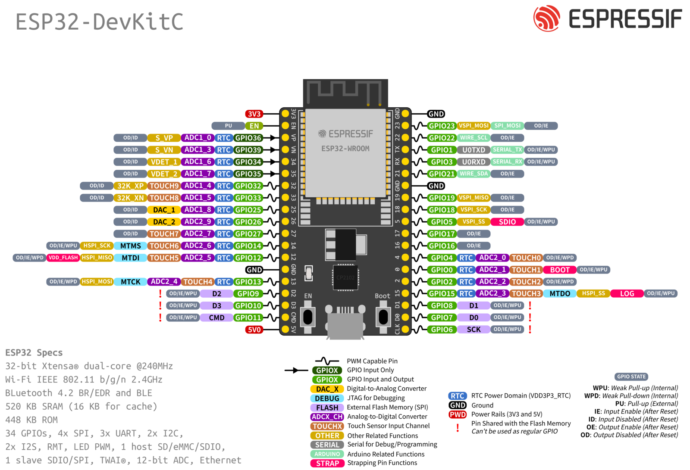
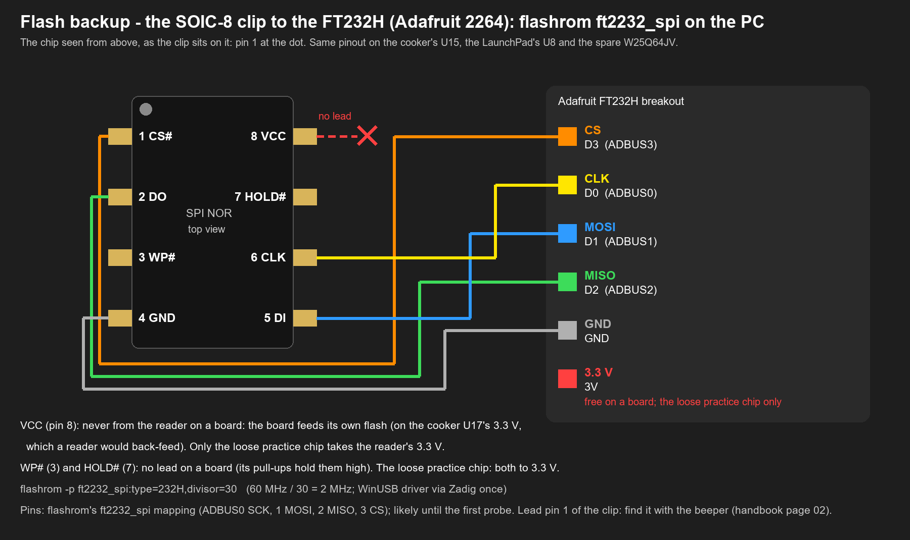

# 1. The readers: Raspberry Pi, Pico, FT232H

Four readers can do the clip read. They read the same way: [flashrom](https://flashrom.org) through
`tools/flashbackup/backup.py` (two reads with equal SHA-256, a manifest). Only the wiring and flashrom's `-p`
string differ. Pick one; the others are the spares.

| Reader | flashrom runs on | `-p` string | Speed | Status (2026-11-06) |
|---|---|---|---|---|
| **Raspberry Pi** (any model with the 40-pin header) | the Pi | `linux_spi:dev=/dev/spidev0.0,spispeed=2000` | 2 MHz (kHz units) | owned (bench kit) |
| **Raspberry Pi Pico** (RP2040) with pico-serprog | the PC | `serprog:dev=COM<n>:115200,spispeed=2M` | 2 MHz | owned; on USB 2026-11-06 but not seen by Windows yet (see 1.2) |
| **ESP32** (WROOM-32 dev board) with `tools/espserprog` | the PC | `serprog:dev=COM<n>:921600,spispeed=2M` | 2 MHz | **ready**: flashed and tested 2026-11-06 on raptox's ESP32-D0WD-V3 (COM5, CP2102), empty test and write guard pass, the practice chip read and written right, every block verified in the reader, a live view |
| **FT232H** (Adafruit 2264) | the PC | `ft2232_spi:type=232H,divisor=30` | 2 MHz (60 MHz / 30) | ordered |

Not a reader here: **the kit's CH341A**, which drives 5 V on its data lines (measured), and the CH340, which
has no SPI. **An Arduino Uno or Nano** neither: 5 V logic, the CH341A's problem; a 3.3 V Arduino (a Pro Mini 3.3 V)
would work with a serprog firmware, slowly.

**Why 2 MHz.** The flash would run at tens of MHz, but the clip, about 20 cm of jumper wire and, on the cooker, the
four 0402 series resistors between U15 and U1 all round the edges. 2 MHz reads 8 MiB in well under a
minute and leaves margin. If two reads differ, halve it (1 MHz) before anything else.

**flashrom knows the three chips.** flashrom 1.8.0 (the MSYS2 build on the bench PC) lists the cooker's
**XM25QH64A**, the LaunchPad's **MX25R3235F** and the spare **W25Q64JV** (`flashrom -L`, `confirmed` 2026-11-06).

## 1.1 Raspberry Pi (flashrom on the Pi)

1. Raspberry Pi OS (Lite is enough), on the network, SSH on. With **Raspberry Pi Imager**: set a hostname, a user,
   the network (an Ethernet cable is simplest; or Wi-Fi), and **SSH with public-key authentication only**, pasting
   the PC's public key (Imager offers it). Then the PC logs in without a password: `ssh <user>@<hostname>.local`.
   A **Pi 3 B+** works as it is (the same header and SPI0; ). Its micro-USB port is power only: it never shows
   up as a USB device on the PC, only on the network. A 5 V 2.5 A supply. **No SD card writer?** A Pi 3 B+ boots from
   a USB stick as delivered (USB boot is on by default on that model, `likely`, Raspberry Pi's documentation):
   Imager writes Raspberry Pi OS straight onto a stick on the PC.
2. SPI on, once: `sudo raspi-config nonint do_spi 0`, then reboot. `ls /dev/spidev0.*` must show `spidev0.0`.
3. `sudo apt install flashrom python3`, then `flashrom --version` and
   `flashrom -L | grep -i -E "XM25QH64A|MX25R3235F|W25Q64JV"`. **If the XMC part is missing** (an older
   flashrom than the PC's 1.8.0; which version Raspberry Pi OS ships is `unverified`), the Pi still reads the
   LaunchPad and the spare chip. For the cooker, use the Pico or the FT232H on the PC, or build a current flashrom
   on the Pi. Never pick a "similar" chip definition with `-c` for the cooker: a read with a wrong size or command
   set gives a dump that looks right and isn't.
4. Copy the tool over: `scp tools/flashbackup/backup.py <user>@<pi>:` (it needs only Python's standard library).
5. Empty test, nothing on the header: `flashrom -p linux_spi:dev=/dev/spidev0.0,spispeed=2000`. Expected: "No
   EEPROM/flash device found". That proves flashrom and the SPI driver, nothing else.
6. Wiring, physical header pins: **24 CE0 → CS, 23 SCLK → CLK, 19 MOSI → DI, 21 MISO → DO, 25 GND → GND**
   (Raspberry Pi's documented 40-pin header). Pin 17 (3V3) only for the loose practice chip.
7. Reads: `python3 backup.py read --programmer linux_spi:dev=/dev/spidev0.0,spispeed=2000 --out ~/dumps/<date>
   --name <stem> --expect-chip <part> --expect-size <bytes>` (`sudo` only if `/dev/spidev0.0` is refused).
8. The dumps to the PC: `scp -r <user>@<pi>:dumps/<date> dumps/<board>/`, then on the PC
   `py -3.13 tools/flashbackup/backup.py check dumps/<board>/<date>/<stem>.json`: every file `ok`.

The Pi's lines idle as SPI outputs from boot: CS high. So its leads go onto the header **only when the board under
the clip is powered**, and come off before the board's power goes off ([the order](index.md#the-order)).

**A Raspberry Pi Zero works the same way** (the same header, the same SPI0). It needs a network for SSH: Wi-Fi on a
Zero W/2 W, or its USB set up as a network gadget.

## 1.2 Raspberry Pi Pico (serprog firmware, flashrom on the PC)

1. **The firmware:** the release `.uf2` of pico-serprog (by stacksmashing; on GitHub). Download it into a new folder
   `installers/pico-serprog-<version>/` (gitignored, rule 7), and record its SHA-256 in the journal. **Read that
   release's README for its pin map** before wiring. The drawing uses GP2 SCK, GP3 MOSI, GP4 MISO, GP5 CS
   (`likely`, from the project's README as known; check it).
2. **Into BOOTSEL:** hold the Pico's BOOTSEL button while plugging its USB cable in. A drive named `RPI-RP2`
   appears. Copy the `.uf2` onto it; the Pico reboots by itself into the new firmware. This writes the Pico's own
   flash, nothing else.
3. Windows now shows a new serial port ("USB Serial Device (COM<n>)", Device Manager → Ports). If nothing at all
   appears when the Pico is plugged in, try another cable first: a charge-only cable powers it without data.
4. Empty test, nothing connected: `$env:FLASHROM = "<path of flashrom.exe>"`, then
   `& $env:FLASHROM -p serprog:dev=COM<n>:115200` → "No EEPROM/flash device found". flashrom talked to the
   firmware.
5. Wiring, Pico pins counted from the USB end: **7 GP5 → CS, 4 GP2 → CLK, 5 GP3 → DI, 6 GP4 → DO, 3 GND → GND**.
   Pin 36 (3V3 OUT) only for the loose practice chip.
6. Reads on the PC: `py -3.13 tools/flashbackup/backup.py read --programmer "serprog:dev=COM<n>:115200,spispeed=2M"
   --out dumps/<board>/<date> --name <stem> --expect-chip <part> --expect-size <bytes>`. If flashrom refuses the
   `spispeed` parameter, leave it out (the firmware's default).

Power order: the Pico is "on" when its USB is in. **Plug it in only after the board is powered; unplug it before the
board goes off.** Its leads can stay on the clip.

## 1.3 ESP32 (espserprog, flashrom on the PC)

The dev board's whole pin layout, for finding GPIO5, 18, 19 and 23 on the board (the classic ESP32-DevKitC V4, as
the WROOM-32 boards used here are laid out; a clone's silkscreen decides):

Source: Espressif Systems, ESP-IDF v5.1 documentation, "ESP32-DevKitC V4 Getting Started Guide" (<https://docs.espressif.com/projects/esp-idf/en/v5.1/esp32/hw-reference/esp32/get-started-devkitc.html>), file `docs/_static/esp32-devkitC-v4-pinout.png` of the ESP-IDF repository, Apache License 2.0; unchanged.

The project's own firmware, [tools/espserprog](../../tools/espserprog/README.md): flashrom's serprog
protocol on the classic ESP32 already used for the j8probe. Two safety features no generic reader has: it
**refuses every write-enable, program and erase command** in the firmware, and its **SPI pins stay
high-impedance** except while flashrom has a session open.

1. Build and flash it, once: `py -3.13 -m platformio run -d tools/espserprog -t upload --upload-port COM<n>` (this
   writes the ESP32's own flash, nothing else).
2. Empty test, nothing on the pins: `& $env:FLASHROM -p serprog:dev=COM<n>:921600` → "No EEPROM/flash device
   found". "Cannot synchronize" instead: the port's opening reset the dev board; run it again.
3. Wiring: **GPIO5 → CS, GPIO18 → CLK, GPIO23 → DI, GPIO19 → DO, GND → GND**. 3V3 only for the loose practice
   chip.
4. Reads: `--programmer "serprog:dev=COM<n>:921600,spispeed=2M"`, the rest as for the Pico. About 90 s per 8 MiB
   at 921 600 baud.

The blue LED (GPIO2) is lit while the pins are driven. Optional: a view-only **live page** over Wi-Fi (the read's
progress, address, throughput, re-reads), with the network given at build time only; see its README. Keep the handbook's order anyway: board on before the read,
the ESP32 unplugged before the board goes off.

## 1.4 FT232H (Adafruit 2264; when it arrives)

1. Once per PC: Zadig → Options → List All Devices → the FT232H (interface 0) → **WinUSB** → Replace Driver.
   flashrom's `ft2232_spi` goes through libusb and needs it. (The board's serial-port use then needs the FTDI
   driver back; Zadig can switch either way.)
2. Empty test: `& $env:FLASHROM -p ft2232_spi:type=232H,divisor=30` → "No EEPROM/flash device found".
3. Wiring: **D3 → CS, D0 → CLK, D1 → DI, D2 → DO, GND → GND** (flashrom's ft2232_spi mapping, ADBUS0-3, `likely`
   until the first probe). The board's 3V pin only for the loose practice chip.
4. Reads: `--programmer "ft2232_spi:type=232H,divisor=30"`, the rest as for the Pico.

Power order as for the Pico: USB in after the board is powered, out before it goes off.

## 1.5 Records
For whichever reader is used: its type, firmware (`.uf2` name and SHA-256 for the Pico), flashrom's version line
(the manifest holds it too) and the empty-test result go into the journal once.
