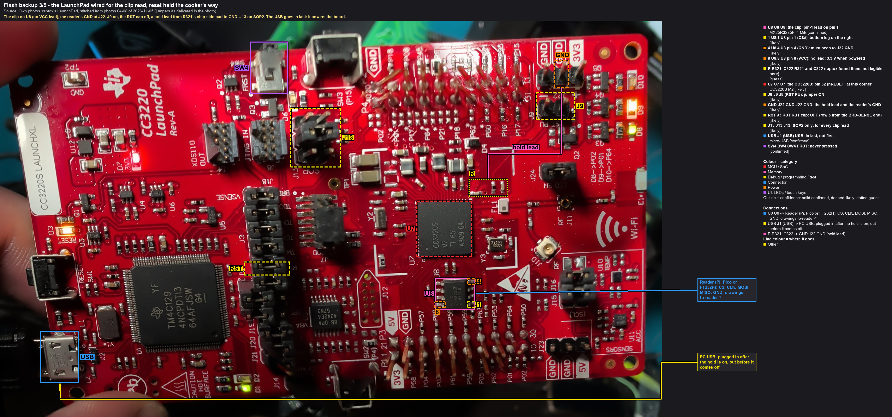
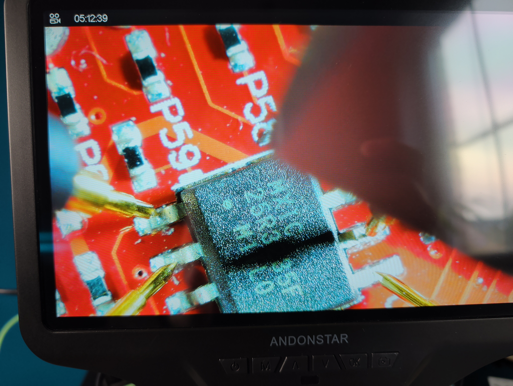

# 3. LaunchPad: qualify the clip route against the boot loader

**Why this step comes first.** The LaunchPad still runs a **development** image. Its boot loader
still hands out raw reads, so the same flash can be read two independent ways: through the boot loader (the
route proven on 2026-11-05/06) and through the clip. **If both give the same SHA-256, the clip route reads every
byte right**: reader, harness, clip, reset hold and tool, all at once. After (private flash-backup page: names the vendor's image and the programming project, not published)
(the production image) the boot loader refuses raw reads, and this comparison is no longer possible. The
same reads are also the rule-1 backup that page 4's write relies on.



Callouts: [fb5-1_launchpad-clip-hold](../hardware/callouts/fb5-1_launchpad-clip-hold.md).

## 3.1 The boot-loader reads (the reference and the backup)
1. LaunchPad on its USB, jumpers as delivered (RST, RX, TX caps on; J9 off; TMS/TCK/TDI/TDO off), **J13 on SOP2
   only**.
2. One session, the reset from the PC, the two reads in one go (as ):
   ```
   & "<Uniflash>\simplelink\imagecreator\bin\xds110reset.exe" -a toggle -d 200 -s <probe serial>
   Start-Sleep 2
   py -3.13 tools/cc32xx/ccx.py --venv <cc3200tool venv> --cc3220 -p COM<user UART> --reset none read_flash dumps/launchpad/<date>/u8_bl_ref_1.bin read_flash dumps/launchpad/<date>/u8_bl_ref_2.bin
   ```
3. `sha256sum` both: equal. That hash is **H_ref**. A missed break ends the session with an error; then
   reset and read again: the miss rewrote `/tmp/phy.cal`, so the earlier reads are no longer the reference.
4. **From here on the chip must not run anything** until the clip read is done: no reset with J13 on SOP1, no
   Uniflash. After the session it sits in the network processor's boot loader, which writes nothing.

## 3.2 Set up the hold and the clip (USB out)
1. **USB out.** The board is now unpowered: everything below is done cold.
2. **The RST cap off** (row 6 from the BRD-SENSE end; park it on one pin). The XDS110 then no longer reaches
   nRESET, so nothing can fight the hold.
3. **J9 on** (RST PU): R321 now pulls nRESET up to 3.3 V, as it does on the cooker.
4. **Find R321's chip-side pad with the meter** (raptox found R321 and C322 near U7's pin-32 corner; the photo
   can't show which is which):
   - each of R321's two pads to J9's pins, beeper: **the pad that beeps to J9 is the 3.3 V side. Never the hold
     point**.
   - the other pad, in ohms to the BoosterPack header's 3V3 pin: about 10 kΩ (R321 itself; J9 on). That is the
     **hold point**, on nRESET with C322.
5. **The hold:** a PCBite probe on the hold point, its lead to **J22's GND pin**. Beeper: hold point to J22 GND
   beeps (the lead works); **the 3V3 pin to J22 GND does not** (the rail isn't grounded: a short chirp from the
   capacitors is fine, a steady tone means the probe is on the wrong pad).
6. **The clip on U8**, pin-1 jaw on **pin 1: the bottom leg on the right** in the picture (`likely`, from the
   marking's orientation). Check with the beeper: the harness's **GND lead beeps to J22 GND**. That is U8 pin 4, and
   it only does so if the clip sits the right way round. Then each lead to its leg, no neighbours ringing.
7. With the ESP32: flashrom must report `Programmer name is "espserprog-ro"` (the read-only build; `backup.py`
   warns otherwise). Then the reader's leads on the harness, the reader **not yet** powered (Pico or FT232H unplugged; on the Pi, its
   header end not yet connected).

## 3.3 Read through the clip ([the order](index.md#the-order))
1. **USB in.** The board powers up with nRESET already held: the CC3220 never starts. (J13 is still on SOP2: if the
   hold slipped, the ROM would only wait for a break.)
2. Meter: U8 pin 8 about 3.3 V; U8 pin 7 (HOLD#) about 3.3 V; the hold point 0 V.
3. **Reader on** (Pico/FT232H plugged in; Pi: GND lead first, then the four signals).
4. `backup.py read --programmer <...> --out dumps/launchpad/<date> --name u8_clip_ref --expect-chip MX25R3235F
   --expect-size 4194304 --label "LaunchPad, development image, clip, reset held at R321"`. Expected: "Macronix
   MX25R3235F, 4194304 bytes", two reads, **VERIFIED**: **H_clip**.
5. **Reader off**, then **USB out**, then the hold off, the clip off.

## 3.3b As run on 2026-11-06
- **H_ref = `3d7f6b42…ca73`** (the boot loader's two reads), **H_clip = `3d7f6b42…ca73`** (two in-circuit reads):
  equal. **The in-circuit route is qualified**: the reader, the harness, 2 MHz, the hold.
- **Probes, not the clip, on U8** (corrected in ). U8 is the narrow 150 mil package; the clip closes onto the
  wide 208 mil one. The reads that matched were made with **four PCBite probes on U8's legs**, their leads in the
  harness adapter's socket (photos 01 to 04 of 2026-11-06, during the first matching read at 14:50). The files keep
  their names (`u8_clip_ref*`). The clip itself proved out on the wide package: the practice chip and the
  cooker's U15.

  
- **The hold used: the XDS110** (RST cap on, `xds110reset -a assert`, released with `-a deassert`), not the R321
  lead. It takes one probe away from the crowded area around the chip. **Prove the hold before every clip read:**
  `ccx.py --rom-only -p COM<user UART> --reset none` must end with "Did not get ACK on break condition". A held
  chip can't answer.
- **The reader without Wi-Fi.** Two reads stalled on the live-view build; the build without Wi-Fi never
  has. `backup.py` now gives each read a time limit, so a stall becomes a failed attempt instead of a hang.

## 3.4 The verdict
- **H_clip = H_ref: the clip route is qualified** (`confirmed` from then on): it reads byte for byte what the chip's
  own boot loader reads. The cooker's backup can rely on it.
- H_clip ≠ H_ref: `py -3.13 -I tools/sflash/blockdiff.py blocks dumps/launchpad/<date>/u8_bl_ref_1.bin
  dumps/launchpad/<date>/u8_clip_ref_1.bin` lists the differing blocks and the files they belong to:
  - only `/tmp/phy.cal`: the chip ran between the two reads (3.1.4 was broken); repeat 3.1-3.3
  - scattered single bits or bytes: a signal problem; lower the speed (1 MHz), re-seat, read again
  - everything different: the reader read something else (wrong chip select, clip off), look at the probe output
- Back to the delivered state afterwards: the RST cap on, J9 off.

## Records
Journal: ACTION (both read sessions, the four file names and hashes, the reader, its firmware, the clip mapping) and
FINDING (the verdict, with blockdiff's output if any). Chapter 2's results table gets the row for step 2.3 (the clip
read it was waiting for).
