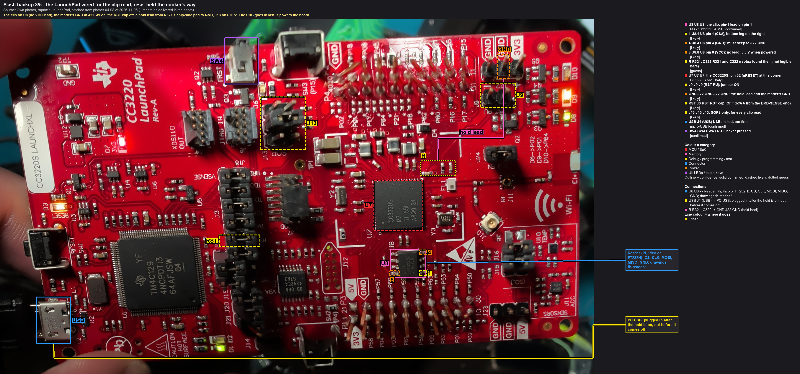
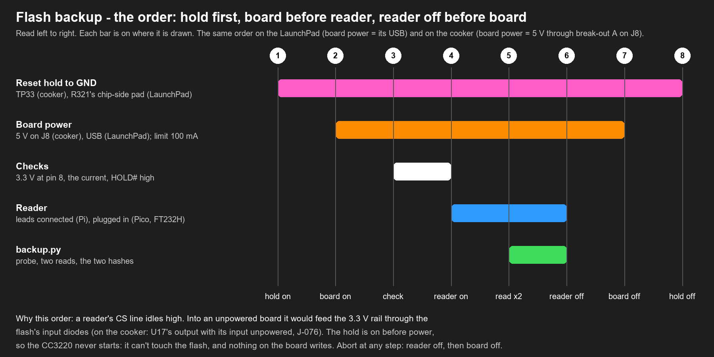

# 5. LaunchPad: back up the production flash through the clip

**The cooker's routine, rehearsed exactly.** A production chip's boot loader refuses raw reads, so this flash
can only be read through the clip: the cooker's situation. The route itself was qualified on [page 3](03-launchpad-qualify.md)
against the boot loader. This page proves it on a production flash, and that the read is repeatable: the clip
taken off and put back gives the same bytes.

Picture and callouts: as page 3, [fb5-1_launchpad-clip-hold](../hardware/callouts/fb5-1_launchpad-clip-hold.md).

## 5.1 Set up, cold (USB out)
As [3.2](03-launchpad-qualify.md#32-set-up-the-hold-and-the-clip-usb-out), in short:
1. USB out. **J13 on SOP2** (the safety net if the hold slips).
2. The hold, one of two ways:
   - **the XDS110 (used on page 3):** the RST cap on; after USB in, `xds110reset -a assert`, then prove it:
     `ccx.py --rom-only` gets no ACK
   - the cooker's way: the RST cap off, J9 on, a hold lead from R321's chip-side pad to J22 GND. Beeper: the hold
     point to GND beeps; **3V3 to GND doesn't**
3. The reader on the build **without Wi-Fi**.
4. Clip on U8, pin-1 jaw on pin 1. Beeper: the harness's GND lead to J22 GND beeps.
5. Reader not yet on.

## 5.2 Read, twice over
**Hands off during every read:** no touching the board, the clip or the leads, no photos (before and after only).
One read of the practice chip came back with a 64-byte error while the board was being handled.

1. **USB in** (hold already on: the CC3220 never starts). Meter: U8 pin 8 and pin 7 about 3.3 V.
2. **Reader on.** `backup.py read --programmer <...> --out dumps/launchpad/<date> --name u8_clip_prod
   --expect-chip MX25R3235F --expect-size 4194304 --label "LaunchPad, production image, clip, reset held at R321"`
   → **VERIFIED**: **H_prod**.
3. **Reader off, USB out.** Lift the clip off U8 and put it back (pin 1 again, the GND beep again).
4. USB in, reader on, `--name u8_clip_prod_b` → VERIFIED, and **its hash must equal H_prod**. Two sessions, two
   seatings of the clip, the same bytes: the read doesn't depend on how the clip happened to sit.
5. Reader off, USB out, hold off, clip off.

## 5.3 Afterwards: did the read leave the board untouched?
1. The jumpers back as delivered (RST cap on, J9 off), J13 on SOP2, USB in.
2. `ccx.py --cc3220 --status` (reset from the PC first): still **Production, 0 / 15**. A clip read sends nothing to
   the CC3220, and this shows it: nothing raised an alert, the mode didn't change.
3. Optionally J13 on SOP1, reset: the application boots, the access point comes back.

## 5.4 If it goes wrong
| Seen | Means | Next |
|---|---|---|
| "No EEPROM/flash device found" | no SPI answer: clip, CS, power | reader off, USB out; re-seat, the GND beep, each lead; is U8 pin 8 at 3.3 V with USB in? |
| a chip found, but not MX25R3235F (or ID `FF FF FF` / `00 00 00`) | MISO stuck, or HOLD# low | MISO and MOSI swapped? U8 pin 7 at 3.3 V? |
| two reads differ, the third equals one | a marginal edge | keep the verified pair; next time 1 MHz |
| no two reads equal | the CC3220 is driving the bus (the hold slipped), or a loose lead | reader off, USB out; check the hold point (0 V when powered), re-seat, 1 MHz |
| `u8_clip_prod_b` ≠ `u8_clip_prod` | something wrote between the sessions, or a bad read slipped through | `blockdiff.py blocks` on the two: which file? |

## Records
Journal: ACTION (both sessions: names, hashes, reader, speed, time per read) and FINDING (the repeatability, the
status panel after). The dumps stay in `dumps/` (gitignored) with a copy off the machine (rule 1).
