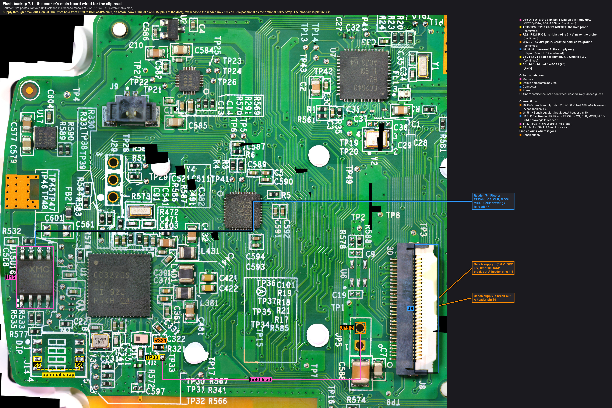
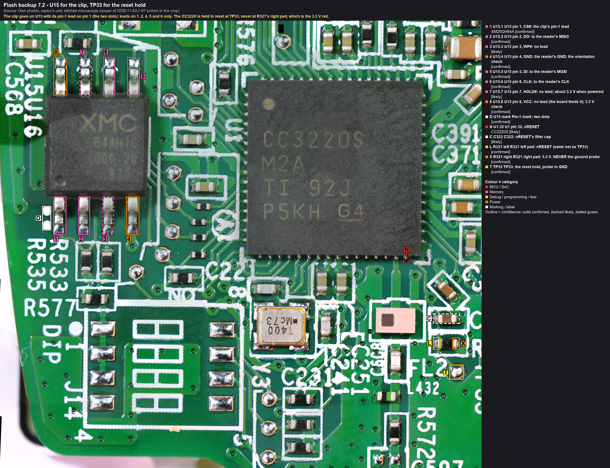

# 7. The cooker: connect, then validate every connection before power

**Gate.** Page 3 passed with **this reader and this harness**: the clip route qualified against the boot loader.
(The plan also had page 5 first, a production flash read twice over; raptox moved the cooker ahead of pages 4 to 6: a clip read doesn't depend on the chip's mode.) Nothing on this page applies power.

**What is connected, and what isn't.** The supply through break-out A on J8. The reset hold from TP33 to
GND. The clip on U15 with five leads. Nothing else: the cooker's own cable stays out of J8, so the
power board (mains) is not part of the bench at all (rule 3). Nothing goes on J29 or the Bluetooth chip.

Callouts: [fb7-1_cooker-wiring](../hardware/callouts/fb7-1_cooker-wiring.md).

Callouts: [fb7-2_cooker-u15-tp33](../hardware/callouts/fb7-2_cooker-u15-tp33.md).

## 7.1 The bench
1. The main board on its bezel, ESD mat and strap. The cooker's FFC out of J8 (the default since ).
2. Bench supply: **5.0 V**, over-voltage protection **6 V**, current limit **100 mA**, output **off**.
3. Photo of the bench before anything is clipped on (the reference for "what was where").

## 7.2 The supply through break-out A
1. Break-out A's 100 mm cable into J8, as on 2026-11-04 (the cable runs straight, 30 end to 30 end; J8 table).
2. Supply **+** on break-out header pins **1-6** (tied together), supply **−** on header pin **30**. Every other
   header pin stays free.
3. Beeper, supply still off:

   | From | To | Expected |
   |---|---|---|
   | header pin 1 | JP5 pin 1 | beep (VIN) |
   | header pin 30 | JP5 pin 2 | beep (GND) |
   | header pin 1 | header pin 30 | **no** beep (a reversed cable would put the supply on 25-30) |
   | header pin 1 | U15 pin 8 | no beep (VIN reaches 3.3 V only through U17) |

## 7.3 The reset hold
1. A PCBite probe on **TP33** (callout T in picture 7.2), its lead to a second probe on **JP5 pin 2** (GND, the round
   pad).
2. Beeper:

   | From | To | Expected | Means |
   |---|---|---|---|
   | TP33 | JP5 pin 2 | beep | the hold lead works: nRESET is on GND |
   | **U15 pin 8** | **JP5 pin 2** | **no beep** (a short chirp is the rail's capacitors) | **the 3.3 V rail isn't grounded**: the probe isn't on R321's right pad (callout X) |
   | U15 pin 8 | TP33 | about 9.7 kΩ (ohms range) | R321 is still the only link: 's value |
3. **Left out: the SOP2 strap** (J14 pad 3 to pad 6, callouts S3, S6 in 7.1). It would only keep the application
   from starting if the hold slipped: without a break, the network processor still boots its own firmware after
   about 1 s and writes one record (; corrected in ). Not worth two more probes beside the clip. The
   hold is what protects the flash.

## 7.4 The clip on U15
1. Under the microscope or a loupe: the clip's pin-1 jaw on **U15 pin 1, the bottom-left leg by the two dots**
   (callouts 1 and D in 7.2). Each jaw contact on its leg's flat top, none touching two legs.
2. The harness's **VCC lead stays taped**. WP# and HOLD# have no leads.
3. Beeper, from the reader-end of each lead:

   | Lead | To | Expected |
   |---|---|---|
   | GND | JP5 pin 2 | beep: **U15 pin 4 is GND, so the clip sits the right way round** |
   | CS | U15 pin 1 | beep |
   | DO (MISO) | U15 pin 2 | beep |
   | DI (MOSI) | U15 pin 5 | beep |
   | CLK | U15 pin 6 | beep |
   | each lead | its neighbours, and U15 pin 8 | no beep |
4. The reader end of the leads ready at the reader, **not connected / not plugged in**. With the ESP32: it runs the
   read-only build (`espserprog-ro`, `guard_test.py` passed since its last flash).

## 7.5 Photo evidence
Before power, four photos, imported as every photo (rule 6: byte-identical into `images/own/<date>/`, a descriptive
name, logged in [photos.md](../photos.md)):
1. the whole bench: supply, break-out A, the board, the probes, the reader
2. the clip on U15 from above, pin 1 visible (a microscope frame: `tools/microscope/capture.py --name fb-cooker-clip-u15`)
3. the TP33 probe and its lead to JP5 pin 2
4. break-out A's header with the supply leads on 1-6 and 30

## 7.6 Go / no-go
Every row above as expected, and the photos taken: **go** for [page 8](08-cooker-backup.md). Anything else: stop,
find out why, nothing is powered yet. The journal gets one ACTION entry with the table's results.
