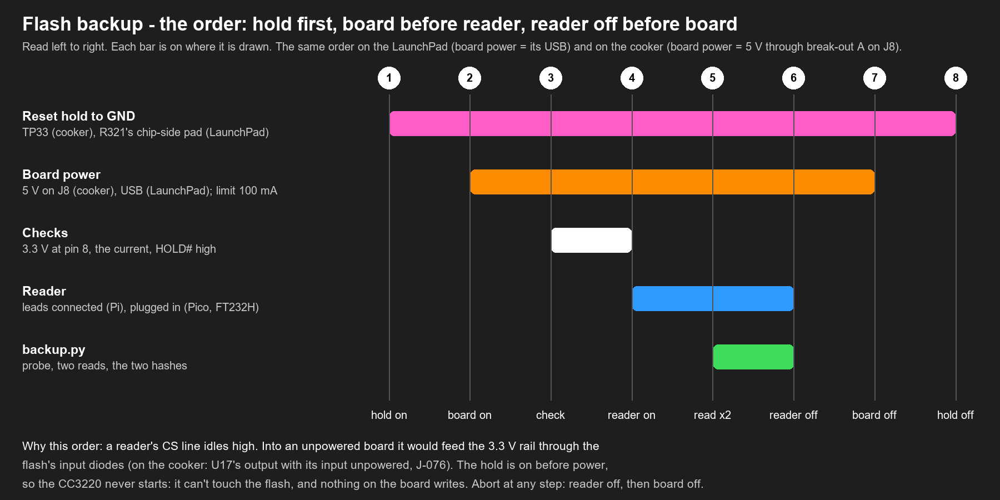
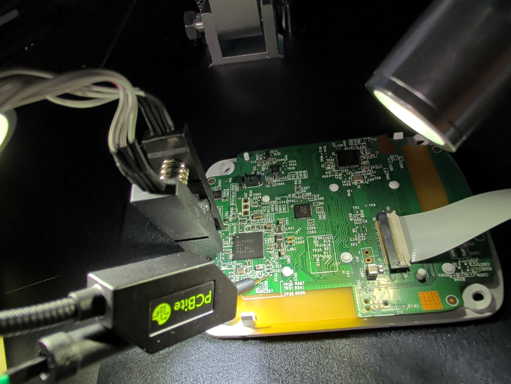
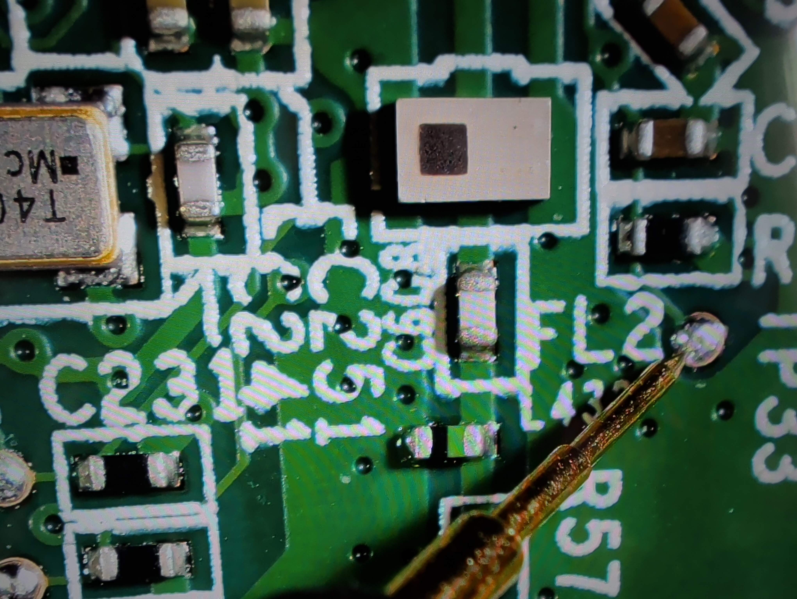
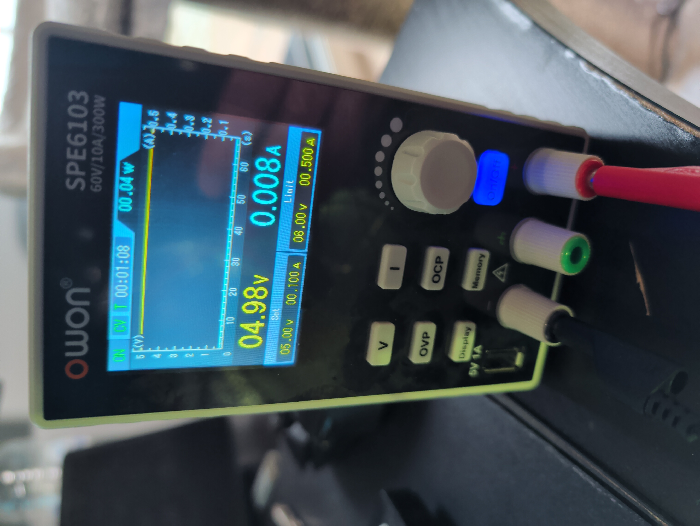
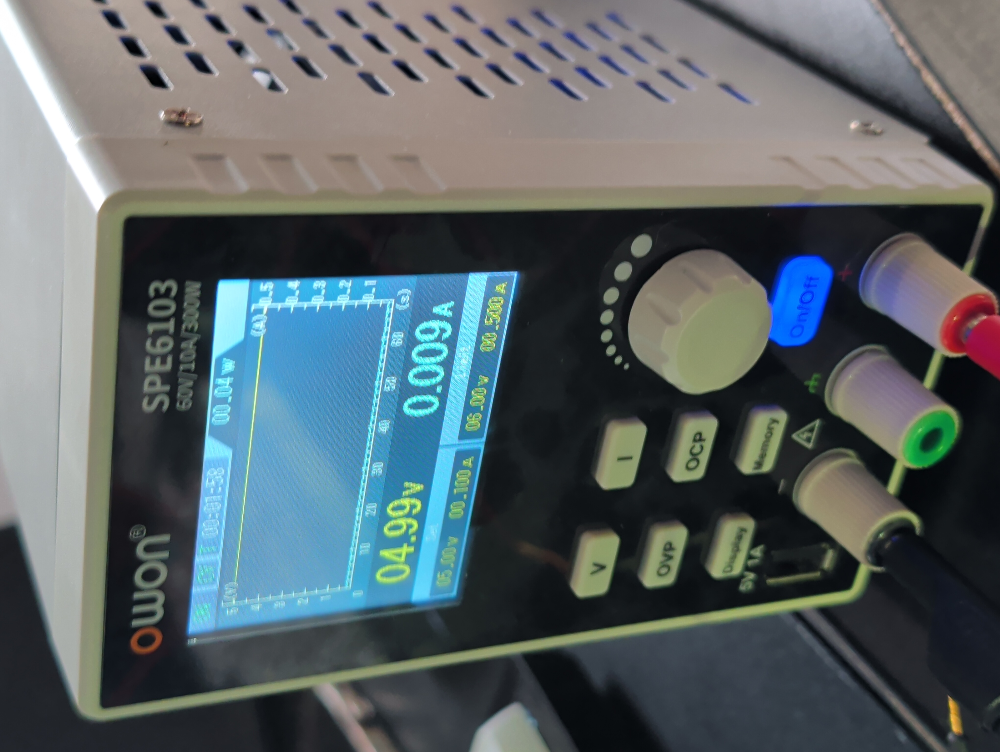

# 8. The cooker: power on, back up the flash, power off

**Gate.** [Page 7](07-cooker-connect.md) said go. The reset hold is on TP33 before the supply is switched on, so the
CC3220 never starts: its network processor can't boot, nothing on the board can write to U15, and the clip read
sends nothing to the chip. The only thing that changes the board's state is power itself.



## 8.1 Power on (the hold already on)
1. Last look: the supply at 5.0 V, OVP 6 V, limit 100 mA; the hold probe on TP33; the clip seated; the reader **not**
   connected. With the ESP32: the build **without Wi-Fi** (`netinfo.py` says "built without Wi-Fi"): reads on the
   live-view build stalled twice.
2. **Supply output on.** Read the current within a few seconds and write it down.
   - Expected: a small, steady current. The CC3220 sits in reset, U17 and U15 idle, and the Bluetooth chip U7 boots
     its own firmware from its internal flash (it isn't held and doesn't reach U15; `likely`). No baseline yet:
     this reading becomes one.
   - **At the limit (100 mA), the voltage folding back:** a short. Output off at once, stop. Back to the meter
     ('s supply checks).
   - **Rising or jumping by tens of mA after the first seconds:** the CC3220 has started (the hold slipped). Output
     off at once. Check the hold (7.3), start again.

## 8.2 The checks (meter, black lead on JP5 pin 2)
| Point | Expected | If not |
|---|---|---|
| U15 pin 8 | about 3.3 V | 0 V: U17 doesn't regulate. Stop: 's checks, the chapter 3 outcomes |
| U15 pin 7 (HOLD#) | about 3.3 V | low: something holds HOLD# down. Stop: the read would fail |
| TP33 | 0 V | about 3.3 V: the hold isn't on nRESET. Output off |

## 8.3 Read
**Hands off from here to 8.4:** nobody touches the board, the probes, the clip or the leads, and the bench isn't
bumped. Photos come before (page 7) and after. A read of the practice chip went wrong once while it was handled.

1. **Reader on:** the ESP32, Pico or FT232H plugged into the PC; Pi: the GND lead onto its header first, then CS, CLK,
   MOSI, MISO. The ESP32: `--programmer "serprog:dev=COM<n>:921600,spispeed=2M"`.
2. On the reader's machine (Pi: on the Pi; Pico/FT232H: on the PC):
   ```
   backup.py read --programmer <the reader's -p string> --out dumps/cooker/<date> --name u15_clip \
       --expect-chip XM25QH64A --expect-size 8388608 --label "cooker main board, clip on U15, reset held at TP33"
   ```
3. Expected:
   - `chip: XMC XM25QH64A, 8388608 bytes` (JEDEC `20 70 17`)
   - two reads; at 2 MHz on the ESP32 about 165 s each (`likely`: the LaunchPad's 4 MiB took 81.7 s), so the
     board is powered for about 6 minutes; `backup.py` kills a read that takes over 560 s as stalled
   - **VERIFIED** and the SHA-256: **the cooker's backup**
4. If flashrom reports several matching definitions: rerun with `--chip XM25QH64A`. Anything else unexpected:
   reader off, then supply off, then think (8.5). Never move the clip while the board is powered.

## 8.4 Power off, straight away
1. **Reader off** (Pico/FT232H unplugged; Pi: the signal leads off its header, then GND).
2. **Supply output off.**
3. Then the hold probe off, the clip off.

The board was powered for a couple of minutes, with its CC3220 in reset the whole time.

## 8.5 If it goes wrong
| Seen | Means | Next |
|---|---|---|
| no chip found | the clip or a lead; or no 3.3 V at U15 | reader off, supply off; page 7's 7.4 again |
| a chip, but not XM25QH64A, or the ID `FF FF FF` / `00 00 00` | MISO stuck, HOLD# low, or MOSI/MISO swapped | as above, plus HOLD# at 3.3 V (8.2) |
| two reads differ, a third equals one | a marginal edge | the verified pair counts; note it |
| no two reads equal | the CC3220 drives the bus (hold slipped), or a loose lead | supply off; check TP33's probe; re-seat; 1 MHz |
| the current jumps during the read | the CC3220 started | supply off at once; the reads so far are evidence, not a backup |

## 8.6 Safe-keeping (rule 1)
1. Pi: `scp` the folder to the PC, then `py -3.13 tools/flashbackup/backup.py check dumps/cooker/<date>/u15_clip.json`
   on the PC: every file `ok`.
2. **A copy off the machine** (the NAS or a USB stick), checked there the same way.
3. The dump stays out of git (`dumps/` is gitignored) and out of every public place: it holds the cooker's identity
   and probably your Wi-Fi profile ([page 9](09-cooker-analysis.md#95-handle-it-as-a-secret)).
4. Journal: ACTION (the backup: file names, size, SHA-256, reader, speed, the current reading, the off-machine copy).
   From this entry on, **rule 1's gate is open for the cooker's CC3220 flash**.
5. Timeline: one neutral line ("the main board's flash backed up in circuit").

## 8.7 As run on 2026-11-06
- **The reader:** the ESP32, the read-only build without Wi-Fi (`netinfo.py`: "built without Wi-Fi"; `guard_test.py`
  passed right before).
- **Power:** set to 5.00 V and 0.100 A, OVP 6 V. It read **4.98 V and 8 mA, flat**, with U1 held. During the read,
  **9 mA, flat**: the CC3220 stayed in reset the whole time.
- **First try: no chip found.** `tools/espserprog/idprobe.py` gave floating answers (`00`/`FF`): a jaw off its leg.
  Powered off, the clip re-seated, powered on: **`20 70 17`** (XM25QH64A) at 250 kHz and at 2 MHz.
- **The backup:** two reads of 162.1 s, both **`803c7da8…4a8f09`**. VERIFIED. A copy on the NAS, checked there.
- **Off:** the ESP32 first, then the supply.









All photos of the session: [photos.md](../photos.md#2026-11-06-the-flash-backup-launchpad-probes-then-the-cookers-u15).
