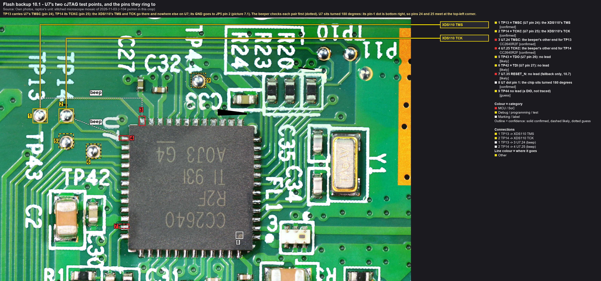
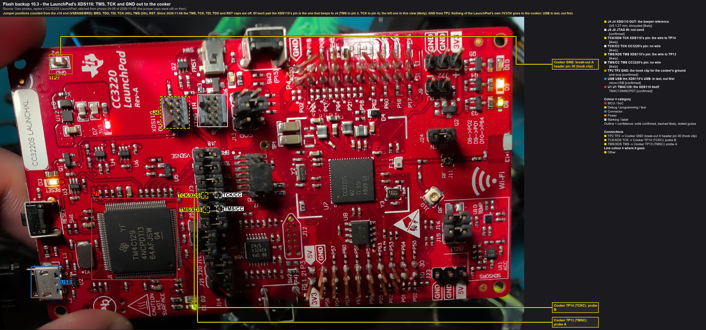
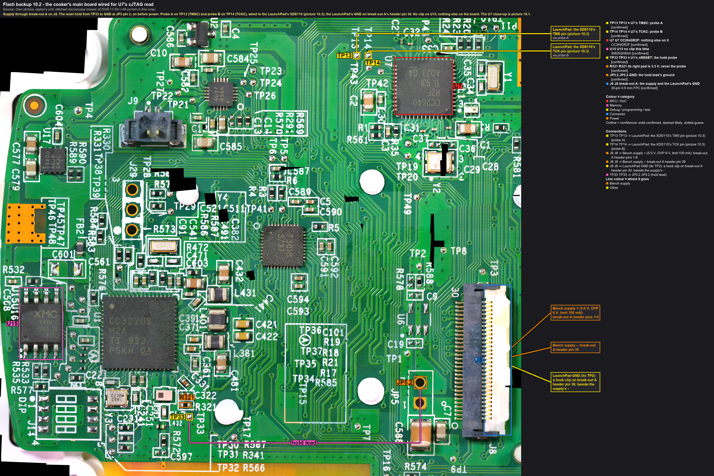
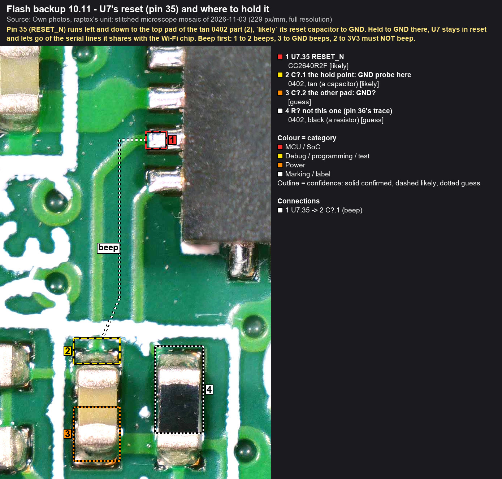

# 10. The cooker: back up the Bluetooth chip (U7) over cJTAG

**Why.** The repair writes a full image to U15, and the new firmware then reflashes U7, the CC2640R2F, by itself at
its first start (`likely`). So U7's present flash gets overwritten. It's the evidence of what the interrupted
update did to the Bluetooth chip, and its only undo. Rule 1: two equal reads of it first, a copy off the machine,
before anything boots. This page reads U7's whole 128 KiB internal flash, read-only, through its debug port.

**How.** U7's debug port is two-pin cJTAG: **TMSC** (data) and **TCKC** (clock), on test points **TP13** and
**TP14** (traced on the mosaic, then `confirmed` by the beeper on 2026-11-06, 10.2). The probe is the **XDS110 on the CC3220S
LaunchPad**: its TMS and TCK, out through the LaunchPad's jumper column, nothing else. TI's own DSLite (from
Uniflash) does the reading in its `memory` mode: it copies memory into a file and never loads, erases or programs
anything. `tools/flashbackup/u7read.py` runs it until two reads are equal, as `backup.py` does for U15.

**The CC3220 is held in reset at TP33 throughout**, as on page 8: neither firmware can start, so nothing talks to U7
or tries to flash it while it's being read.



Callouts: [fb10-1_cooker-u7-cjtag](../hardware/callouts/fb10-1_cooker-u7-cjtag.md). The supply, JP5 and TP33:
[picture 7.1](../../images/annotated/fb7-1_cooker-wiring.jpg).

## What you need
- The cooker's main board as on page 8, **without the clip**: break-out A on J8, the bench supply, the TP33 hold.
- The CC3220S LaunchPad and its USB cable. Its jumper column as since 2026-11-06: the **TMS, TCK, TDI, TDO and RST
  caps off**, so its own CC3220 is cut off from the probe.
- Three leads: two PCBite probes with Dupont wires (TP13, TP14), and one wire with a hook clip (GND).
- The meter for the beeper checks.
- On the PC: Uniflash 9.7.1 (it brings DSLite and the XDS110 driver), `tools/flashbackup/u7read.py` and
  `tools/flashbackup/cc2640r2f_xds110_cjtag.ccxml`, a folder `dumps/cooker/<date>/` outside git.

**Never connected to the cooker:** J4's pin 1 (TI: "not a voltage sense pin"), the LaunchPad's 3V3 or 5V, TP42,
TP43, TP44, U7's reset. The probe configuration says **target supplied power**; `u7read.py` refuses one that would
let the probe power the target, because that would feed the cooker's 3.3 V rail against its own regulator (U17).

## 10.1 The order
1. **Hold on** (TP33), before any power.
2. **Board power on**: 5.0 V through break-out A, limit 100 mA.
3. **Checks**: the current, 3.3 V, TP33 low (page 8's table), and TP13/TP14 (10.4).
4. **LaunchPad USB in** only now. The XDS110 drives 3.3 V on TMS and TCK, and into an unpowered U7 that would flow
   through its pins' protection diodes into the rail.
5. **Read**: `u7read.py ccfg`, then `u7read.py read`.
6. **LaunchPad USB out**, before the board.
7. **Board power off.**
8. **Hold off**, leads off.

## 10.2 Beeper checks on the cooker (unpowered)
Board unpowered, nothing connected, meter on the beeper. Touch U7's toes at the package edge with a fine tip, and
make sure the neighbouring toe doesn't ring as well: a slip gives a false hit.

| From | To | Expected | If not |
|---|---|---|---|
| TP13 | U7 pin 24 (3 in the picture) | **beep** | stop. Try pins 23 and 25 too, note what rings |
| TP14 | U7 pin 25 (4) | **beep** | stop, as above (pin 26 rings to TP43) |
| TP13 | TP14 | no beep | a short between the two lines: stop |
| TP13 | U7 pin 25 | no beep | a slip, or a short |
| TP14 | U7 pin 24 | no beep | as above |
| TP13, TP14 | GND (JP5 pin 2) | no beep | the line is grounded: stop |
| TP13, TP14 | 3V3 (U15 pin 8) | no beep | a short to the rail: stop |
| diode mode: red on JP5 pin 2, black on TP13, then TP14 | | about 0.5 to 0.8 V | open: no chip pin behind it |

The diode reading is a chip pin's protection diode, as on J29's holes. Write every reading down.

**As measured on 2026-11-06:** TP13 to pin 24 beeps, TP14 to pin 25 beeps; pins 24 and 25 to GND and TP13
to TP14: nothing. Still to do before power: the two cross checks, both against 3V3, and diode mode.

## 10.3 Beeper checks on the LaunchPad (USB out)
TMS and TCK each have two pins in the jumper column: one is the **XDS110's**, the other the LaunchPad's own CC3220.
The XDS110's is the one that beeps to J4, the "XDS110 OUT" header (1.27 mm, Arm's 10-pin Cortex debug layout,
which J4 follows, TI SWRU463C 2.5.2): pin 2 = TMS/SWDIO, pin 4 = TCK/SWCLK, pins 3 and 5 = GND. Pin 1 is marked on
the board; the even pins are the row next to it.



Callouts: [fb10-3_launchpad-xds110](../hardware/callouts/fb10-3_launchpad-xds110.md). The photo is from 2026-11-05,
with the caps still on; count the positions from the J18 end (VSENSE/BRD): BRD, TDO, TDI, **TCK (4th)**,
**TMS (5th)**, RST. The XDS110's pin of each is `likely` the left one in this view: the beeper decides.

| From | To | Expected |
|---|---|---|
| J4 pin 2 | each of the TMS position's two pins | one beeps: **the XDS110's TMS** |
| J4 pin 4 | each of the TCK position's two pins | one beeps: **the XDS110's TCK** |
| J4 pin 2 | J4 pin 4 | no beep |
| J4 pin 3 | TP2, the wire loop marked GND (top left in picture 10.3) | beep |

Mark the two pins (a dot of tape). If the J4 cable and its breakout have arrived, they do the same job: the
breakout's SWDIO, SWCLK and GND, and **never its VCC pin**.

## 10.4 Wire, power on, check


Callouts: [fb10-2_cooker-wiring](../hardware/callouts/fb10-2_cooker-wiring.md).

1. **Unpowered, LaunchPad USB out.** The cooker as on page 7 (picture 7.1): break-out A on J8 (header pins 1-6 +,
   30 −), the supply set to 5.0 V, OVP 6 V, limit 100 mA, output off; the TP33 hold probe to JP5 pin 2 (page 7's
   7.3 checks). No clip, no serial adapter, no strap.
2. **Probe A on TP13, probe B on TP14** (picture 10.1). Probe A's wire to the XDS110's TMS pin, probe B's to its TCK
   pin (10.3).
3. **GND:** the LaunchPad's TP2 (GND) to the cooker's GND: a hook clip on break-out A's header pin 30, beside the
   supply's − lead (or on the supply's − terminal).
4. **The beeper from each wire's LaunchPad end:** TMS end to TP13, TCK end to TP14, the GND wire to JP5 pin 2. The TMS
   and TCK ends not to each other, not to GND. Photos.
5. **Supply on.** Within a few seconds (black lead on JP5 pin 2):

   | Point | Expected | If not |
   |---|---|---|
   | the supply's current | about 8 mA, steady (page 8: 8 mA with U1 held) | at the limit, or tens of mA and rising: output off, stop |
   | U15 pin 8 | about 3.3 V | 0 V: output off, stop (page 8) |
   | TP33 | 0 V | about 3.3 V: the hold slipped, output off |
   | TP13 (TMSC) | about 3.3 V (`likely`: the pin is pulled up, as cJTAG's data line is) | 0 V: U7 unpowered, or not TMSC. Note it, go on |
   | TP14 (TCKC) | about 0 V (`likely`: pulled down) | note it |

6. **LaunchPad USB in.** Windows finds the XDS110 (COM11 and COM4 come back).

## 10.5 Read
**Hands off from here to 10.6:** nobody touches the board, the probes or the leads.

**U7 answers once per power-up**: the first DSLite session after power-on reads, every later one fails
with "Error -242, a router subpath could not be accessed". So each power-up gives one read, and the backup is
two power-ups. On the first run DSLite also **updates the XDS110's firmware by itself**, without asking (it did,
2.3.0.7 to 3.0.0.45).

1. **The connect test**, the CCFG only (88 bytes; if debug were locked, this is where it would show). Optional: it
   uses up the power-up's one session, so power-cycle (10.6, then 10.4 from step 5) before step 2:
   ```
   py -3.13 tools/flashbackup/u7read.py ccfg --out dumps/cooker/<date>
   ```
   Expected: `connected`, then the CCFG decoded. Anova's two images both carry "CPU debug open; ROM boot loader
   enabled; backdoor DIO7 active high; image valid". Anything else is the first finding: note it, then go on (the read
   is read-only, whatever the CCFG says).
2. **The backup**, one read per power-up, then the pair:
   ```
   py -3.13 tools/flashbackup/u7read.py read --out dumps/cooker/<date> --name u7_jtag --label "cooker main board, U7 over cJTAG (LaunchPad XDS110 on TP13/TP14), U1 held at TP33"
   ```
   Expected: `read 1` with its SHA-256 (128 KiB in about 6 s), then reads 2 and 3 failing with Error -242. Power-cycle
   (USB out, supply off, supply on, USB in) and read again into a new name (`--name u7_jtag_b --max-reads 2`).
   Then, with the board off:
   ```
   py -3.13 tools/flashbackup/u7read.py pair dumps/cooker/<date>/u7_jtag.json dumps/cooker/<date>/u7_jtag_b.json --name u7_backup
   ```
   **VERIFIED** with the SHA-256, the CCFG and the comparison (10.7).
3. If DSLite stops, `u7read.py` quotes its `fatal:` line; the whole output is in `u7_jtag.log` or `u7_ccfg-*.log`:

   | DSLite says | Means | Next |
   |---|---|---|
   | "An attempt to connect to the XDS110 failed" | the LaunchPad isn't on USB, or its driver | USB in; Uniflash's XDS110 driver |
   | "A firmware update is required for the XDS110 probe", then "Updating XDS110 Firmware" | DSLite updates the probe by itself, unasked (2.3.0.7 to 3.0.0.45 on 2026-11-06) | nothing to do: it writes the probe's own flash, not the cooker's; let it finish, never unplug during it |
   | Error -242, "A router subpath could not be accessed", on a later connect | U7 answers once per power-up | power-cycle, read into a new name, then `pair` |
   | an error at `IcePick_C`, "scan", "cJTAG" or the routing to CS_DAP | no answer on TMSC/TCKC: a lead, GND, U7 unpowered, or the wrong pins | USB out, supply off; 10.2 to 10.4 again; then 10.8 |
   | an error at `CS_DAP` or `Cortex_M3` after IcePick answered | U7 answers, but its CPU's debug port stays shut: CCFG has locked it, or the firmware put the CPU to sleep | stop, note it. **Never "unlock"**: on a CC26xx that is a mass erase |
   | "wrote N bytes, M asked" | DSLite's length unit isn't bytes here; nothing is wrong with the chip | stop and report it; the tool needs a fix |

## 10.6 Power off, straight away
1. **LaunchPad USB out.**
2. **Supply output off.**
3. Then the hold probe off, the probes off.

## 10.7 What the comparison says
`u7read.py` compares the backup with the two U7 images in hand: **old** (`0f4d7ede…`, the one the cooker's flash
holds committed: the old app's partner) and **3.3.35** (`e267c585…`, the one the interrupted update stored in full).
They differ in sectors 0 to 19 (0x00000-0x13fff) and are the same from sector 20 up. Both carry about 72 KiB of
code, then zeros from 0x12000 to the CCFG page.

| The comparison | Means | Next |
|---|---|---|
| EQUAL to old | the update never touched U7 (`likely`); U7 isn't the fault | the cause lies elsewhere: a listened boot ([chapter 4](../recovery/04-boot-listen.md)) before the write. The new image still reflashes U7 |
| EQUAL to 3.3.35 | U7 was flashed in full with 3.3.35's image during the update, while the CC3220 went back to the old app | a mismatched pair: a candidate for the dead unit (`guess`). The new image matches both again |
| 3.3.35 in the low sectors, then erased or old | U7 was flashed part way: its image is broken | strong evidence that U7 is the fault (H2). The new image's first start reflashes it, or option D |
| erased sectors, or an erased CCFG | U7 was erased and not written again | as above; with no valid image, U7's ROM boot loader runs, so it can be flashed |
| other, only in a sector or two between 0x12000 and 0x1efff | something written at run time where the images carry zeros (stored settings, `guess`), not damage | compare those sectors in depth, offline |
| other, anywhere else | an image we don't know | offline: which image, which version |

## 10.8 If the connect fails
1. Check 10.2 to 10.4 again: probes on the pads, GND, TP13 at about 3.3 V.
2. **RESET_N:** U7's reset (pin 35, picture 10.1, callout 7) runs to an R/C pair under U7, with no test point. If U7's
   firmware keeps the CPU in a sleep state the probe can't wake, holding RESET_N low while connecting would help.
   That's a new lead on a new point: a page of its own, not improvised.
3. The other route: U7's ROM serial boot loader over a 3.3 V serial adapter (the backdoor DIO7, its UART and RESET_N),
   the way the cooker's own firmware flashes U7. Four lines that aren't located yet.

## 10.9 Safe-keeping (rule 1)
1. `py -3.13 tools/flashbackup/u7read.py check dumps/cooker/<date>/u7_backup.json`: every file `ok`.
2. **A copy off the machine** (the NAS), checked there the same way.
3. The dump stays out of git (`dumps/` is gitignored). U7's flash is Anova's firmware: never published, like U15's.
4. Journal: ACTION (the backup: files, SHA-256, the CCFG, the comparison, the current, the TP13/TP14 readings).
   From that entry on, rule 1's gate is open for U7 too, and the full image can go on.
5. Timeline: one neutral line ("the Bluetooth chip's flash backed up through its debug port; it holds …").

## 10.10 As run on 2026-11-06
- **The wiring:** yellow from the LaunchPad's TMS position to the probe on TP13, blue from TCK to TP14 (both into
  the free sockets of the caps parked on the XDS110's pins), black from the LaunchPad's TP2; the TP33 hold's ground
  on break-out A's header pin 19 (GND, like 17, 22, 23 and 30).
- **First session, 19:59:** DSLite updated the XDS110's firmware unasked (2.3.0.7 to 3.0.0.45), then connected:
  IcePick, CS_DAP, Cortex-M3. **U7 answers and its debug port is open.** It then refused the CCFG read at 0x20000:
  DSLite's `--range` length counts 32-bit words here (`u7read.py` asks for words since). Later connects failed with
  Error -242.
- **After a power cycle, 20:08:** read 1, 128 KiB in 5.6 s, **`0f4d7ede…`**; reads 2 and 3 failed with Error -242.
- **After a second power cycle, 20:10:** read 1, **`0f4d7ede…`** again. `pair`: **VERIFIED**.
- **The result: U7 holds the old image, byte for byte** (the one the cooker's flash lists as committed, from
  `update-certificates.tar`). CCFG: debug open, ROM boot loader enabled (backdoor DIO7, active high), image valid.
  **The interrupted update never reached U7**: it isn't the fault (`likely`).
- `u7_backup.json` and both reads in `dumps/cooker/2026-11-06/`, a copy on the NAS, checked there.

## 10.11 U7 held in reset (for the CC3220's boot loader)
J29's lines are shared with U7: U7's firmware drives them from power-up, so the CC3220's boot loader never sees a
break through J29 (: the board side of the 1.2 kΩ stayed at 3.3 V under the break). Held in reset, U7 lets go.



Callouts: [fb10-4_cooker-u7-reset](../hardware/callouts/fb10-4_cooker-u7-reset.md).

1. **Beeper, unpowered:** U7 pin 35's toe (1) to the tan part's top pad (2): **beep**. The tan part's lower pad (3)
   to GND: beep. **Pad 2 to 3V3 (U15 pin 8): no beep**, or it isn't the hold point (R321's lesson).
2. **A GND probe on pad 2, before power**, like the TP33 hold, and to the same GND (break-out pin 19).
3. The session as  plans it, with the U1 hold **off** and the U7 hold **on**.
4. Off afterwards; the U7 hold comes off before the first boot of the new image.
