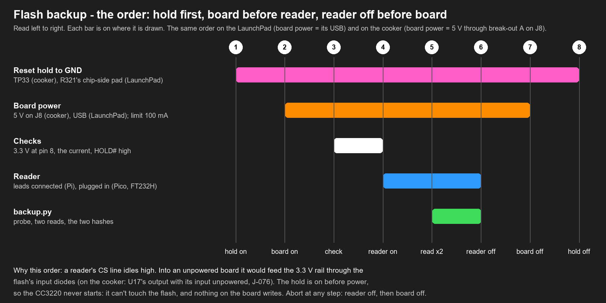

# Flash backup by clip: the handbook

**What this is.** The step-by-step procedure for backing up the cooker's serial flash (U15, 8 MiB) **in circuit,
without desoldering**: a SOIC-8 clip on U15, the CC3220 held in reset at TP33, the board fed through break-out A on
J8, and a 3.3 V reader (Raspberry Pi, Raspberry Pi Pico, ESP32 or FT232H) running flashrom. Everything is rehearsed first on
the CC3220S LaunchPad, where a mistake costs nothing.

**Why by clip.** A CC3220S in production mode, as the cooker's `likely` is, refuses raw reads through its boot
loader from the first block. The clip bypasses the CC3220 and reads the flash chip itself. **The backup comes
before any other session on the cooker** (rule 1): nothing writes to that flash until two equal reads of it exist,
with a copy off the machine.

## The plan
| Step | Page | Board | What |
|---|---|---|---|
| | [1. The readers](01-readers.md) | | Pi, Pico, ESP32, FT232H: install, wiring, empty test |
| | [2. The clip and the harness](02-clip-and-harness.md) | practice chip | map the clip, build the harness, a first read on a loose spare chip |
| (before 1) | [3. Qualify the clip route](03-launchpad-qualify.md) | LaunchPad, development image | the clip read against the boot loader's read: they must be equal |
| 1 | (private flash-backup page: names the vendor's image and the programming project, not published) (private) | LaunchPad | Anova's 3.3.35 as a production image (a WRITE, behind page 3's backup) |
| 2 | [5. Back up through the clip](05-launchpad-backup.md) | LaunchPad, production | the R321 hold, two reads, and again after re-seating the clip |
| 3 | [6. The files](06-launchpad-files.md) | (offline) | file list, readable files recovered, where the mode is kept |
| 4 | [7. Connect and validate](07-cooker-connect.md) | **cooker** | every connection checked with the meter and photographed before power |
| 5 | [8. Power on, back up, power off](08-cooker-backup.md) | **cooker** | the hold on first, two reads, off again |
| 6 | [9. The flash examined](09-cooker-analysis.md) | (offline) | file list, what the update left, the readable files, the repair decision |
| 7 | [10. The Bluetooth chip](10-cooker-u7.md) | **cooker** | U7's own flash over cJTAG, twice, before the full image's first start reflashes it |

The numbers in the first column are raptox's six steps (2026-11-06). Page 3 was added in front of step 1: once the
LaunchPad runs a production image, its boot loader can no longer read its flash, and the one chance to check the clip
read against an independent read is gone.

## The order

1. **Reset hold on**, before any power: the CC3220 never starts, so nothing on the board can write the flash.
2. **Board power on** (the LaunchPad's USB; the cooker's 5 V through J8, limit 100 mA).
3. **Checks:** 3.3 V on the flash's pin 8, HOLD# high, the current.
4. **Reader on** only now: a reader's CS line idles high and would feed an unpowered board's 3.3 V rail through the
   flash's input diodes (on the cooker: U17's output).
5. **Read**: `tools/flashbackup/backup.py`, two equal reads.
6. **Reader off** before the board.
7. **Board power off.**
8. **Hold off**, clip off.

## Ground rules for these pages
- **Reads only.** `backup.py` can start flashrom only to read or probe ([its README](../../tools/flashbackup/README.md)).
  The one write in this handbook is page 4's, on the LaunchPad, behind page 3's backup.
- **The clip's VCC lead never goes onto a board.** Each board feeds its own flash; only the loose practice chip
  (page 2) takes the reader's 3.3 V.
- **3.3 V readers only.** Not the kit's CH341A: 5 V on its data lines.
- **The reset hold goes on TP33 (cooker) or R321's chip-side pad (LaunchPad), never on R321's other pad**: that one
  is the 3.3 V rail. Page 7 has the meter check that tells them apart.
- **Nothing on the power board, ever.** The cooker's own cable stays out of J8 (rule 3).
- **Two equal reads, then a copy off the machine** (rule 1). `backup.py check` proves each copy.
- **The cooker's dump is a secret**: its cloud identity and, probably, your Wi-Fi profile
  ([page 9](09-cooker-analysis.md#95-handle-it-as-a-secret)).
- **Hands off during a read**: board, probes, clip and leads untouched, photos before and after.
- Any surprise: **reader off, then power off.** A clip read never puts the flash at risk; power and wrong probes do.

## The pictures
| Picture | Shows |
|---|---|
| [fb-reader-pi](../../images/diagrams/fb-reader-pi.png), [fb-reader-pico](../../images/diagrams/fb-reader-pico.png), [fb-reader-esp32](../../images/diagrams/fb-reader-esp32.png), [fb-reader-ft232h](../../images/diagrams/fb-reader-ft232h.png) | the clip's leads to each reader (drawings, `tools/diagrams/clip_wiring.py`) |
| [fb-power-sequence](../../images/diagrams/fb-power-sequence.png) | the order above |
| [fb5-1_launchpad-clip-hold](../../images/annotated/fb5-1_launchpad-clip-hold.jpg) | the LaunchPad: U8, the hold, J9, the RST cap, J13 |
| [fb7-1_cooker-wiring](../../images/annotated/fb7-1_cooker-wiring.jpg) | the cooker: J8 supply, TP33 hold to JP5, the clip on U15, the optional strap |
| [fb7-2_cooker-u15-tp33](../../images/annotated/fb7-2_cooker-u15-tp33.jpg) | the cooker close-up: U15's eight pins, TP33, R321's two pads, C322 |
| [fb10-1_cooker-u7-cjtag](../../images/annotated/fb10-1_cooker-u7-cjtag.jpg) | the cooker's U7: TP13 (TMSC) and TP14 (TCKC), the pins they ring to, the orientation |
| [fb10-2_cooker-wiring](../../images/annotated/fb10-2_cooker-wiring.jpg) | the cooker for page 10: J8 supply, TP33 hold, the two probes, the LaunchPad's GND on break-out A pin 30 |
| [fb10-3_launchpad-xds110](../../images/annotated/fb10-3_launchpad-xds110.jpg) | the LaunchPad: J4 (the beeper reference), the TMS and TCK pins of the jumper column, TP2 GND, the USB |
| [fb10-4_cooker-u7-reset](../../images/annotated/fb10-4_cooker-u7-reset.jpg) | the cooker's U7: its reset (pin 35) and the pad to hold it at, for the CC3220's boot loader |

## Tools
- `tools/espserprog/`: the ESP32 reader's firmware, read-only in itself, its pins hi-Z when idle.
- `tools/flashbackup/backup.py`: flashrom, read-only, until two reads are equal; a manifest per backup; `check` for
  every copy.
- `tools/flashbackup/u7read.py`: the same for U7 over cJTAG, with TI's DSLite in its read-only `memory` mode; the
  CCFG decoded, and the backup compared sector by sector with the two U7 images in hand.
- `tools/sflash/sffs.py`: the CC3220S file system from a dump (list, `--manifest`, `--extract`).
- `tools/sflash/blockdiff.py`: two dumps compared block by block, mapped to files; and the allocation-table bytes
  that tell two groups of dumps apart (the mode).
