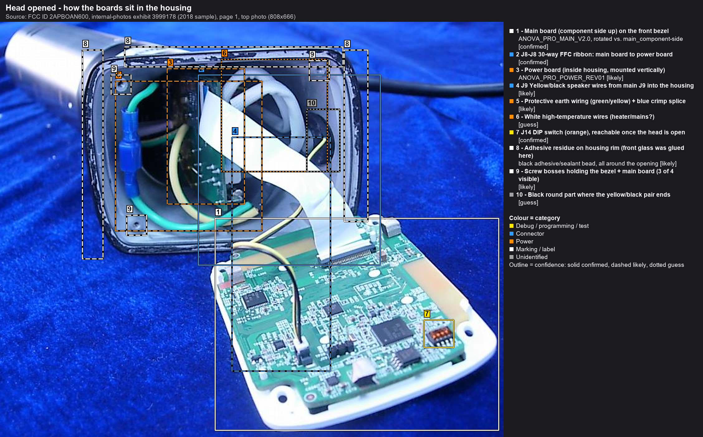
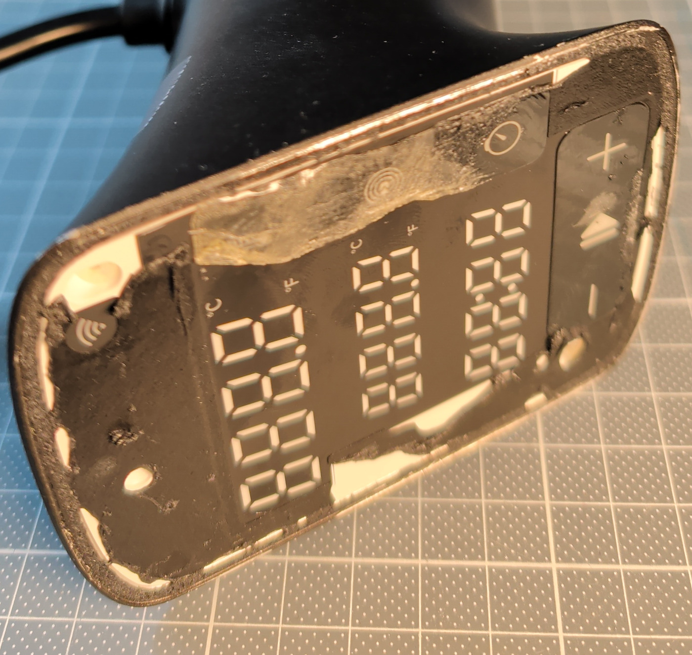
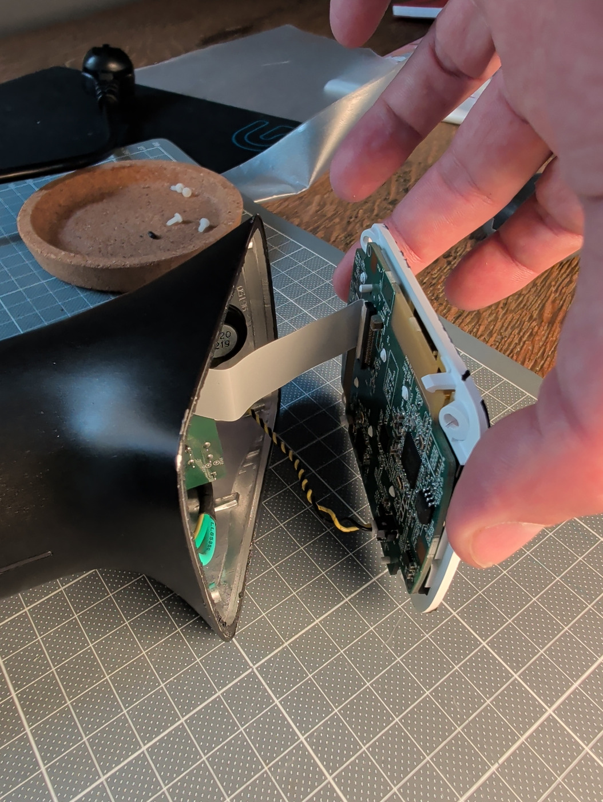

# Disassembly: opening the head

Status: **done on raptox's unit on 2026-11-01**: glass off, 4 screws out, bezel + main board hinged out on the FFC and
speaker wires. Observations are in [raptox's teardown](#raptoxs-teardown-2026-11-01) below. The procedure is based on the FCC
photo plus one community repair report.

*Source: FCC ID 2APBOAN600, internal-photos exhibit 3999178 (2018 sample).*

## raptox's teardown (2026-11-01)
| Glass removed: adhesive residue on the bezel | Bezel + main board lifted out |
|---|---|
|  |  |

- **Adhesive:** a black, crumbly/rubbery bead runs around the edge of the bezel, and a clear glossy patch sits at the top.
  Rubbery residue usually means a foam tape or a sealant bead rather than a hard glue (from photos only, not confirmed).
  Clean it off the bezel and glass completely before resealing.
- The bezel lifts out with **4 white plastic screws** (on the cork tray in the photos). It stays attached by the
  **30-way FFC** and the **twisted yellow/black speaker pair** (J9). There's enough slack to work on the board while hinged.
- **Speaker** confirmed: a round speaker labelled `20 / 219` sits in the housing.
- The power board is visible standing in the tube (test points TP21/TP22 on its top edge), with the green earth crimp next to it.
- The main board is heat-staked to the bezel (6 melted posts). It doesn't need to come off: the whole component side is
  accessible. See [main-board.md](main-board.md).

## How the head is built (front to back)
1. **Black glass front.** It has a black coating on its back side and no wires or ribbons attached. It is **glued to the
   grey housing rim all the way around**. The black adhesive residue on the rim is visible in the FCC photo (callout #8).
2. **White bezel / light guide with the main board.** The board is **heat-staked** to the bezel (melted plastic posts, like rivets),
   and two clips on opposite corners also hold it. The whole bezel assembly is held in the housing by
   **four plastic screws** into the corner bosses (#9; three are visible in the photo).
3. **Housing interior:**
   - the 30-way FFC ribbon (main J8 to power J8)
   - the yellow/black **speaker** wires (main J9)
   - the earth wiring
   - the power board standing vertically in the tube

## Procedure (proposed)
1. **Unplug** the unit and let it cool. Lay the head face-up on a soft surface. Anova's own disassembly article says not to
   jostle the impeller.
2. **Photograph** the unit from all sides before starting.
3. **Remove the glass:** heat, then cut, then lift. Details in [Glass removal](#glass-removal) below.
4. **Lift the glass** evenly once the bond is cut all round. Don't lever against a single point, and don't
   scratch the black coating on the back of the glass.
5. **Remove the four screws** at the bezel corners.
6. **Lift the bezel assembly slowly.** The FFC and speaker wires are still attached, so let it hinge out like in the FCC photo.
   - **Before touching anything:** photograph the component side and **record the DIP switch J14 positions**.
   - This side is all we need for Phase 1-3: CC3220S, the U15/U16 flash, J14, J29, J37 and the test points. The board does
     **not** have to come off the bezel.
7. If needed, disconnect the FFC by lifting the **grey latch** on the FPC socket (it should release easily, never pull the ribbon),
   then unplug J9 (speaker).
8. Only if you need the LED side (J38, U18, touch pads): un-stake the board. The community method is to warm each plastic post
   briefly and lift the board. On reassembly, re-soften each post and press it flat. Try to avoid this.

## Glass removal
The adhesive type is **unknown**. The torn black residue in the FCC photo suggests a black tape, PSA or sealant bead.
The approach below works for most types, but is untested on this unit.

**Heat it to soften the bond, then cut it. Don't count on it melting.**
- Tape-type adhesives (PSA, VHB-style) and hot-melt soften a lot at **60-70 °C**.
- Silicone or polyurethane sealants barely soften. They have to be **cut**.

**Equipment:**
- hair dryer or heat gun on its lowest setting, or a heat pad / microwaved rice sock laid on the glass for even heating
- thin plastic opening picks (0.3-0.5 mm)
- scalpel / X-Acto
- optional: 0.1-0.2 mm nylon fishing line or dental floss as a cutting wire
- optional: an IR thermometer
- masking tape

**Steps:**
1. **Check what the cover is made of.** Glass feels cold and hard and resists scratching. Acrylic feels warmer and softer.
   If it is **acrylic, do not use IPA**: alcohol can craze stressed acrylic.
2. **Mask** the grey housing rim with tape to protect it from blade slips.
3. **Heat evenly** around the perimeter: keep the air moving and don't hold it on one spot. Aim for **about 60-70 °C** at the edge
   (hot, but you can still just touch it). **Stay below about 80 °C**: the housing is plastic and the main board sits a few mm
   under the glass. Heat the whole edge, not one corner, to avoid thermal stress in the glass.
4. **Start at a corner.** Slide a thin pick or blade into the joint between glass and rim, flat and parallel to the glass.
   **Limit the depth to a few mm** (mark the blade with tape): the bezel and main board are right underneath.
5. **Work around the perimeter.** Leave picks in the gap behind you so the adhesive can't re-bond, and re-heat whenever it cools.
   - If a gap opens, pull a **cutting wire** (fishing line or floss) through the bond line with a sawing motion.
     This cuts the adhesive without bending the glass.
6. **Solvent, only if needed:** a few drops of **99% isopropyl alcohol** wicked into the cut joint help with tape adhesives.
   Use it sparingly, only at the edge, and only on glass.
   - **Never use acetone or other strong solvents.** They attack the plastic housing, the black coating and the printed logo
     on the back of the glass.
7. Lift only when it's loose all the way round. If it still resists somewhere, keep cutting there.

Things to avoid:
- freezing tricks
- metal tools levering against the glass edge (chips)
- prying the glass up from one point, which bends the glass

## Reassembly
- The community repair resealed the glass with a thin bead of caulk (type not stated).
- During the reverse-engineering phase, expect to reopen the unit several times. Use a temporary hold (tape) and do the
  permanent, steam-resistant seal only at the end. Neutral-cure silicone or a display adhesive are typical choices;
  this is a suggestion, not tested.
- The touch keys sense *through* the glass, so make sure it sits flat and evenly against the bezel.

## Safety
- Never power the unit with the head open and mains connected, with **one deliberate exception**: the single supply
  measurement of [bench-setup step 1a](bench-setup.md#step-1a-measure-the-j8-supply-in-the-cooker-one-time-with-care),
  main-board side only, battery meter, isolation check first. The power board is inside the tube right behind the bezel.
  All other powered tests use a bench supply on the logic rails once J8 is mapped ([recovery-strategy.md](../firmware/recovery-strategy.md)).

## Sources
- Anova Community, "Defective touch sensors and solution" (Precision Cooker Pro repair report):
  <https://community.anovaculinary.com/t/defective-touch-sensors-and-solution/34678>
- Anova support, "How do I disassemble/reassemble my Anova Precision Cooker Pro?" (skirt and end cap only):
  <https://support.anovaculinary.com/hc/en-us/articles/360027636811>
- FCC 2APBOAN600 internal photos, page 1.
