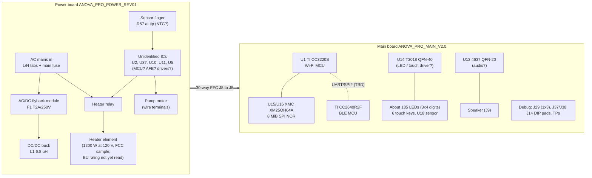

# Hardware overview

Status: **main board confirmed on raptox's unit (2026-11-01); power board still from FCC photos (2018 sample, POWER_REV01)**.
Confidence labels follow [components.md](components.md). Nothing has been measured electrically yet.

## Mechanical layout
- The **head** holds the main board on the back of the front bezel, facing the user through a light guide and a black glass cover.
  See [assembly](../../images/annotated/assembly_open.png).
- The **power board** stands vertically inside the head/tube. Its long PCB finger reaches down into the stainless tube,
  probably carrying the water-temperature sensor.
- A **30-way white FFC ribbon** connects main board J8 to power board J8.
- Other wiring in the head:
  - a yellow/black pair from main J9 into the housing
  - protective earth (green/yellow, blue crimp splice)
  - white high-temperature wires (heater/mains, probable)

## Block diagram (provisional)

Which MCU runs the UI and the cooking control loop, and how the CC3220S and CC2640R2F talk to each other, is
**unknown**. These are the main questions for Phase 1/2.

## Radios (from FCC test reports)
| Radio | Chip | Standard | Antenna | Conducted power |
|---|---|---|---|---|
| Wi-Fi 2.4 GHz | CC3220S | 802.11b/g/n HT20, ch 1-11 | PCB antenna, 2.45 dBi | 32.4 mW (grant) |
| Bluetooth LE | CC2640R2F | BLE 4.2, 1 Mbps GFSK | PCB antenna, 2.21 dBi | 3.5 mW (grant) |

The FCC sample was AN600-10, rated AC 120 V / 60 Hz, 1200 W. Samples were received 2018-08-01.

## Boards
| Board | Photos | Doc |
|---|---|---|
| Main `ANOVA_PRO_MAIN_V2.0` | **raptox's unit:** [component side](../../images/annotated/main_component-side_own.png) · FCC: [component side](../../images/annotated/main_component-side.png), [LED side](../../images/annotated/main_led-side.png) | [main-board.md](main-board.md) |
| Power `ANOVA_PRO_POWER_REV01` | FCC: [top](../../images/annotated/power_top.png), [bottom](../../images/annotated/power_bottom.png) | [power-board.md](power-board.md) |
| Front bezel / light guide | FCC: [back view](../../images/annotated/front_bezel.png) | [main-board.md](main-board.md) (LED / touch side) |

## Biggest open questions
1. ~~Does raptox's AN600-20 use the same board revisions?~~ Main board: same layout, debug parts not fitted. Power board: not checked yet.
2. Which chip(s) did the failed OTA update target: CC3220S app, CC3220 service pack, CC2640R2F, or a power-board MCU?
3. Is there an MCU on the power board (U2 is the candidate)?
4. What is the pinout of the J8 FFC and the debug footprints (J29, J37, J38), and what do the J14 DIP pads connect to?
5. What are U14 (`T3018`) and U13 (`4637`)? (U17 is an onsemi NCP59800 LDO, `likely`: [nets](nets.md#supply).)
6. Which logic rails exist, and are they present on the dead unit? Expected: about 5 V in on J8 pins 1-6, 3.3 V made
   by U17 (`likely`, [nets](nets.md#supply)). Not measured yet.
