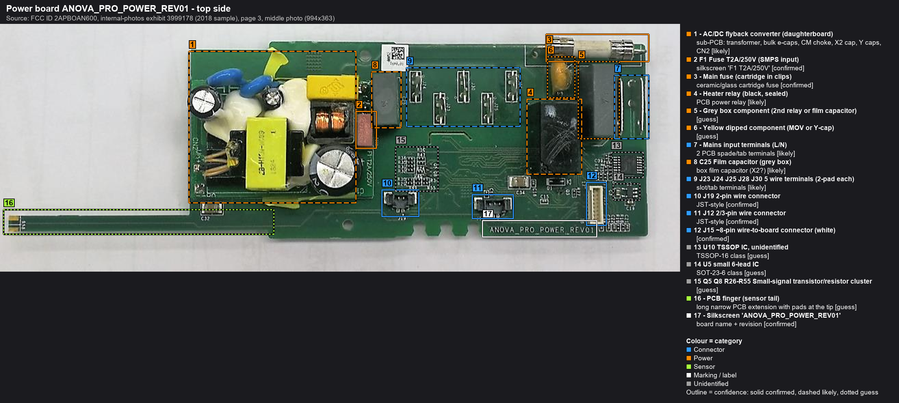
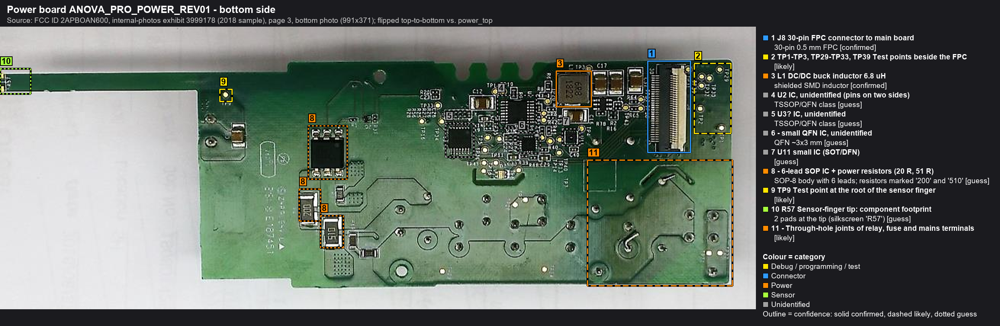

# Power board: `ANOVA_PRO_POWER_REV01`

Source: FCC 2APBOAN600 internal photos (2018 sample). Callout tables: [top](callouts/power_top.md) · [bottom](callouts/power_bottom.md).

> **Mains voltage.** The AC/DC module primary, fuse, relay, mains tabs and their solder joints on the bottom side are at
> line potential. Only work on this board unplugged, and discharge the bulk capacitor before touching it.

## Top side

*Source: FCC ID 2APBOAN600, internal-photos exhibit 3999178 (2018 sample).*

| # | Item | Notes |
|---|---|---|
| 1 | AC/DC flyback **daughterboard** | Transformer, bulk e-caps, CM choke, X2/Y caps, CN2. Output voltage unknown (12 V or 5 V are typical). |
| 2 | **F1 T2A/250V** | Input fuse of the AC/DC module. Check continuity on the dead unit (unplugged). |
| 3 | Main cartridge fuse | Heater path. Rating not legible. |
| 4 | Black sealed relay | Heater switching (likely) |
| 5 | Grey box | Second relay or film cap (guess) |
| 6 | Yellow dipped part | MOV or Y-cap (guess) |
| 7 | Mains tabs (L/N) | |
| 8 | C25 film cap | |
| 9 | J23/J24/J25/J28/J30 | Five 2-pad wire terminals: heater, pump, thermal cut-off, ... (TBD) |
| 10-12 | J19 (2p), J12 (2-3p), J15 (about 8p) | Sensor/motor wiring (TBD) |
| 13-15 | U10 (TSSOP-16), U5 (SOT-23-6), Q5/Q8 cluster | Unidentified. Drivers and sensing (guess). |
| 16 | PCB finger | Reaches into the tube. Probably carries the temperature sensor at its tip. |

## Bottom side (flipped top-to-bottom relative to the top photo)

*Source: FCC ID 2APBOAN600, internal-photos exhibit 3999178 (2018 sample).*

| # | Item | Notes |
|---|---|---|
| 1 | **J8** 30-pin FPC | To main board J8. The logic supply is measured on the main-board side of this ribbon ([bench-setup step 1a](bench-setup.md#step-1a-measure-the-j8-supply-in-the-cooker-one-time-with-care)), never on this board while plugged in. |
| 2 | TP1-3, TP29-33, TP39 | Test points next to the FPC |
| 3 | **L1 6R8** (6.8 uH) + C17/C31 | DC/DC buck, probably the logic rail |
| 4 | **U2** | Biggest IC here, marking illegible. **If this is an MCU, it has firmware too.** |
| 5-7 | U3?, small QFN, U11 | Unidentified |
| 8 | 6-lead SOP + 20 R / 51 R power resistors | High-voltage part (offline regulator / driver?) under the AC/DC area |
| 9 | TP9 | Root of the sensor finger |
| 10 | R57 at the finger tip | Temperature-sensor position (guess) |
| 11 | Relay/fuse/mains solder joints | **Mains** |

## Open questions
- [ ] AC/DC output voltage, and does it come up on the dead unit? (Measured at main-board J8 per bench-setup step 1a;
      nothing on this board is probed while plugged in.)
- [ ] Identify U2: MCU or not? Is there a debug or programming footprint on this board?
- [ ] What is the temperature sensor (NTC, RTD, digital)? Where is the pump driver?
- [ ] Wire-terminal assignment (J23-J30, J12, J15, J19).
- [ ] J8 FFC pinout (main to power).
