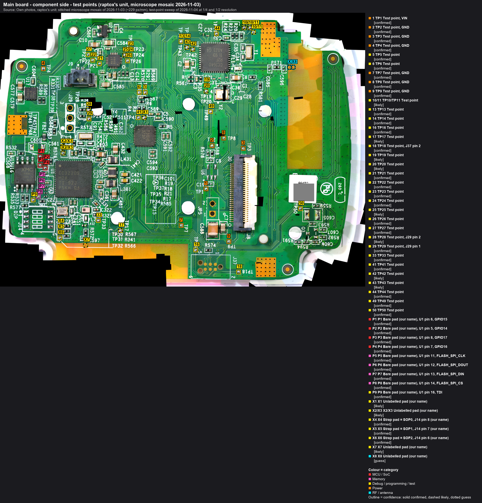

# Test points: main board

Every test point on the main board's component side, so that each one can be measured and given a net. A row counts
as `confirmed` only when a measurement names both ends: the pad and a known net or chip pin. Until then the net columns
stay empty. Other nets are in [nets.md](nets.md), the 30-pin connector in [j8.md](j8.md).

Callout table: [callouts/main_testpoints_micro.md](callouts/main_testpoints_micro.md). The boxes carry the TP number;
P1-P9 and X1-X8 are this project's names for pads without a printed label.

## What the sweep found (2026-11-04)
A sweep of the whole 2026-11-03 mosaic at quarter resolution, with the unclear spots at half resolution:
- **34 labelled test points with their pad:** TP1-TP11, TP13, TP14, TP16-TP29, TP33, TP41-TP44, TP49, TP50. They are
  tinned round pads of about 1 mm, larger than the mask-covered vias.
- **14 TP numbers printed only in a legend:** TP15, TP30-TP32, TP34-TP39, TP45-TP48, with no pad beside the label.
  Like the other boxed lists (R20/R23/R24, R569/R291/R570/C14/C13), these name parts that are too crowded to label in
  place. The TP15/TP34-TP37 box also lists R17-R19, R21, R585 and C101 and carries a circled `A`.
- **Not found:** TP12 and TP40.
- **16 tinned pads without a label:** P1-P9 between U15 and U1 (nets.md), X1 beside TP41, X2/X3 by R576, X4-X6
  beside J14, and the third pad at TP10/TP11. Plus X7, a small gold ring pad on the bottom copper strip, and X8, two
  linked gold pads at the antenna area.
- `guess`: **16 unlabelled pads against 16 TP numbers without a pad**, so all of TP1-TP50 are probably on this side,
  and the legends belong to the unlabelled pads. The meter decides which is which.
- **The LED side** (FCC photo only, 720 px): no TP labels legible. A few tinned pads are visible: a column of three on
  the right, a round and a square pad beside the `ANOVA PRO MAIN V2.0` text, and pads at both copper strips. Our own
  scan of that side waits for the board to come off the bezel (raptox's decision).

**Positions** are in the board frame of [main-board.md](main-board.md#mechanics) (origin = centre of FID1, x to the right,
y down, mm), read from the mosaic at quarter resolution: about ±0.3 mm. Negative y is above FID1, toward the board's
top edge.

## Measured so far
Beeper, main board unpowered, 2026-11-05 (raptox). Each result is also in its inventory row below.

| Pad | Result |
|---|---|
| TP1 | **VIN_J8**: rings to JP5 pin 1 |
| TP2, TP3, TP4, TP7, TP8, TP9 | **GND**: ring to JP5 pin 2. Their short beep against JP5 pin 1 is C588/C7 charging |
| TP13 | rings to **no J8 pin**, so J8 pins 8, 13 and 14 end elsewhere in U7's corner |
| TP18 | **J37 pin 2**, the Tag-Connect footprint's data line if it has the usual pinout, `guess` |
| TP28, TP29 | **J29 pins 2 and 1**; J29 pin 3 is GND. J29 looks like a UART header (TX, RX, GND), `likely`. From the holes: **192 kΩ to U1 pin 57 (hole 2) and pin 55 (hole 1)**, open across |
| X4, X5, X6 | **U1 pins 35, 34, 21: SOP0, SOP1, SOP2**, pulled down with **100 kΩ, 100 kΩ, 2.68 kΩ**. The empty switch J14's strap pads, on its pins 8, 7, 6 (which to which from the mosaic, `likely`), each with a cap to GND |
| P1, P2, P3, P4 | **U1 pins 6, 5, 8, 7**: GPIO15, GPIO14, GPIO17, GPIO16, together the GSPI port |
| P5, P6, P7, P8 | **U1 pins 11, 12, 13, 14**: the flash bus, CLK, DOUT, DIN, CS. At the flash end P5, P6, P7 and P8 ring to U15 pins 6, 5, 2 and 1 |
| P9 | **U1 pin 16, TDI**, muxable as GPIO23 or UART1_TX |

- `guess`: TP1's strip starts at pin 1 of the empty U6 and U6's pad 2 is on GND, the usual SOT-23-5 regulator
  pinout, so U6 is probably an unfitted regulator fed from VIN.
- Open: a pad reported as "TP15" has no pad on this map, only a legend entry; probably TP14, to confirm.

## J14 strap pads: X4, X5, X6
J14 is the empty 4-way DIP-switch footprint below U1 (a switch is fitted on the FCC sample). X4, X5 and X6 are the
three tinned pads in a column right of it, under the `Y3` label, inside a silkscreen bracket. Measured by raptox on
2026-11-05 (beeper, unpowered); the routes are from the mosaic. The pads to U1: ; their pull-downs:
.

| J14 pin | Position | Joined by the switch to | Pad | Beyond the pad |
|---|---|---|---|---|
| 1, 2, 3 | 1, 2, 3 | pins 8, 7, 6 | none | one net, the common side (measured), with R577's right end; **270 Ω to 3V3** (U15 pin 8, measured), so R577 is the feed (`likely`); not on VIN |
| 8 | 1 | pin 1 | **X4** (top) | **U1 pin 35, SOP0**, 100 kΩ to GND (measured); a cap to GND: the top part of the C231 box |
| 7 | 2 | pin 2 | **X5** (middle) | **U1 pin 34, SOP1**, 100 kΩ to GND (measured); a cap to GND: the middle part of the box |
| 6 | 3 | pin 3 | **X6** (bottom) | **U1 pin 21, SOP2**, 2.68 kΩ to GND (measured); a cap to GND: the bottom part of the box |
| 4, 5 | 4 | each other | none | not connected (measured) |

- **Numbering:** pin 1 is the pad by the printed dot, at the top of the left row. The left row runs 1-4 down, the
  right row 5-8 up, and a switch position joins pin n to pin 9 − n.
- **Measured:** pins 1-3 are one net; pins 4 and 5 connect to nothing; pins 6, 7 and 8 each ring to their own X pad;
  each X pad has a cap to GND; **X4, X5 and X6 ring to U1 pins 35, 34 and 21**. **From the mosaic**
  (`likely`): which pin goes to which pad, from three parallel top-layer traces that can't cross.
- **What they are:** the CC3220's boot-mode straps, `confirmed` for the pads: **X4 = SOP0, X5 = SOP1, X6 = SOP2**.
  Through the mosaic's pin-to-pad order the switch positions 1, 2, 3 are SOP0, SOP1, SOP2 (`likely`), each pulled
  high from the common side when closed. **The UARTLOAD strap (SOP2) goes on X6.**
- **Pull-downs** (measured): X4 100 kΩ, X5 100 kΩ, X6 2.68 kΩ to GND, the values SWAS035C recommends for
  SOP0/SOP1 and SOP2. A 470 Ω strap from 3.3 V onto X6 gives about 2.81 V, above VIH (min 2.15 V at 3.3 V).
- **The common side** (measured): J14 pin 1 reads 270 Ω to 3V3 (U15 pin 8); to GND and to VIN (JP5 pin 1) it
  reads tens to hundreds of kΩ, changing with lead polarity: the rail's load seen through the 270 Ω. So the switch
  pulls a strap to 3.3 V, never to 5 V: a closed position 3 would put about 3.0 V on SOP2.
- **Next** (unpowered, [handbook chapter 1](../recovery/01-meter-checks.md)): diode mode, pad to GND, both ways.

  Where to touch U1's pins: [bench setup](bench-setup.md#j14-empty-dip-switch-footprint), step 4.
- **Never pull X4 and X5 (SOP0 and SOP1) high together before the flash dump.** SOP 011 is RET_FACTORY_IMAGE, which
  rewrites the flash.

## Inventory
Identity is the label-to-pad match: `confirmed` where the printed label sits beside that one pad. The measurement
columns fill in as the meter gets there:
- **GND / 3V3 / VIN:** resistance or the beeper to GND (U15 pin 4 or JP5 pin 2, one net: ), to 3V3 (U15
  pin 8) and to VIN (JP5 pin 1). A short beep that dies is the supply caps charging, not a path.
- **Diode:** diode mode with the red lead on the pad, then the black lead; a 0.4-0.7 V drop in one direction means a
  chip pin's protection diode.
- **Net:** the named net or chip pin the pad rings through to.

| Pad | x mm | y mm | Identity | Beside / note | GND | 3V3 | VIN | Diode +/- | Net | Net conf. | Evidence |
|---|---|---|---|---|---|---|---|---|---|---|---|
| TP1 | 46.7 | 31.0 | `confirmed` (label) | left of JP5, below C19. **First hop** (mosaic, `likely`): its own top-layer strip, from pin 1 of the empty U6 footprint (the pad by the dot) past the empty C19 and down the left of JP5 toward C588. A bare gap separates it from JP5 pin 1 (VIN) and pin 2 (GND) copper on the top layer, so it joins VIN on another layer or at its unresolved lower end by C588 | | | beep (JP5 pin 1) | | VIN_J8 | `confirmed` | beeper, unpowered, 2026-11-05 |
| TP2 | 48.2 | 20.1 | `confirmed` (label) | below its label, between U6 and R578; on the GND strip past U6 | beep (JP5 pin 2) | | | | GND | `confirmed` | beeper, unpowered, 2026-11-05 |
| TP3 | 56.1 | 20.7 | `confirmed` (label) | above J8's pin-30 end | beep (JP5 pin 2) | | short beep only (caps charging) | | GND | `confirmed` | beeper, unpowered, 2026-11-05 |
| TP4 | 5.5 | 0.6 | `confirmed` (label) | beside C604, above U17 | beep (JP5 pin 2) | | short beep only (caps charging) | | GND | `confirmed` | beeper, unpowered, 2026-11-05 |
| TP5 | 31.3 | 6.6 | `confirmed` (label) | above C587/R6 | | | | | | | |
| TP6 | 29.8 | 6.6 | `confirmed` (label) | above C587/R6, left of TP5 | | | | | | | |
| TP7 | 40.4 | 40.3 | `confirmed` (label) | left of C588, below heat stake 5 | beep (JP5 pin 2) | | short beep only (caps charging) | | GND | `confirmed` | beeper, unpowered, 2026-11-05 |
| TP8 | 51.1 | 18.1 | `confirmed` (label) | left of its label, above U6 | beep (JP5 pin 2) | | short beep only (caps charging) | | GND | `confirmed` | beeper, unpowered, 2026-11-05 |
| TP9 | 52.4 | 44.4 | `confirmed` (label) | below J8's pin-1 end (label upside down) | beep (JP5 pin 2) | | short beep only (caps charging) | | GND | `confirmed` | beeper, unpowered, 2026-11-05 |
| TP10/TP11 (a) | 56.3 | -9.7 | `likely` | top edge, right of R20/R23/R24. Two labels, three pads: which is which is open. The third pad may be TP12 or another unlabelled TP (guess). | | | | | | | |
| TP10/TP11 (b) | 57.8 | -9.7 | `likely` | top edge, right of R20/R23/R24 | | | | | | | |
| TP10/TP11 (c) | 58.7 | -8.7 | `likely` | top edge, right of R20/R23/R24 | | | | | | | |
| TP13 | 40.4 | -6.3 | `confirmed` (label) | left of U7, under its label. The bundle carrying J8 pins 8, 13 and 14 arrives at this group, but TP13 rings to no J8 pin. **Traced on the mosaic to U7 pin 24, JTAG_TMSC**: the cJTAG data line, [flash backup page 10](../flashbackup/10-cooker-u7.md) | | | | | U7.24 TMSC; not J8 | `confirmed` | beeper to U7 pin 24: beep; to TP14 and GND: none (raptox, 2026-11-06); mosaic trace + SWRS204C pinout; beeper to the J8 header: none (raptox), 2026-11-05 |
| TP14 | 41.8 | -6.3 | `confirmed` (label) | left of U7, under its label. **Traced on the mosaic to U7 pin 25, JTAG_TCKC**, the cJTAG clock; a second trace leaves it down-left (where to: open; the bundle carrying J8 pins 8, 13 and 14 arrives at this group) | | | | | U7.25 TCKC | `confirmed` | beeper to U7 pin 25: beep; U7 pin 25 to GND: none (raptox, 2026-11-06); mosaic trace + SWRS204C pinout |
| TP16 | 44.1 | 46.5 | `confirmed` (label) | above J37, left of R574 | | | | | | | |
| TP17 | 25.0 | 41.5 | `likely` | beside its label; the TP30-TP32 legend sits just below | | | | | | | |
| TP18 | 54.9 | 52.1 | `confirmed` (label) | right of J37. If J37 has the usual Tag-Connect pinout, pin 2 is SWDIO/TMS (TMSC on U7), `guess` | | | | | J37 pin 2 | `confirmed` | beeper (raptox), 2026-11-05 |
| TP19 | 46.7 | 4.8 | `likely` | upper of two pads left of Y2. Labels TP19 and TP20 are stacked below both pads, in the same order (likely). | | | | | | | |
| TP20 | 46.7 | 6.3 | `likely` | lower of two pads left of Y2 | | | | | | | |
| TP21 | 19.7 | -0.6 | `confirmed` (label) | left of U13 | | | | | | | |
| TP22 | 18.0 | -1.6 | `confirmed` (label) | left of U13 | | | | | | | |
| TP23 | 27.4 | -4.4 | `confirmed` (label) | right of U13 | | | | | | | |
| TP24 | 27.4 | -2.9 | `confirmed` (label) | right of U13 | | | | | | | |
| TP25 | 26.1 | -2.9 | `likely` | right of U13; its label points at it with a stroke | | | | | | | |
| TP26 | 26.8 | -1.4 | `confirmed` (label) | right of U13 | | | | | | | |
| TP27 | 16.8 | -3.0 | `confirmed` (label) | left of U13, by C582 | | | | | | | |
| TP28 | 16.9 | 11.0 | `likely` | right of J29, by R57x | | | | | J29 pin 2; 192 kΩ to U1 pin 57 (from the hole) | `confirmed` | beeper, ohms (raptox), 2026-11-05 |
| TP29 | 17.0 | 13.3 | `confirmed` (label) | right of J29 | | | | | J29 pin 1; 192 kΩ to U1 pin 55 (from the hole) | `confirmed` | beeper, ohms (raptox), 2026-11-05 |
| TP33 | 19.4 | 39.0 | `confirmed` (label) | by FL2 / R321 | | | | | | | |
| TP41 | 29.5 | 13.0 | `confirmed` (label) | left of R4/R3, above U14 | | | | | | | |
| TP42 | 43.3 | -4.3 | `likely` | left of U7, above its label. **Traced on the mosaic to U7 pin 27, DIO_17/JTAG_TDI** | | | | | U7.27 TDI | `likely` | mosaic trace + SWRS204C pinout |
| TP43 | 41.8 | -4.8 | `likely` | left of U7, right of its label. **Traced on the mosaic to U7 pin 26, DIO_16/JTAG_TDO**; a second trace leaves it down-left (where to: open's bundle?) | | | | | U7.26 TDO | `likely` | mosaic trace + SWRS204C pinout |
| TP44 | 49.3 | -8.2 | `confirmed` (label) | above U7; a trace to one of U7's top-row middle pins (a DIO), not traced exactly | | | | | | | |
| TP49 | 47.8 | 11.4 | `confirmed` (label) | above U6, left of Y2's corner | | | | | | | |
| TP50 | 70.6 | 36.0 | `confirmed` (label) | by Q3 / C605 | | | | | | | |
| P1 | 4.7 | 22.9 | no refdes | between U15 and U1. see nets.md | | | | | U1 pin 6 (GPIO15) | `confirmed` | beeper (raptox), 2026-11-05 |
| P2 | 6.0 | 24.3 | no refdes | between U15 and U1. see nets.md | | | | | U1 pin 5 (GPIO14) | `confirmed` | beeper (raptox), 2026-11-05 |
| P3 | 4.7 | 25.0 | no refdes | between U15 and U1. see nets.md | | | | | U1 pin 8 (GPIO17) | `confirmed` | beeper (raptox), 2026-11-05 |
| P4 | 6.0 | 25.7 | no refdes | between U15 and U1. see nets.md | | | | | U1 pin 7 (GPIO16) | `confirmed` | beeper (raptox), 2026-11-05 |
| P5 | 4.8 | 28.8 | no refdes | between U15 and U1. see nets.md | | | | | U1 pin 11 (FLASH_SPI_CLK), U15 pin 6 (CLK) | `confirmed` | beeper (raptox), 2026-11-05 |
| P6 | 4.8 | 30.3 | no refdes | between U15 and U1. see nets.md | | | | | U1 pin 12 (FLASH_SPI_DOUT), U15 pin 5 (DI) | `confirmed` | beeper (raptox), 2026-11-05 |
| P7 | 4.7 | 31.8 | no refdes | between U15 and U1. see nets.md | | | | | U1 pin 13 (FLASH_SPI_DIN), U15 pin 2 (DO) | `confirmed` | beeper (raptox), 2026-11-05 |
| P8 | 4.2 | 33.1 | no refdes | between U15 and U1. see nets.md | | | | | U1 pin 14 (FLASH_SPI_CS), U15 pin 1 (CS#) | `confirmed` | beeper (raptox), 2026-11-05 |
| P9 | 2.9 | 33.8 | no refdes | between U15 and U1. On the top layer its one trace heads toward J14 and is lost under J14's outline; the join to U1 is on another layer | | | | | U1 pin 16 (TDI) | `confirmed` | beeper (raptox), 2026-11-05; pin number against SWAS035C figure 7-1 |
| X1 | 31.0 | 13.0 | no label | beside TP41. Unlabelled; TP40 is the obvious guess. | | | | | | | |
| X2/X3 (a) | 10.4 | 20.3 | no label | by R576 / C561, left of U1. Unlabelled pair. | | | | | | | |
| X2/X3 (b) | 10.5 | 21.9 | no label | by R576 / C561, left of U1 | | | | | | | |
| X4 | 9.7 | 40.5 | no label; J14 strap pad, **SOP0** | top of the column right of J14, by Y3, inside a silkscreen bracket. Stub to the top part of the C231 box | 100 kΩ, cap (raptox) | | | | U1 pin 35 (SOP0); J14 pin 8 | `confirmed` (U1 pin 35; a J14 pin), `likely` (which J14 pin) | beeper, ohms (raptox) and mosaic, 2026-11-05 |
| X5 | 9.7 | 42.0 | no label; J14 strap pad, **SOP1** | middle of the column right of J14. Stub to the middle part of the C231 box | 100 kΩ, cap (raptox) | | | | U1 pin 34 (SOP1); J14 pin 7 | `confirmed` (U1 pin 34; a J14 pin), `likely` (which J14 pin) | beeper, ohms (raptox) and mosaic, 2026-11-05 |
| X6 | 9.7 | 43.4 | no label; J14 strap pad, **SOP2** | bottom of the column right of J14. Stub to the bottom part of the C231 box | 2.68 kΩ, cap (raptox) | | | | U1 pin 21 (SOP2); J14 pin 6 | `confirmed` (U1 pin 21; a J14 pin), `likely` (which J14 pin) | beeper, ohms (raptox) and mosaic, 2026-11-05 |
| X7 | 16.2 | 45.3 | no label | on the exposed copper strip at the bottom edge. Small ring pad, gold, not tinned. | | | | | | | |
| X8 (a) | 67.8 | 0.2 | no label | two linked gold pads right of R571, at the antenna area. Looks like a solder jumper or RF test pads (guess). | | | | | | | |
| X8 (b) | 68.7 | 0.2 | no label | two linked gold pads right of R571, at the antenna area | | | | | | | |

## Open identities
At half resolution, still to settle by the trace each pad sits on, or by the meter:
- **TP10 / TP11:** two labels and three pads (a, b, c). The upside-down `TP10` spans a and b, and the rotated `TP11`
  sits right of b.
- **TP19 / TP20:** the two labels are stacked below both pads; upper = TP19 is `likely`.
- **TP17:** its label is beside the pad, but the TP30-TP32 legend starts just below it.
- **TP25** (marked by a stroke from its label), **TP28** (label above-left), **TP42 / TP43** (labels beside and below).

## How every row gets to confirmed
1. **Desk, now:** the first hop of each pad's trace on the mosaic (`tools/trace`), where the top layer shows it, gives
   a "probe first" target per pad.
2. **Meter, unpowered:** goes ahead before the dump; raptox started on 2026-11-05. Power-ups still wait
   for it. The setup is the one of , with break-out A on J8.
   1. Each pad to GND, 3V3 and VIN, and diode mode both ways: that sorts supply, ground and signal pads in three
      readings.
   2. Each signal pad against the 17 open J8 header pins (7-9, 12-16, 18, 20, 21, 24-29) with the beeper.
   3. Each signal pad to the chip pin its first hop points to (U1, U7, U13, U14, U15, J14, J29, J37).

   A sweep is fast with the beeper: one probe on the pad, the other along the header.
3. **The legend TPs:** settled by step 2's result together with the legends' resistor lists. For example, the
   TP15/TP34-TP37 box names five resistors next to five TPs; P5-P9 sit beside the flash-bus resistors.
4. **Under power, after the dump:** the DC level of each pad with the main board on JP5, by hand or with the
   [j8probe](../../tools/j8probe/README.md) `aux` setup.
