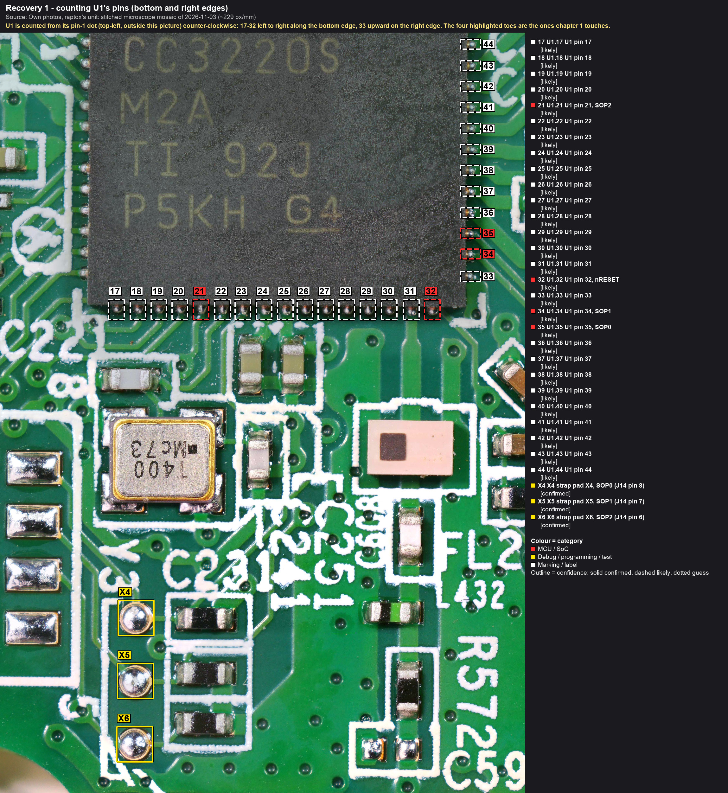
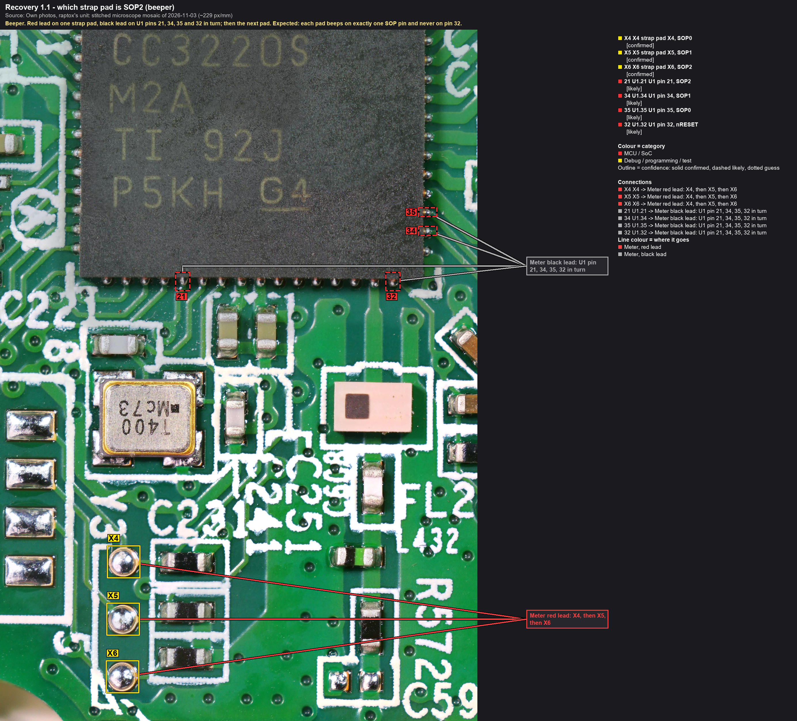
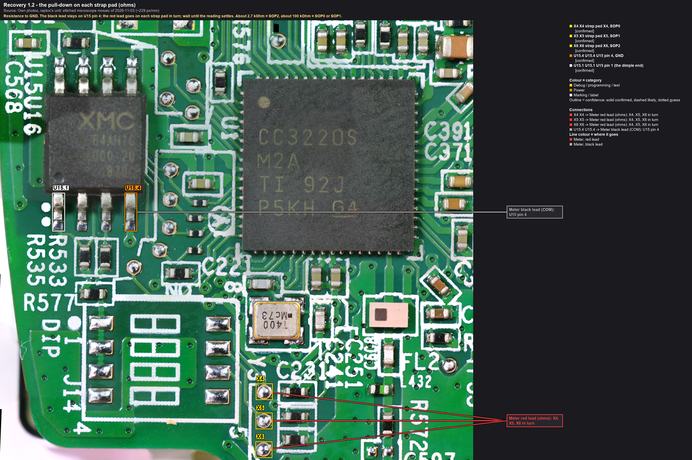
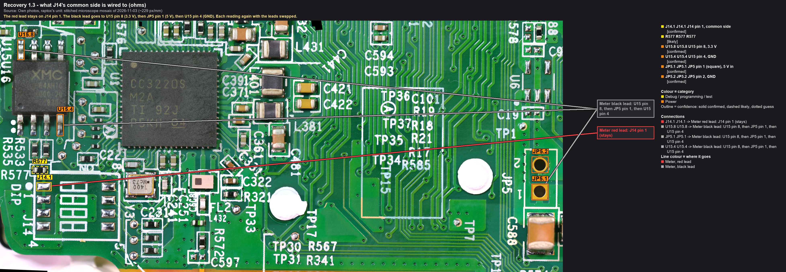
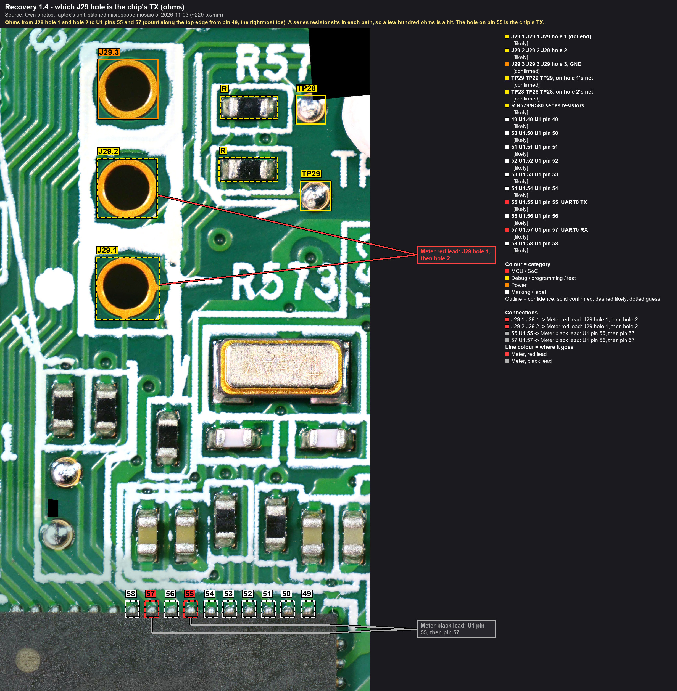
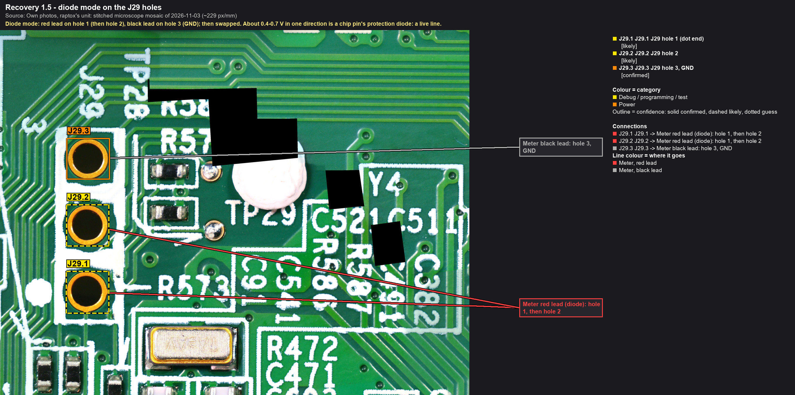
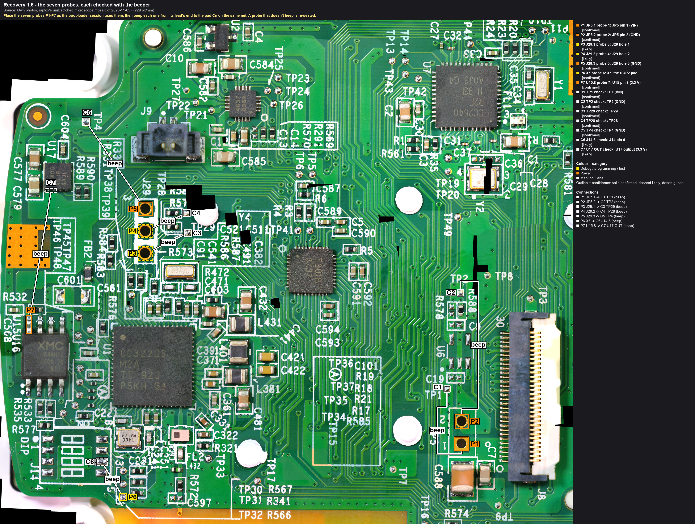

# Chapter 1: meter checks, unpowered

**Purpose.** Before the board is ever powered on the bench, three things must be measured that the pictures can't
show: which of the three strap pads beside J14 is the CC3220's **SOP2** (the boot-mode strap that puts the chip into
its serial boot loader), what the switch footprint's common side is wired to, and which of J29's two signal holes is
the chip's **TX**. Then the seven probe placements are rehearsed and checked with the beeper.

Time: about 30 minutes. Nothing is powered. Nothing is changed on the board.

Every step below opens with its own picture. The boxes carry short labels (`X4`, `21`, `J29.1`, `P3`), and the text
uses the same labels. The panel to the right of each photo says where each meter lead goes.

## Before you start
- The main board on its bezel, on the ESD mat, wrist strap on. The cooker's FFC is out of J8 (the main board is
  alone; break-out A may stay plugged in, its far end free).
- Multimeter with a beeper, resistance ranges and diode mode. Two fine probe tips (the PCBite DMM probes).
- Light and a loupe or the microscope: U1's pins are on a 0.5 mm pitch.
- The sheets to fill: the tables below; the results go to [nets.md](../hardware/nets.md) and
  [testpoints.md](../hardware/testpoints.md) afterwards, and to the journal as a FINDING per item.

## How to touch a CC3220 pin

Callouts: [rec1-0_u1-pin-count](../hardware/callouts/rec1-0_u1-pin-count.md).

U1 is a 64-pin VQFN, 9 mm body, 0.5 mm pitch; the pins are short tinned stubs ("toes") at the package edge. Pin 1 is
at the printed dot at U1's top-left corner (outside this picture), and the count runs counter-clockwise: 1-16 down
the left edge, **17-32 along the bottom edge from left to right**, **33-48 up the right edge**, 49-64 along the top
edge from right to left. The picture numbers every toe from 17 upward; the four that this chapter touches are
highlighted: **21** (SOP2), **32** (nRESET), **34** (SOP1), **35** (SOP0).

Put the needle tip on the toe, outside the body. After each hit, touch the neighbouring toe as well: if the neighbour
rings too, the tip slipped.

## Steps

### 1. The SOP2 pad (beeper)

Callouts: [rec1-1_sop-pads-beeper](../hardware/callouts/rec1-1_sop-pads-beeper.md).

Red lead on strap pad **X4**; black lead on U1 toes **21**, **34**, **35** and **32** in turn. Then the red lead on
**X5**, the four toes again; then **X6**. Twelve combinations. Expected: each pad beeps on exactly one of the three
SOP toes, and none on 32.

| Pad | toe 21, SOP2 | toe 34, SOP1 | toe 35, SOP0 | toe 32, nRESET | Result |
|---|---|---|---|---|---|
| X4 | | | **beep** | | **SOP0** (only the hit was reported) |
| X5 | | **beep** | | | **SOP1** (only the hit was reported) |
| X6 | **beep** | | | | **SOP2** (only the hit was reported) |

**Result (2026-11-05, raptox's beeper, `confirmed`): X4 = SOP0 (pin 35), X5 = SOP1 (pin 34), X6 =
SOP2 (pin 21).** By the mosaic order of , J14 pins 8, 7 and 6 run to X4, X5 and X6 (`likely`), so the switch
positions 1, 2 and 3 would be SOP0, SOP1 and SOP2. **X6 is the SOP2 pad**: the strap goes there in chapter 3.
**X4 and X5** must never be pulled high together before the backup exists: that combination restores the factory
image at the next reset, which rewrites the flash. The pictures of chapters 3 and 5 carry these roles.

### 2. The pull-down fingerprint (ohms)

Callouts: [rec1-2_pulldown-ohms](../hardware/callouts/rec1-2_pulldown-ohms.md).

Resistance range. The black lead stays on **U15.4** (U15 pin 4, GND; **U15.1** marks the chip's pin-1 end so the
right leg is found). The red lead goes on **X4**, **X5**, **X6** in turn. Wait for each reading to settle: the pad's
capacitor charges first. TI recommends about 2.7 kΩ on SOP2 and about 100 kΩ on SOP0 and SOP1 (datasheet SWAS035C),
so the values should sort the pads the same way as step 1. A reading of a few hundred ohms or less means something
else pulls the pad: note it. Record all three values with the range used.

**Result (2026-11-05, raptox's meter, `confirmed`): X4 100 kΩ, X5 100 kΩ, X6 2.68 kΩ** (range not
noted). These are TI's values, sorted the same way as step 1, so X6 is SOP2 by two independent readings. Nothing else
pulls the pads. Chapter 3's 470 Ω strap onto X6 gives about 2.81 V against VIH min 2.15 V (SWAS035C p. 35).

### 3. J14's common side (ohms, both lead polarities)

Callouts: [rec1-3_j14-common](../hardware/callouts/rec1-3_j14-common.md).

J14 pins 1, 2 and 3 are one net with **R577** (measured). The red lead stays on **J14.1**. The black lead goes
on, in turn:
1. **U15.8**, the 3.3 V rail: a few kΩ or less (R577) means the switch would pull a strap up to 3.3 V. That is what
   the 470 Ω strap probe does in chapter 3. Fine.
2. **JP5.1**, the 5 V input: a low reading here means the common side is on 5 V. Then **the switch footprint is never
   jumpered** on this board (the CC3220's pins are not 5 V tolerant), and the strap comes from U15 pin 8 only, as the
   chapters already say.
3. **U15.4**, GND: open, or a high value; a low value is a finding.

Swap the leads for each reading. A value that changes with polarity is a semiconductor in the path, not a resistor.

**Result (2026-11-05, raptox's meter):** J14.1 to **U15.8 270 Ω** (one value reported); to **U15.4
24 kΩ / 42 kΩ** (black / red lead on J14.1); to **JP5.1 0.3 MΩ / 161 kΩ** (black / red lead on J14.1). So the common
side is on 3.3 V through about 270 Ω (R577, `likely`), **not on 5 V**. The GND and VIN readings change with polarity:
that's the rail's own load seen through the 270 Ω, and there's no short on the rail. A closed J14 position would put
about 3.0 V on SOP2. The 470 Ω probe from U15 pin 8 stays the strap in chapter 3.

### 4. J29: which hole is the chip's TX (ohms)

Callouts: [rec1-4_j29-to-u1](../hardware/callouts/rec1-4_j29-to-u1.md).

Resistance range. Red lead on **J29.1**, black lead on U1 toe **55**, then toe **57**. Then the red lead on
**J29.2**, the same two toes. On U1's top edge the count runs from right to left: toe **49** is the rightmost, so
**55 is the 7th from the right and 57 the 9th** (the picture numbers 49-58). Each path has a series resistor
(callout **R**), so a few hundred ohms is a hit and the beeper may stay silent. Datasheet (SWAS035C): pin 55 = GPIO1,
the usual UART0 **TX**; pin 57 = GPIO2, UART0 **RX**. The TI boot loader uses exactly these two in load mode
(`likely`, TI forum, chapter 3).

| Hole | to toe 55 (TX) | to toe 57 (RX) | Result |
|---|---|---|---|
| J29.1 (TP29 net) | **192 kΩ** | open | pin 55 (TX) |
| J29.2 (TP28 net) | open | **192 kΩ** | pin 57 (RX) |

**The hole on pin 55 is the chip's TX**: it goes to the adapter's **RXD** (listening). **The hole on pin 57 is the
chip's RX**: it gets the adapter's **TXD** through 1 kΩ, in the boot-loader sessions only. The wiring pictures of
chapters 3-6 assume hole 1 = TX (dashed lines); if this step finds the opposite, swap the two J29 probes and update
those pictures.

**Result (2026-11-05, raptox's meter, red lead on the hole):** the pairing is the expected one,
hole 1 = pin 55, hole 2 = pin 57 (`likely`), **but each path reads 192 kΩ, not a few hundred ohms.** If that's a
series element, J29 can't carry the boot loader's 921 600 baud (an RC of about 2 µs against a 1.09 µs bit), and a
USB-UART input with a weak pull-up would hold the chip's low at about half the rail. Step 5's diode test argues
against a series element right at the hole: each hole shows a chip junction directly. Also check
under the microscope that the toes touched were 55 and 57. **Chapter 3 waits** for five more unpowered readings:
1. the two 192 kΩ readings with the leads swapped (the same value means a resistor)
2. TP29 to toe 55 and TP28 to toe 57
3. each resistor right of J29 (callout **R**), pad to pad
4. toes 55 and 57 to U15.4 (GND) and to U15.8 (3.3 V)
5. step 5 below, on the holes and on toes 55 and 57

### 5. Diode mode on the J29 holes

Callouts: [rec1-5_j29-diode](../hardware/callouts/rec1-5_j29-diode.md).

Diode mode. Red lead on **J29.1**, black lead on **J29.3** (GND); then the leads swapped. The same for **J29.2**. A
drop of about 0.4-0.7 V in one direction is the chip pin's protection diode: a live line. Open both ways means the
hole reaches nothing; then step 4 can't have found a pin either.

**Result (2026-11-05, raptox's meter):** both holes read **0.7 V** with the red lead on J29.3 (GND)
and **1.5 V** with the leads the other way round. That is a chip pin's signature (`likely`), so each hole is a live
line. **But it doesn't fit step 4's 192 kΩ:** a 0.7 V drop puts the junction directly on the hole's net, so the
192 kΩ can't lie between the hole and that pin. Either another part sits on the hole side and the 192 kΩ lies
beyond it, or step 4's lead wasn't on toes 55/57: toe **56**, between them, is a supply pin (VDD_DIG2, SWAS035C).
Before chapter 3: redo step 4 with the lead's position checked under the microscope (a beep settles it), and take
diode mode on toes 55 and 57 against GND as well.

### 6. The probe contact drill

Callouts: [rec1-6_probe-drill](../hardware/callouts/rec1-6_probe-drill.md).

Place the seven probes **P1-P7** exactly where chapter 3 uses them. Then check each one with the beeper **from the
probe's lead end** (not from its tip) to the pad **Cn** on the same net:

| Probe | On | Beep to | Net |
|---|---|---|---|
| P1 | JP5 pin 1 | C1, TP1 | VIN |
| P2 | JP5 pin 2 | C2, TP2 | GND |
| P3 | J29 hole 1 | C3, TP29 | UART0 |
| P4 | J29 hole 2 | C4, TP28 | UART0 |
| P5 | J29 hole 3 | C5, TP4 | GND |
| P6 | X6, the SOP2 pad (step 1) | C6, J14 pin 6 | SOP2 |
| P7 | U15 pin 8 | C7, U17's output | 3.3 V |

A probe that doesn't ring is re-seated. Note how long the seven placements take: the same drill opens every powered
session.

## Outcomes
| Reading | Means | Next |
|---|---|---|
| each pad rings to one SOP pin, values sort the same way | the straps are mapped (`confirmed`) | chapter 3's strap goes on the SOP2 pad |
| no pad reaches pin 21 | SOP2 is strapped elsewhere (another layer) | the strap goes onto toe 21 with a probe in chapter 3, or the pin is traced first; log it |
| a pad rings to nRESET | one strap is a reset line, not a boot strap | keep it off; map the rest |
| J14's common side is on 5 V | the switch would put 5 V on the straps | never jumper the footprint; the strap source stays U15 pin 8 |
| J29 holes reach neither pin 55 nor 57 | J29 isn't UART0 on the usual pins | the alternatives from the datasheet (TX on 3, 53, 62; RX on 4, 45) are measured next; chapter 3 waits |

## Records
- Journal: one FINDING per step with the readings.
- [nets.md](../hardware/nets.md): new rows SOP2 / SOP1 / SOP0 (pad, pull-down value, U1 pin) and UART0_TX /
  UART0_RX (J29 hole, resistor, U1 pin). [testpoints.md](../hardware/testpoints.md): X4-X6, TP28, TP29 rows become
  `confirmed` with their nets.
- The wiring tables of chapters 3, 4 and 5: the pad and hole names filled in. The annotation files of the pictures
  that assume hole 1 = TX or show all three strap pads get the measured roles, and are re-rendered with
  `py -3.13 tools/annotate.py`.
