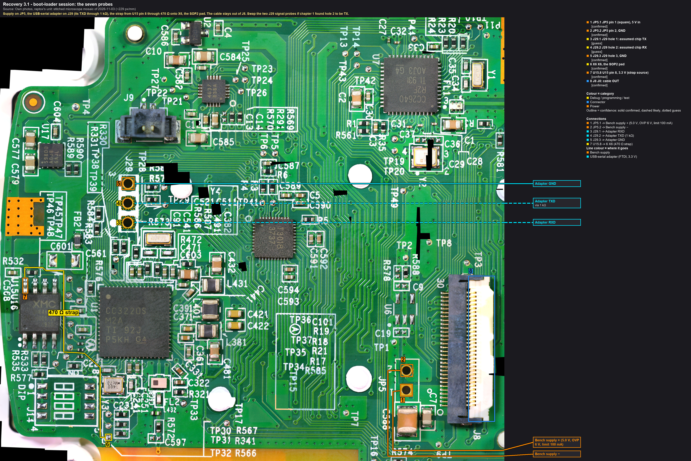
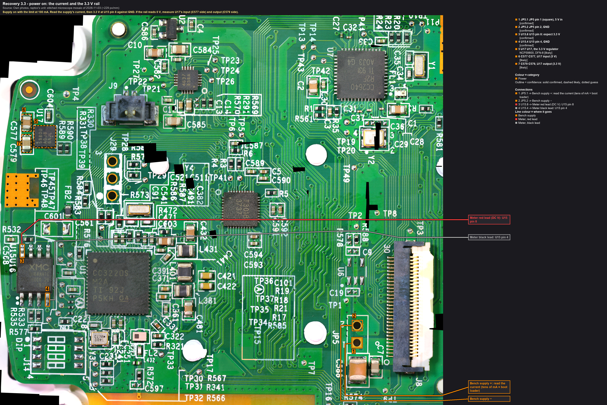
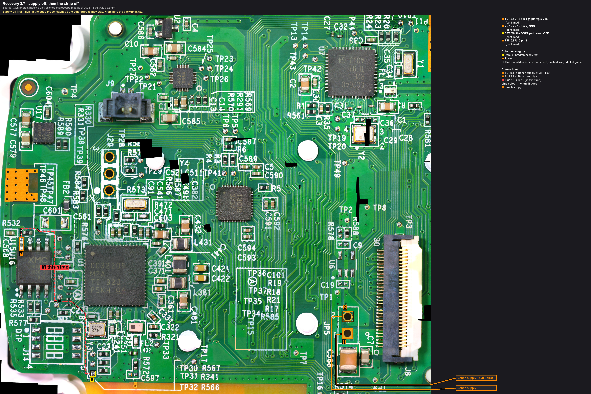

# Chapter 3: the boot-loader session (read-only): the backup, the MAC, the file list

> **Changed on 2026-11-06 by the production twin, before this chapter ever ran.** The rehearsal board
> was given a **production** image, as the cooker's chip `likely` has. With it, the boot loader still answers, still
> reports its versions, and Uniflash still reads the MAC, the mode and the security-alert count. But it **refuses
> every raw read of the flash, every file read by name and every file write**, from the first block, also right
> after a power-up (no security alert from the refusals). So, if the cooker's chip reports production mode:
> - **the backup is not made here.** It is made with the clip on U15 while U1 is held in reset, or with U15 off the
>   board (recovery strategy, step 5, route A), and it comes **before** this chapter;
> - **the file list comes from the backup**, offline (`tools/sflash/sffs.py`), not over the port;
> - **what this chapter still does:** the rail, the version line (proof that U1 and its ROM are alive), and Uniflash's
>   device info: the MAC, **the mode** (production or development) and **the security-alert count and threshold**.
>   Those last two decide whether anything else is attempted here.
>
> Steps 5 and 6 below stay as written for a chip that reports development mode.

**Purpose.** The first time the dead main board is powered on the bench, the CC3220 is held in its ROM **boot
loader** (SOP2 strap high) instead of booting normally. In that mode the chip only waits for commands on its serial
port; its network processor and the application never run, so nothing on the chip can rewrite the flash. The
commands sent are all reads: the version and MAC, the storage size, the file list, and the **raw content of the
whole flash, twice**. Two equal reads are the backup that every later write depends on.

What this session answers, in order: does the 3.3 V rail come up (the regulator and its input); does the CC3220
answer at all (the chip and its ROM are alive); what the file system holds and which file was being written (the
first real evidence about the failed update); and the backup itself.

Gate: chapter 1 done (the SOP2 pad and the J29 TX/RX holes known), chapter 2 steps 2.1-2.4 passed (the raw read
qualified on the LaunchPad, the tool proven on a CC3220S).

## Before you start
- The main board on its bezel, ESD mat and strap. **The cooker's FFC is out of J8** (and stays out; nothing from the
  power board is connected). Break-out A unplugged from J8 as well: nothing hangs on J8 in this session. **Or
  (raptox): the supply through break-out A** on its 100 mm type A cable, which holds better than probes on
  JP5: header pins **1-6 = +** (VIN, U17's input, the JP5 pin 1 net), header pin **30 = −** (GND), every other
  header pin open (J8's signal pins stay as free as with no cable). Before power, unpowered, the beeper: header
  pin 1 to JP5 pin 1, header pin 30 to JP5 pin 2, and header pin 1 **not** to header pin 30 (a reversed cable would
  put the supply on 25-30, J8 pin table).
- Bench supply: 5.0 V set, over-voltage protection at **6 V**, current limit **100 mA**, output **off**. Leads with
  probe-compatible ends.
- The USB-serial adapter (FTDI), I/O jumper on **3.3 V**, on this PC; its COM number known (`uartlog.py --list`).
- Resistors: 1 kΩ (adapter TXD to the board; anything from 470 Ω to 4.7 kΩ does: it only limits what the
  adapter's idle-high line pushes into an unpowered chip, and at 4.7 kΩ with about 20 pF the edges still take under a
  tenth of a 921 600-baud bit), 470 Ω (the strap). Seven PCBite SQ10 probes with leads.
- `tools/cc32xx` ready (the venv per its README); a directory `dumps/cooker/<date>/` outside git; the SHA-256
  commands at hand; a USB stick or the NAS for the off-machine copy.
- The meter for the 3.3 V reading and the beeper drill.
- Optional, for the record: the ESP32 of chapter 4b on **VIN, 3V3 and flash-CS only** (its J29 channels left
  unconnected), logging rail timing and chip-select activity during the session.

## Wiring
| Board point (callout in the step 1 picture) | Through | Instrument | Note |
|---|---|---|---|
| JP5 pin 1 (**1**) | — | bench supply **+** | 5.0 V, OVP 6 V, limit 100 mA. Or break-out A's header pins 1-6 |
| JP5 pin 2 (**2**) | — | bench supply **−** | one ground for everything. Or break-out A's header pin 30 |
| J29 TX hole (**3**, hole 1 assumed; chapter 1 decides) | — | adapter **RXD** | the chip talks here |
| J29 RX hole (**4**) | **1 kΩ** | adapter **TXD** | the tool talks here; the resistor limits what the adapter's idle-high line can push into an unpowered chip |
| J29 hole 3 (**5**) | — | adapter **GND** | |
| **X6**, the SOP2 pad (**6**; measured) | **470 Ω** | from **U15 pin 8** (**7**) | the strap: 3.3 V from the board's own rail, so it rises with the rail and is sampled high at every power-on. **Simpler (raptox): a wire across J14's position 3, pad 3 to pad 6**: the board's own strap circuit, 3.3 V through its 270 Ω common feed (R577), about 3.0 V on SOP2, no extra resistor. Beep pad 6 to X6 once first (pad 6 → X6 is from the mosaic). The DIP switch's position 3 does the same, once fitted (after the backup: no iron next to U15 before it) |
| J8 (**8**) | — | nothing: **cable out**; or break-out A for the supply only | |

Not connected: the adapter's VCC/5V/3V3 pins, DTR, RTS, CTS. Nothing on J8. Nothing on the Bluetooth chip.

## Steps

### 1. Place and check (unpowered)


Callouts: [rec3-1_wiring](../hardware/callouts/rec3-1_wiring.md).

Probes as in the picture and the table: **1** and **2** to the supply, **3**, **4** and **5** to the adapter (the
1 kΩ in the TXD line), the 470 Ω strap from **7** to **6**. The dashed lines are the assumption that hole 1 is the
chip's TX; swap **3** and **4** if chapter 1 found the opposite. Then the beeper drill of
[chapter 1 step 6](01-meter-checks.md#6-the-probe-contact-drill) from every probe's lead end. Confirm by eye: the
cable is out of J8 (**8**); the supply's **+** is on the square pad (**1**), **−** on the round one (**2**); the
strap sits on X6, the SOP2 pad, and nowhere else (never on X4 or X5); the 1 kΩ is in the TXD line. Write the time down.

### 2. Start the tool before power
On the PC; the board stays as in the step 1 picture. Open the command, don't press Enter yet:

```
py -3.13 tools/cc32xx/ccx.py --rom-only -p COM<adapter> --reset prompt
```

`--rom-only`: the tool connects, prints the ROM boot loader's version line and stops. It sends a break and
one version query, nothing else: no switch to the network processor, so that processor never starts (after a
missed break it would boot its own firmware, which writes to the flash), and no upload to RAM. This is the
only boot-loader session before the clip backup; `--cc3220`, `--status` and Uniflash come after it.

Without `--rom-only` the tool would only connect and print the version line too. It opens the port (the adapter's DTR and RTS
go active at that moment, which is why they are wired to nothing), asserts no strap (no `--sop2`: the strap is on
the board), and will ask for a reset: that reset is the power-cycle of step 4. What the tool sends in this
chapter, from its source: a serial break until the ROM acknowledges, the version request, the storage requests,
and raw block reads. The by-name file read of step 6 also opens and closes the file through the ROM, in read mode.
Nothing in the read commands erases or writes.

### 3. Power on (limit 100 mA)


Callouts: [rec3-3_power-on](../hardware/callouts/rec3-3_power-on.md).

Supply output on. Meter on DC volts, red lead on **3** (U15 pin 8), black lead on **4** (U15 pin 4). Read within a
few seconds:
- **the supply's current**: tens of mA is a chip waiting in its boot loader; near the 100 mA limit with the voltage
  folding back is a short or a brown-out loop, so power off and measure;
- **3.3 V at U15 pin 8** (meter): about 3.3 V means U17 regulates; 0 V means the regulator or its input, see the
  outcomes.
Note both in the log.

### 4. Connect
The board as in the step 1 picture; the only action on the bench is the power-cycle at the supply. Press Enter to
start the tool. At its prompt ("Reset the device with SOP2 asserted and press Enter"),
**power-cycle the board** (supply off, two seconds, on) so the chip samples the strap and enters the boot loader,
then press Enter. Expected within a second: the break acknowledged and the **version line**: five groups of four
numbers (boot loader, NWP, a version word, PHY, chip type). That line is the proof that U1 and its ROM are alive.
Save it (the wrapper logs it). The MAC is not in it: it comes from Uniflash's "get device info" (step 6b) or the
home router's client list, and goes into the journal in a private block, never into a public-bound file.

### 5. The backup: read the flash twice
> **Changed by the LaunchPad rehearsal, before this chapter runs:** cc3200tool alone refuses a
> CC3220S ("Unsupported device"); the commands below need the wrapper's `--cc3220`, and both reads go into **one
> session** (`read_flash u15_bl_1.bin read_flash u15_bl_2.bin` after a single power-cycle), since the boot loader
> takes one session per reset. And a session in which the network processor misses every break after the switch
> lets that processor **boot its own firmware, which wrote two blocks of the LaunchPad's flash**. On the cooker that
> would be a write before the backup. The break is now held across the network processor's start-up (: 20 of
> 20 sessions caught on the LaunchPad, a miss stops the run). A missed break rewrites the radio calibration file
> `/tmp/phy.cal`. **On a production-mode chip this step is refused altogether**: see the note at the
> top; the backup is the clip.

On the PC, with a power-cycle at each prompt; the board as in the step 1 picture.

```
py -3.13 tools/cc32xx/ccx.py -p COM<adapter> --reset prompt read_flash dumps/cooker/<date>/u15_bl_1.bin
py -3.13 tools/cc32xx/ccx.py -p COM<adapter> --reset prompt read_flash dumps/cooker/<date>/u15_bl_2.bin
```
Each run asks for its reset: power-cycle at the prompt, Enter. Each run also reads the flash a second time by itself
to verify, so a run that ends without a verify error is already two consistent reads; the two files are the two
independent reads rule 1 asks for. Expect 8 MiB per file (the tool reads as many blocks as the ROM's storage info
reports; chapter 2 showed what a CC3220S reports). Then:

```
sha256sum dumps/cooker/<date>/u15_bl_1.bin dumps/cooker/<date>/u15_bl_2.bin
```
**Equal** → the backup exists. Copy both files and the hashes off the machine now. Unequal → a third read; two
equal ones out of three are the backup, the odd one and the link are the finding (a loose probe, a baud problem).

### 6. The file list and the readable files
On the PC; the board as in the step 1 picture. First offline, from the backup, with the port closed:
```
py -3.13 tools/cc32xx/ccx.py -if dumps/cooker/<date>/u15_bl_1.bin -d cc32xx list_filesystem --extended --json-output
py -3.13 tools/cc32xx/ccx.py -if dumps/cooker/<date>/u15_bl_1.bin -d cc32xx list_filesystem --inactive --extended
```
The file list is the first evidence: which files exist, their sizes and flags, which have an inactive (fail-safe)
copy, which is marked pending. On a CC3220S the allocation table may be encrypted (TI; chapter 2 tells), in which
case the listing fails or is garbage: then the file names known from the firmware image are asked for one by one.
Over the port, by name (development mode only: a production-mode boot loader refuses file info/, and
the dump gives the same files offline), **only plain files, never a secure one**: on the LaunchPad the boot loader
handed plain files out decrypted, but asking for a secure file without its token raised a **security alert**, and
at the threshold (three by default, TI SWRU455M section 8.14) the chip locks. The cooker's threshold and its current
count are unknown. `ccx.py` refuses the known secure names (`/sys/mcuimg.bin`, `/sys/servicepack.ucf`,
`/sys/certstore.lst`, `/sys/factory.img`, anything the update manifest marks secured). Never ask for a name whose
type is unknown. One session, after the backup of step 5:
```
py -3.13 tools/cc32xx/ccx.py --cc3220 -p COM<adapter> --reset none read_file /sys/upgrade_state.bin dumps/cooker/<date>/files/upgrade_state.bin read_file /sys/cc2640.bin dumps/cooker/<date>/files/cc2640.bin
```
`/sys/upgrade_state.bin` is the application's own record of an update (; `00 00` on the LaunchPad with none
pending): on this unit it may say where the 28 Oct update stopped. The Bluetooth image's hash against the
package's copy is a check on the Bluetooth leg. Whether a production-mode chip hands out files by name at all is
unknown (`unverified`); a refusal is a result, not a reason to try other names. Uniflash's device file browser
(development mode only) is no option on the cooker.

### 6b. The MAC (Uniflash)
> **Checked on the LaunchPad:** Uniflash's connect and "get device info" wrote nothing to its flash (a read
> before and after are identical). That LaunchPad's chip is in development mode, the cooker's in production mode,
> so the same behaviour there is `likely`, not proven. This step stays **after** the backup of step 5.
> **On a production image too:** device info works and shows "Current Mode" and the alert count; it is the
> one thing this chapter still reads on a production-mode chip.

On the PC; the board as in the step 1 picture. Uniflash doesn't need TI's debug probe: given a serial port, its
Image Creator asks for the reset itself ("Please power off the device", Enter, "Please power on the device") and
holds the break until the boot loader answers. From its command line, after a power-cycle:
```
dslite.bat --mode cc32xx device info --port COM<adapter> --json
```
It gives the MAC and the device type, but not the mode or the alerts. The whole of Uniflash's "Device status"
panel comes from one session of the project's own client after a power-cycle:
```
py -3.13 tools/cc32xx/ccx.py --cc3220 --status -p COM<adapter> --reset none
```
three reads (the flash's storage info, the default MAC, TI's file-system usage): the device type, the MAC, the
hardware version, **the mode**, the capacities, the free space, the flash's ID bytes and **the security-alert count and
threshold**. Record them all (the MAC in a private block). Nothing else in Uniflash is touched (no Program, no Format, no restore). Rehearsed through the same adapter on the LaunchPad first (chapter 2,
step 2.10). If Uniflash can't connect through a plain adapter, the router's client list is the other source of the MAC.

### 7. Power off, strap off


Callouts: [rec3-7_strap-off](../hardware/callouts/rec3-7_strap-off.md).

Supply off, then the strap probe lifted (the dashed line from **7** to **6**). The adapter may stay. The board is now backed up and the rule-1 gate is
open for the CC3220 flash. Nothing else is written in this chapter.

## Outcomes
| Reading | Means | Next |
|---|---|---|
| no 3.3 V at U15 pin 8, current near zero | U17 not regulating or its input missing | measure U17 IN (C577's pad), OUT (C579's pad) and EN; stop, finding |
| current at the limit, voltage folds back | a short on a rail | power off, ohms VIN and 3V3 to GND; stop, finding |
| 3.3 V present, no acknowledgement of the break | the chip isn't in the boot loader | swap the TX/RX holes; check the strap level (meter on the pad with power on: about 3.3 V); try the strap on U1 pin 21's toe; retry; then it is the chip or its clock |
| version line received | **U1 and its ROM are alive**; the power path works | the backup, then the file list decides the next chapter |
| file list complete, one file pending or missing its active copy | the file system survived, the update left a file half done | chapter 5 option A on that file, after the rehearsal |
| file list unreadable (encrypted table) but by-name reads answer | the file system is intact and secure; the ROM still serves files | the by-name results decide: a refused or short application image is the lead |
| by-name reads fail for every file, storage info odd | the file system's structure is damaged | the raw backup still exists; chapter 5 options B/C |
| the two raw reads differ | link problem or something still writing | third read; check the probes and the baud; the boot loader itself shouldn't write |

## Records
- Journal: ACTION (the first bench power-up: wiring, readings, time), FINDING (rail, current, version line with the
  MAC in a private block, the file list and what it says), ACTION (the backup: both file names, sizes, SHA-256, where
  the off-machine copy went). The journal's WRITE entries of chapter 5 cite this backup's hash.
- Timeline: one neutral line (the Wi-Fi chip answers / doesn't; the flash is backed up).
- `mkdocs.yml` status line.
- [nets.md](../hardware/nets.md): the 3.3 V rail row becomes measured.
