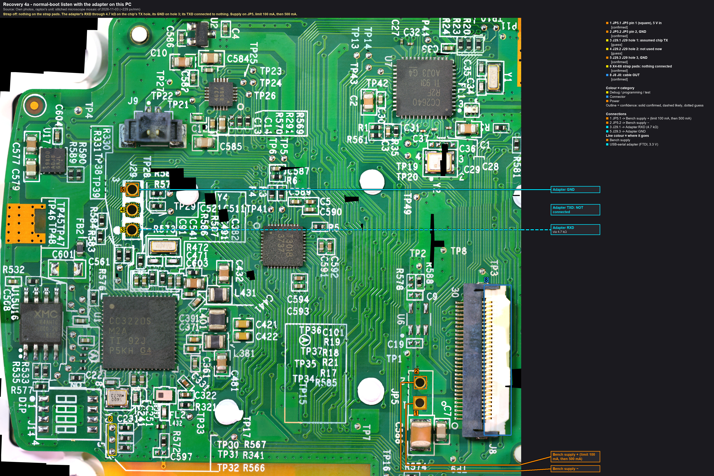
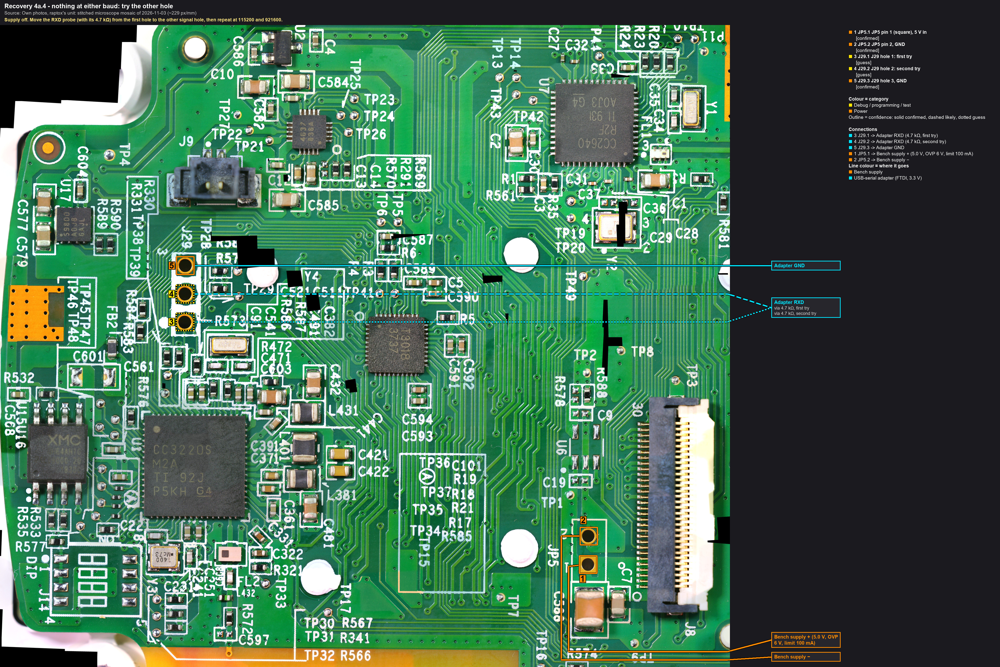
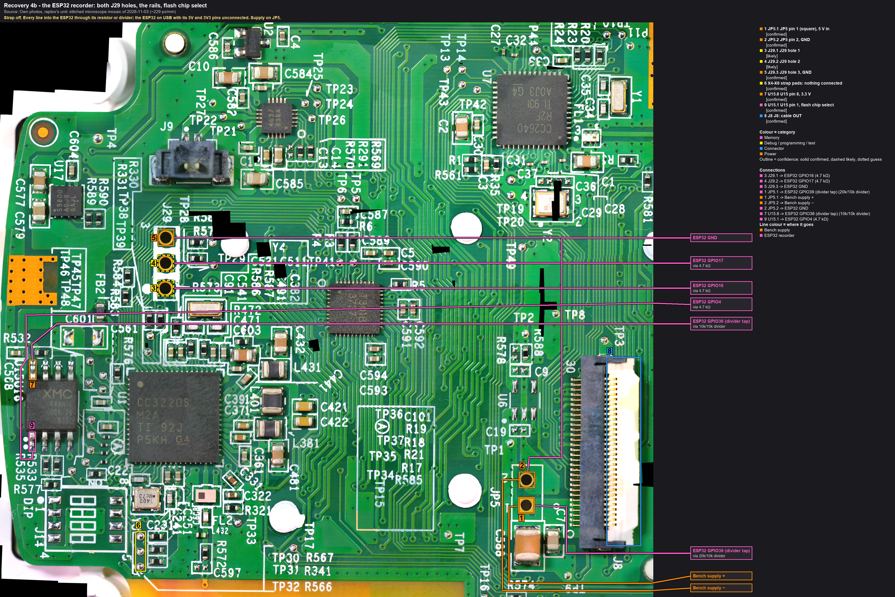

# Chapter 4: the boot listen (normal boot, SOP 000)

**Purpose.** With the flash backed up (chapter 3), the board is powered the way the cooker powers it, straps all low,
and whatever the CC3220 prints on its serial port at power-up is recorded: the ROM's or the network processor's
error text if the image can't be started, the application's banner if it can, and anything in between. Two ways to
listen: **4a**, the USB-serial adapter on this PC (two wires; the simplest, first); **4b**, the ESP32 recorder, which
adds both J29 holes at once, the rail and flash-chip-select timing, a baud-rate hint and a Bluetooth/Wi-Fi scan.

Gate: chapter 3 (the backup). This boot can change the flash: the network processor may roll back, commit or arm a
watchdog on an unfinished update. That is why it comes after the backup, and why the flash is read again afterwards.

## Before you start
- As chapter 3: board on the bezel, ESD, **FFC out of J8**, bench supply at JP5 (5.0 V, OVP 6 V, limit 100 mA,
  then 500 mA once the board is running: the CC3220's Wi-Fi calibration bursts reach 450 mA, datasheet SWAS035C
  section 8.5; a limit that is too low shows up as a brown-out reset loop, not as a fault of the board).
- **The strap is off.** Nothing on the J14 pads. With the board's own pull-downs the straps read 000, the normal boot.
- 4a: the adapter, I/O jumper on 3.3 V, one 4.7 kΩ resistor. `tools/uartlog` ready.
- 4b: the classic ESP32 dev kit (WROOM-32) flashed with `tools/j8probe` setup `aux`, the resistors (4.7 kΩ ×3) and
  the two dividers (20k/10k, 10k/10k), USB to this PC; `tools/j8probe/j8log.py` ready. Desk-tested first: an
  adapter's TXD into GPIO16 at 115200 must show up in `j8log.py --console` (the README's desk test).

## 4a. The adapter on this PC

Callouts: [rec4a_wiring](../hardware/callouts/rec4a_wiring.md).

| Board point (callout) | Through | Instrument |
|---|---|---|
| J29 TX hole (**3**, hole 1 assumed; chapter 1 decides) | 4.7 kΩ | adapter **RXD** |
| J29 hole 3 (**5**) | — | adapter **GND** |
| JP5 pin 1 / pin 2 (**1** / **2**) | — | bench supply + / − |
| the strap pads (**6**) | — | **nothing** |
| J8 (**8**) | — | nothing: cable out |

The adapter's **TXD stays unconnected**: nothing may drive the chip's RX in a listen session. VCC, DTR, RTS stay
unconnected too. The ground of this PC joins the board's ground through the adapter: fine on the bench supply.

1. Probes placed as in the 4a picture, beeper drill ([chapter 1 step 6](01-meter-checks.md#6-the-probe-contact-drill),
   the four probes used here).
2. On the PC: `py -3.13 tools/uartlog/uartlog.py --port COM<adapter> --baud 115200 --label j29-boot` (the log goes
   to `.capture/uart/`).
3. Supply on (limit 100 mA). Watch the current and the console for ten seconds. Raise the limit to 500 mA if the
   board draws more and the voltage sags.
4. Text that reads → done for this baud; let it run a minute (the application may print more as it tries to
   start Wi-Fi), then supply off.
   Garbage or framing errors → supply off, the logger at **921600** (`--baud 921600`), supply on again. Still
   nothing → the other J29 hole:

   

   Callouts: [rec4a-4_other-hole](../hardware/callouts/rec4a-4_other-hole.md). Supply off, the RXD probe with its
   4.7 kΩ from **3** to **4**, then 115200 and 921600 again (or a second adapter on **4** at the same time).
5. Supply off. Keep the log; the gist goes into the journal.

What to look for: a ROM or network-processor message about the image (authentication, missing file, service pack),
the application's banner and version, the words `STARTUP`, `OTA`, `PROVISIONING` (the firmware's job modes), file
names, a `$` prompt (the firmware's text shell is known over Bluetooth; whether it is also on the UART is a `guess`),
repeated banners (a reset loop).

## 4b. The ESP32 recorder

Callouts: [rec4b_wiring](../hardware/callouts/rec4b_wiring.md).

| Board point (callout) | Through | ESP32 pin |
|---|---|---|
| J29 hole 1 (**3**) | 4.7 kΩ | GPIO16 |
| J29 hole 2 (**4**) | 4.7 kΩ | GPIO17 |
| J29 hole 3 (**5**) | — | GND |
| JP5 pin 1 (**1**, also the supply +) | 20k/10k divider, tap to the pin | GPIO39 |
| JP5 pin 2 (**2**, also the supply −) | — | GND |
| U15 pin 8 (**7**) | 10k/10k divider | GPIO36 |
| U15 pin 1 (**9**) | 4.7 kΩ | GPIO4 |

The ESP32 runs from USB; its 5V and 3V3 pins stay unconnected. Every channel is an input with its pulls off, by the
firmware's construction; nothing drives the board.

1. Probes placed as in the 4b picture (seven), beeper drill.
2. On the PC: `py -3.13 tools/j8probe/j8log.py --port COM<esp32> --label j29-boot --console`. The `aux` setup sniffs both J29
   holes from its own boot at 115200.
3. Supply on. The log's `t0` is the moment VIN rises; then the 3.3 V rail's rise, the first flash chip-select edge
   (the ROM reading the flash), the first bytes on J29, any Bluetooth advertisement or Wi-Fi network seen.
4. Framing errors on a hole → `uart off J29.x`, read the `bd` hint from the window lines, `uart J29.x <bd>`,
   power-cycle. Try 921600 as well.
5. Supply off. `j8log.py --summary` on the capture for the per-channel table.

## After the boot: read the flash again
Back to [chapter 3's step 1 wiring](03-bootloader-session.md#1-place-and-check-unpowered) (strap on, adapter TXD
through 1 kΩ) and one more `read_flash` to
`dumps/cooker/<date>/u15_bl_after-boot.bin`; SHA-256 against the backup. **Equal**: the boot didn't touch the
flash. **Different**: the network processor wrote at boot (a rollback, a commit, a counter), which is itself a
finding about the fail-safe mechanism the README asks about; the backup from chapter 3 stays the reference, this
read is kept beside it.

## Outcomes
| Observation | Means | Next |
|---|---|---|
| nothing on either hole at any baud, no chip-select activity | the ROM doesn't start, or the holes aren't UART0 | chapter 3's answer decides: if the boot loader answered, UART0 TX is elsewhere or the ROM is silent in normal boot (not unusual: `guess`) |
| chip-select activity, no text | the ROM reads the flash and stops silently | the file list (chapter 3) says what it found; chapter 5 |
| ROM / NWP error text | the image or a system file can't be started | the text names the file: chapter 5 option A on it |
| the application's banner, then silence or a loop | the application starts and fails later | its last words are the lead (sensors, the Bluetooth link, the identity file) |
| a banner, Wi-Fi access point or Bluetooth advertisement seen | the application runs on the bench | the fault may be on the power-board side after all; back to the J8 campaign |

## Records
- Journal: FINDING (what the chip prints, which hole is TX, the baud, the rail-up time, the first chip-select
  edge), ACTION (the second raw read and its hash).
- [nets.md](../hardware/nets.md): UART0_TX / UART0_RX rows with the baud. `tools/j8probe` and `tools/uartlog`
  captures stay in `.capture/`.
- Timeline: one neutral line.
