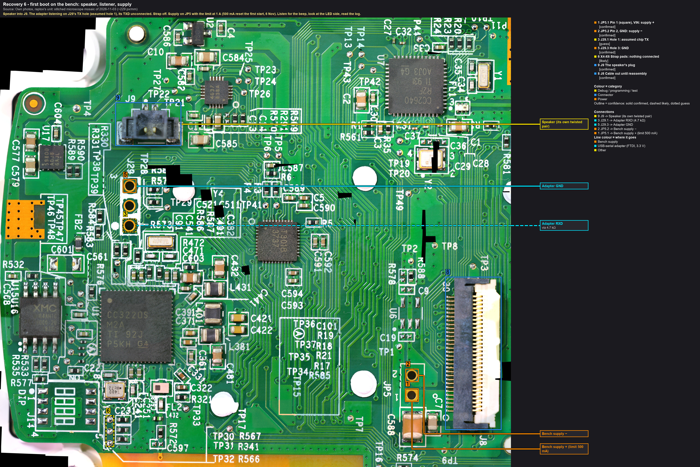
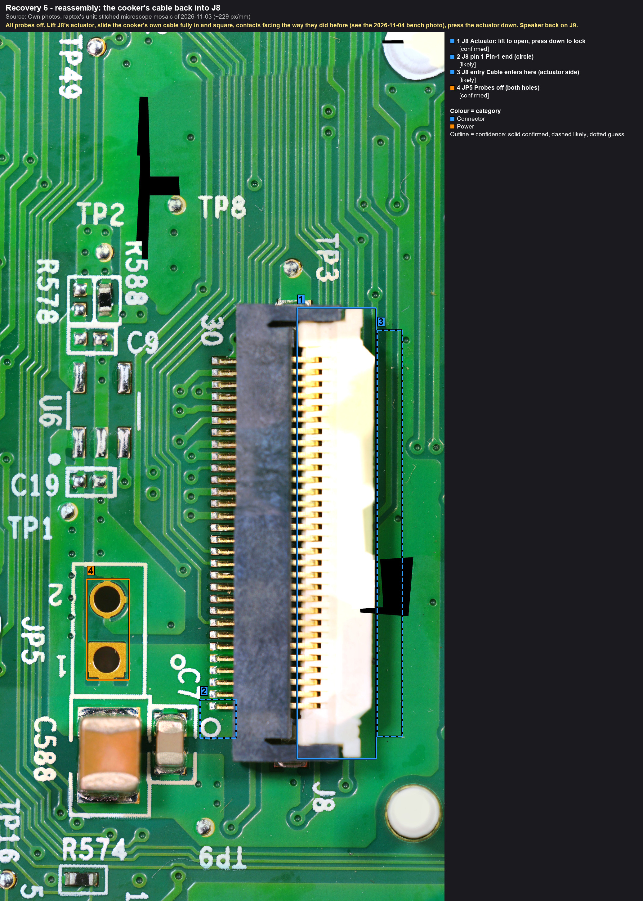

# Chapter 6: first boot and the cook test

**Purpose.** After the write (chapter 5), find out on the bench whether the CC3220 now runs its application, then put
the cooker back together and cook.

> **As it went, 6 November 2026.** On the bench the new image reset over and over at the 500 mA limit and came up
> at 1 A, fed on several J8 pins. Reassembled: the buttons and the display respond, a cook can be set from the
> panel; the pairing worked after a couple of minutes (the new firmware updates the Bluetooth chip first,
> `likely`); a 54 °C cook for ten minutes, the water on point. [The story](../../blog/posts/2026-11-06-it-cooks-again.md).

## On the bench

Callouts: [rec6-1_bench-boot](../hardware/callouts/rec6-1_bench-boot.md).

Wiring as chapter 4a (the adapter listening on J29's TX hole **3**, its GND on **5**, strap pads **6** empty) plus
the speaker on **9** (J9; its twisted pair is long enough) and, if the ESP32 is at hand, chapter 4b's Bluetooth/Wi-Fi
scan. The cable stays out of J8 (**8**) until reassembly.

1. Supply on, limit **1 A** (at 500 mA the first start reset over and over on 6 Nov; feed several J8 pins). Within seconds: the **beep** (the CC3220 plays it), the **lights** on the LED side (the
   board is on the bezel; look from the front), text on the serial port.
2. Within a minute: a Bluetooth advertisement (the phone's nRF Connect, the `0e140000-…` service) and, if the unit
   had Wi-Fi credentials and they survived, a join attempt on the home network (the router's client list, the
   unit's MAC from chapter 3). Without the power board the firmware will complain about its sensors and its
   companion chip; that is expected.
3. Supply off. Everything into the journal.

| Observation | Means | Next |
|---|---|---|
| beep, lights, text | the CC3220 application runs | reassemble and cook |
| text but no beep or lights | the application starts and stops early | its last words; the Bluetooth chip's leg (the companion link) is the next suspect |
| nothing, as before | the write didn't change the symptom | chapter 3's read-only connect: is the written file there? Then the next option of chapter 5, or the Bluetooth chip |

## Reassembly

Callouts: [rec6-2_reassembly-j8](../hardware/callouts/rec6-2_reassembly-j8.md). How the cable sat before:
[the 2026-11-04 bench photo](../../images/own/2026-11-04/01_bench_main-board_breakout-A-on-J8.jpg).

The reverse of [opening the head](../hardware/disassembly.md), with these points:
1. All probes off, the strap off, the adapter off. A last look at the board under the microscope: no stray solder,
   no bent pin, no probe mark on U1's pins.
2. The cooker's own FFC back into J8: contacts facing the way they faced before (the bench photo of 2026-11-04 shows
   it), the actuator closed, no skew; the speaker on J9.
3. The bezel's four plastic screws; the glass stays off for the first power-up so the display and the lights are
   visible and the head can be opened again in seconds.
4. **Nothing is probed while the unit is plugged in.** The power board carries mains.

## The first power-up as a cooker
The head is closed from here on, so there is nothing to probe and no board picture: the cooker is used as a cooker.
Tube in a pot of water between the min and max lines, head dry, a switched outlet within reach.
1. Plug in: the beep, the display, the Wi-Fi light. Note the firmware version if the display or the app shows it.
2. The app: does the cooker still appear under the account (identity kept, option A) or does it need pairing again
   (options B/C: pairing mode, the cooker's access point, the account binding)?
3. A short cook: set 55 °C, start; the pump runs, the water warms, the display follows; stop.
4. Unplug. Glass back on (the adhesive bead cleaned off and replaced).

## Records
- Journal: ACTION (reassembly), EVENT (first power-up), FINDING (what works, what doesn't).
- Timeline: the milestone, dated. `mkdocs.yml` status line. A blog post.
- The README's story: what the update had broken, in plain words, with the evidence from chapters 3 and 4.
