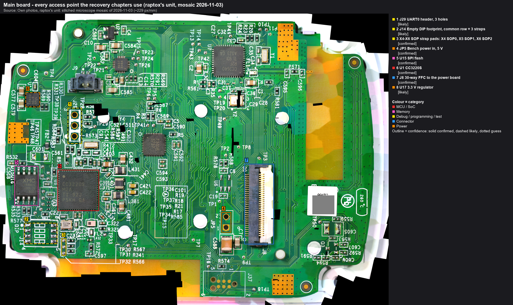

# Recovery handbook

The bench procedures for getting the dead main board's Wi-Fi chip (U1, TI CC3220S) backed up, examined and, if the
evidence allows, repaired. One chapter per bench session, in the order they run. Each chapter is a numbered
procedure with its own annotated pictures (callout numbers in the text refer to the boxes in the picture), a wiring
table, the expected reading at every step, an outcome table (reading → what it means → what comes next) and the
records it produces. **Every step that touches the hardware opens with its own picture**: a close-up with only that
step's points boxed and labelled, and a panel beside the photo with a line from each point to the instrument pin it
goes to (meter lead, supply terminal, adapter pin, ESP32 pin), with the resistor in between. Steps that happen only
on the PC say which picture the board stays in. The strap pads are measured (2026-11-05: X4 = SOP0, X5 =
SOP1, X6 = SOP2) and the pictures carry the roles. One fact is still unmeasured, and the pictures show it honestly:
which J29 hole is the chip's TX (hole 1 is assumed, drawn dashed). Chapter 1 step 4 measures it; the pictures are
then updated. The chapters were
written before the sessions, from what the board and the datasheets show;
the measured values are filled in as each session runs, each with its confidence (`confirmed` / `likely` / `guess`)
and its source.

Why the CC3220 first: the firmware map ([recovery strategy](../firmware/recovery-strategy.md)) puts the start-up
beep, the lights and the Wi-Fi on the CC3220, and the pump, heater and touch panel on the Bluetooth chip (U7). A
unit with no beep and no lights points at the CC3220 not running, or at its power.

> **As it went, 6 November 2026: the cooker cooks again** ([the story](../../blog/posts/2026-11-06-it-cooks-again.md)). The chapters below
> were written before the sessions and stay as written; this is what the sessions found, in chapter order:
> - **Chapter 1:** J29 is the other way round. **Hole 1 is the chip's receive line (pin 57), hole 2 its transmit
>   line (pin 55)**, driven directly (the 192 kΩ reading didn't hold up), and both are **shared with the Bluetooth
>   chip (U7)**, which drives hole 1 from power-up. The pictures still draw hole 1 as TX.
> - **The backups** were made before chapter 3: the flash by clip ([flash backup handbook](../flashbackup/index.md)),
>   the Bluetooth chip over its debug port ([page 10](../flashbackup/10-cooker-u7.md)).
> - **Chapter 3:** the boot loader answers through J29 only with U7 held in reset at its reset capacitor (page 10,
>   picture 10.11), the SOP2 strap set and the adapter's TXD through 1.2 kΩ on hole 1, one session per power-up.
>   The device status showed the cause: **the security-alert counter at its limit, the chip locked.**
> - **Chapter 5:** a full image went on: the current firmware, with the unit's own readable files from the backup,
>   its cloud identity among them. The app paired with the cooker afterwards.
> - **Chapter 6:** the first start of the new image needs more than 500 mA (the Wi-Fi start draws bursts): 1 A, the
>   supply on several J8 pins.

## The chapters

| # | Chapter | Session | Gate before it | What it produces |
|---|---|---|---|---|
| 1 | [Meter checks](01-meter-checks.md) | unpowered, about 30 min | none | which J14 pad is the SOP2 strap, which J29 hole is the chip's TX, the probe placements |
| 2 | (private rehearsal chapter: names the vendor's firmware files and the signature handling, not published) | TI development board, 1-3 h | none (it is not the cooker) | the in-circuit flash read qualified, the boot-loader client proven, the write rehearsed |
| 3 | [Bootloader session](03-bootloader-session.md) | dead board powered, chip in its ROM boot loader, **read-only** | chapters 1 and 2 | the version line, the MAC, the chip's mode and security-alert count. **The backup and the file list only on a development-mode chip**: in production mode the boot loader refuses them (6 Nov), and the backup is the clip, before this chapter |
| 4 | [Boot listen](04-boot-listen.md) | dead board powered, normal boot, listening on the serial port | chapter 3 (the backup exists) | what the chip prints at power-up, which hole is TX, the baud rate |
| 5 | (private write chapter: names the vendor's firmware files and the signature handling, not published) | dead board, **the write** | two equal backups, the rehearsal passed (in the cooker's mode), a logged decision | the application image replaced; the outcome. On a production-mode chip the one-file replace is refused (6 Nov): a full image or the factory restore |
| 6 | [First boot and cook](06-first-boot-and-cook.md) | bench, then the reassembled cooker | chapter 5 | a cooking cooker, or the next finding |

Chapters 2 and 5 are not in the public copy of this repository: they name the vendor's firmware files and describe
the signature handling step by step.

## Ground rules that every chapter follows
- **Back up before any write.** No flash is written anywhere before a full read exists that was taken **twice with
  the same SHA-256**, stored outside the repository and copied off the machine. Chapter 3 makes that backup;
  chapter 5 is the only chapter that writes to the cooker.
- **The working second unit is never touched.** Everything here is done on the dead unit's main board.
- **No mains on the bench.** The main board is powered from a current-limited bench supply at its power header
  JP5. The power board stays out of every session; its cable (the 30-way FFC) is out of J8 before anything else.
- **Nothing above 6 V** on JP5 or on J8 pins 1-6: the 3.3 V regulator's input limit.
- **Probes, not solder.** The connections are made with spring probes (Sensepeek PCBite SQ10) on the holes, pads
  and chip legs. No header is soldered, nothing is pressed into a hole. Contact is checked with the beeper before
  every power-up.
- **Every claim carries a confidence and a source.** Datasheet facts are `confirmed` as datasheet facts; what the
  board does is `likely` until measured; anything inferred is a `guess`.
- **Everything is logged** in the project journal as it happens: a finding, a decision, a hardware action, a write
  (with the hash of the backup it relied on).

## What must be known before any write: the per-device identity
Everything that makes this unit *this* unit lives on the 8 MiB serial flash next to the CC3220. A full
reprogramming of that flash erases all of it. The table says what survives which kind of write (TI documentation,
`likely`; sources in the [recovery strategy](../firmware/recovery-strategy.md)):

| Item | Where it lives | Can it be read? | Survives a file-level replace / a factory restore / a full program |
|---|---|---|---|
| The Wi-Fi/Bluetooth **MAC address** | a secure system file on the flash | TI Uniflash's "get device info" over the boot loader (works on a production-mode development board, 6 Nov; on this unit: chapter 3); the home router's client list has it too (the unit was on the home Wi-Fi). The open-source client's version reply does **not** carry it | yes / **no** / **no** (it must be put into the new image) |
| The cooker's **cloud identity** (the device ID and the credential the firmware uses to fetch its jobs) | a secure file, encrypted with device-unique keys | only as raw bytes inside the backup | yes / **lost** / **lost**, and nothing here can recreate it |
| The firmware's own state and settings files | files on the flash | the unencrypted ones, in chapter 3 | yes / **lost** / **lost** |
| The certificates and the certificate catalogue | plain files | yes; the update package carries copies | yes / rebuilt / rebuilt |
| The serial number | the label on the board | n/a | n/a |

The conclusion that shapes chapter 5: **never format the flash.** The write that keeps everything is a file-level
replacement of the application image alone, through the chip's own boot loader, with the maker's own signature on
the file. A factory restore and a full image are the fallbacks; each costs the identity.

## The parts and tools
| Item | Used in |
|---|---|
| Current-limited bench supply, 5.0 V, over-voltage protection at 6 V | chapters 3-6 |
| USB-serial adapter with **3.3 V** logic (FTDI; the I/O jumper on 3.3 V) | chapters 3, 4a, 5 |
| 7 spring probes (PCBite SQ10) with leads; the beeper (multimeter) | every chapter |
| Resistors: 4.7 kΩ (every listening line), 1 kΩ (the adapter's TX into the board), 470 Ω (the strap) | chapters 3-5 |
| ESD wrist strap and mat | every chapter |
| TI CC3220S LaunchPad, its USB cable | chapter 2 |
| SOIC-8 clip and a 3.3 V SPI reader (Raspberry Pi or Pico) | chapter 2 |
| ESP32 dev kit (classic, WROOM-32) with the j8probe firmware, dividers 20k/10k and 10k/10k | chapter 4b (optional) |
| Software: `tools/uartlog` (serial logger), `tools/cc32xx` (the boot-loader client, read-only by default), `tools/j8probe`, TI Uniflash | chapters 2-5 |

The boot-loader client is the open-source cc3200tool (toniebox-reverse-engineering fork), installed in a virtual
environment outside the repository; `tools/cc32xx/ccx.py` wraps it, allows only the read commands unless told
otherwise, and logs every run. See [tools/cc32xx](../../tools/cc32xx/README.md).

## Where everything is on the board

Callouts: [main_hookup_overview_micro](../hardware/callouts/main_hookup_overview_micro.md). 1 J29, the serial
header; 2 J14, the empty switch footprint; 3 the three strap pads beside it; 4 JP5, the power header; 5 U15, the
serial flash; 6 U1, the CC3220S; 7 J8, the cable to the power board (out in every session); 8 U17, the 3.3 V
regulator. Close-ups with the individual holes, pads and legs are in the chapters.

## The order, and what "today" can cover
Chapter 1 (30 minutes with the meter) → chapter 2 steps 1-5 (the LaunchPad, 1-2 hours) → chapter 3 (the first time
the dead board is powered on the bench; the backup, the MAC, the file list) → chapter 4a. Chapter 5 only when the
rehearsal's write test passed the same day and the file list points at the application image. If the chip doesn't
answer in chapter 3, the day ends with a finding about the power or the chip, not with a write.
