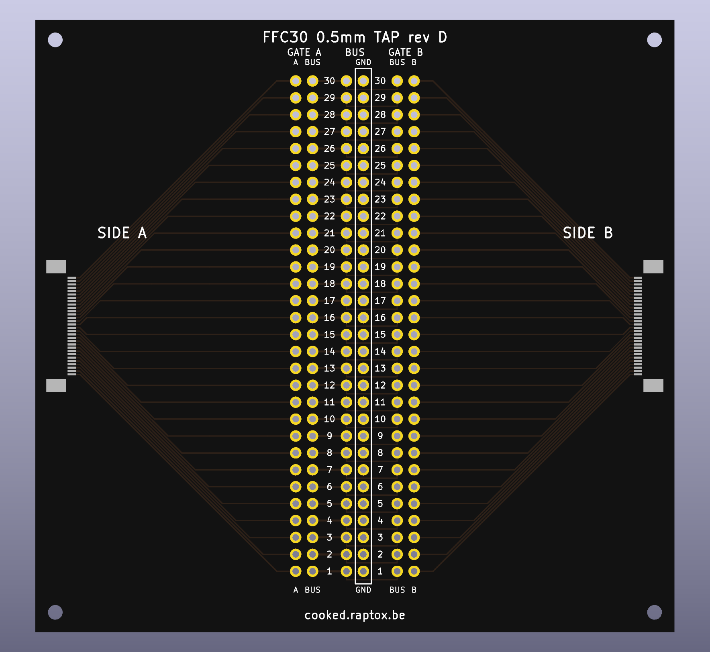

# FFC30 tap

A gated pass-through board for any 30-way flat flex cable (FFC) at 0.5 mm pitch. It sits between two boards, brings
every line out on a 2.54 mm **bus** pin with a ground pin beside it (for a logic analyser such as the DSLogic Plus),
and puts a **jumper gate** on each side: a cap per line decides whether that line of side A, of side B, or of both
reaches the bus. Every cap on = a plain pass-through. Nothing on the board is specific to one device; it was first
made for the Anova Precision Cooker Pro's J8 link ([pinout](../../docs/hardware/j8.md)).

**Status (2026-11-18): rev D drawn, not ordered** (in [ffc30-tap/](ffc30-tap/), DRC clean). **Rev C is in production
at JLCPCB** (ordered 2026-11-12, 5 boards, fully assembled), frozen with its own instructions in [revC/](revC/README.md).



## Rev D
- 96 x 92 mm, 4 layers, 1.6 mm, black solder mask.
- Two sockets, the same part on both sides: HanElectricity **05A20L30P** (LCSC C5362159), bottom contact, flip lock,
  2.0 mm high, for 0.3 mm FFC. Contacts on one face only, so neither cable can go in upside down. Land pattern from
  HanElectricity's drawing 05A20LXX (rev A, 2015-05-03): signal pads 0.30 x 1.25 mm, mounting pads 2.00 x 3.00 mm.
  The body's front (cable entry) is flush with the board edge (`likely`, within about 0.2 mm). Unchanged from rev C.
- **One row per line, 30 rows** (pin 30 at the top, pin 1 at the bottom, in the order of the socket pads), six pins
  a row in three pairs, one empty pitch between the pairs so a cap can't bridge two of them:

  ```
  socket A ─ [ A   BUS ]   [ BUS  GND ]   [ BUS   B ] ─ socket B
               gate A          bus           gate B
  ```
  - **A n** = the left socket's pin n, **B n** = the right socket's pin n, **BUS n** = the three BUS pins of row n
    (one net).
  - Cap on **A|BUS**: side A's line n on the bus. Cap on **BUS|B**: side B's line n on the bus. Both: line n passes
    through, as in rev C. Neither: the two sides are apart on that line, and each can be probed or driven on its own.
  - Cap on **BUS|GND**: line n joined to the ground rail, as in rev C. The rail (the GND column and the two inner
    ground planes) floats until one is on.
- Six 2x15 headers (LCSC C56496, 2.54 mm, straight), two per pair, butted end to end at the middle (pins 15 and 16).
- Every line on the top layer: a 45 degree fan-out from each socket straight into its outer column; the BUS link from
  the bus pair to gate B runs round the ground pin in the gap below its row. In1 and In2 are solid ground planes.
- Silkscreen: the row numbers (in both gaps), the column and pair names, SIDE A / SIDE B, the ground box, the title
  and cooked.raptox.be.

## Using it
1. **Cables:** both of the same type (contacts on the same side at both ends, "type A"), contacts down into the
   sockets.
2. **The board whose pin numbers you want goes in the LEFT socket (side A).** Row n is then its pin n, if its
   connector has bottom contacts and numbers its pins like these sockets (pin 1 on the left, seen from where the
   cable enters). Otherwise row n is its pin 31 - n. The lines pass through correctly either way.
3. **Before power,** with the caps on and only one board's cable in, ring the pins you know (its supply pins
   together, its ground pins together) to make sure of the numbering.
4. **Gates, in this order:** ground lines first (A|BUS and BUS|B on every ground row), then the supply, then the
   signals; take them off in the reverse order. A side with its supply connected and its ground open finds a ground
   through the signal lines and the chips' protection diodes.
5. **Ground rail:** a cap on BUS|GND only on a row that *is* ground. A cap there on a supply row shorts the supply.
   One or two are enough for slow signals (DreamSourceLab's DSView guide: one common ground below about 5 MHz).
6. **Probes:** the signal lead on a BUS pin (or on an A or B pin to see one side before its gate), its ground lead on
   the GND pin of the row.
7. **Mains:** a PC-grounded analyser connects the PC's earth to the board's ground. With a mains-powered board in the
   chain, check that its ground is isolated from mains first.
8. **Underneath:** the header pins stick out about 1.4 mm under the board (3 mm tails through 1.6 mm), plus solder.
   Stand the board on four M2 nylon standoffs, at least 6 mm, in the corner holes, or on a non-conductive surface.
   Never on metal: it joins pins, and a supply line on ground shorts the supply.

## Ordering at JLCPCB
Three files, all in `ffc30-tap/fab/`:

| Step | File | Settings |
|---|---|---|
| PCB | `ffc30-tap_gerbers_JLC.zip` | 4 layers, 96 x 92 mm (read from the files), 1.6 mm, **black** solder mask, the default 4-layer stackup |
| Assembly | | **Standard** PCBA (the headers are wave soldered, which Economic doesn't do), top side, edge rails as JLCPCB asks (rev C had them on the sides without sockets), **Confirm Parts Placement: Yes** |
| BOM | `jlc_bom.csv` | J1, J2 = C5362159 (socket); J3-J8 = C56496 (2x15 header). Both are extended parts; check stock |
| Placement | `jlc_cpl.csv` | Check every part in the placement preview, then confirm |

The CPL already carries two corrections for JLCPCB's own part models (measured in their placement viewer on
2026-11-12, set in `build_fab.py`; the copper itself follows the makers' drawings):
- **Sockets J1, J2:** JLCPCB's model of C5362159 sat 2.0 mm toward the board edge from the pads, so the CPL moves each
  socket 2.0 mm toward its pads. With that, the model's pins end about 0.15 mm inside the pads' tips and its body
  starts about 0.8 mm from them, as the footprint assumes.
- **Headers J3-J8:** JLCPCB's model of C56496 lies across the board at 0 degrees; the CPL turns them 90 degrees.

Still check in the placement preview, against [the render](ffc30-tap/render_top.png): the sockets' cable openings
face the board edges and their pins sit on the 30 pads; the headers stand over their two columns, two butted end to end per pair.

Rev C's first quote (2026-11-12, 5 boards, before shipping): PCB EUR 14.40 (black mask EUR 7.20 of it), Standard PCBA
EUR 43.39, total EUR 57.79; PCB 3 days, assembly 5-6 days.

## Regenerating
The board is generated from code: change `generate_board.py`, never the `.kicad_pcb` by hand. With KiCad 10's own
Python, in `ffc30-tap/`:

```sh
"<KiCad 10>/bin/python.exe" -I generate_board.py   # board, footprint library, fp-lib-table
"<KiCad 10>/bin/python.exe" -I build_fab.py        # DRC (must be clean), gerbers, drill, BOM, CPL, renders
```

## Revisions
- **rev A** (2026-11-12, [revA/](revA/), not ordered): 2 layers, one 2x15 header, sockets with contacts on both faces
  (X05A20H30G). One cable inserted upside down mirrors the bus (pin n to 31 - n): on the cooker that feeds the main
  board backwards. Its header numbers read reversed with the main board in the socket marked HOST.
- **rev B** (drawn, not kept): four columns of 15 (ground, line, line, ground) with ground planes.
- **rev C** (2026-11-12, [revC/](revC/), **ordered**, in production since 2026-11-18): frozen as sent to JLCPCB
  (`fab/ffc30-tap_gerbers_JLC.zip` SHA-256 `b90ba95b…403c0a`, `jlc_bom.csv` `8b6289e8…3837`, `jlc_cpl.csv`
  `60cd19c0…7c69`); never regenerate it. Its first build still carried rev A's socket pads; the X05A20LXXT land pattern
  replaced them the same day, before any order (the board grew to 80 x 70 mm). The same day the socket became
  HanElectricity's 05A20L30P (XKB's was out of stock at JLCPCB), with its own land pattern.
- **rev D** (2026-11-18, [ffc30-tap/](ffc30-tap/), not ordered): a jumper gate on each side of rev C's bus, one row
  per line (A, BUS | BUS, GND | BUS, B), every line gated, grounds included. 96 x 92 mm, six 2x15 headers, every
  line on the top layer. Universal: no device-specific notes on the board or in its instructions.
