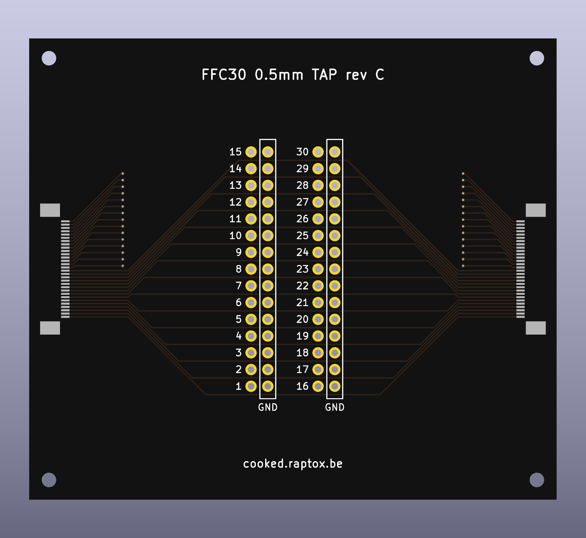

# FFC30 tap

A pass-through board for a 30-way flat flex cable (FFC) at 0.5 mm pitch. It sits between two boards, passes every
line straight through, and brings each line out on a 2.54 mm pin with a ground pin beside it, for a logic analyser
such as the DSLogic Plus. It was made for the Anova Precision Cooker Pro's J8 link (main board to power board,
[pinout](../../docs/hardware/j8.md)), but nothing on the board is specific to that cooker.

**Status (2026-11-12): rev C ordered at JLCPCB** (order number and date to add). The order files are in [ffc30-tap/fab/](ffc30-tap/fab/); see
[Ordering at JLCPCB](#ordering-at-jlcpcb).



## Rev C
- 80 x 70 mm (JLCPCB's assembly asks for at least 70 x 70 mm), 4 layers, 1.6 mm, black solder mask.
- Two sockets, the same part on both sides: HanElectricity **05A20L30P** (LCSC C5362159), bottom contact, flip lock,
  2.0 mm high, for 0.3 mm FFC. Contacts on one face only, so neither cable can go in upside down (rev A's sockets
  allowed it). Land pattern from HanElectricity's drawing 05A20LXX (rev A, 2015-05-03): signal pads 0.30 x 1.25 mm,
  mounting pads 2.00 x 3.00 mm. The body's front (cable entry) is flush with the board edge (`likely`, within about
  0.2 mm: the drawing gives the depth, the pin tips' place on the pads is estimated).
  The first pick, XKB X05A20L30T (C2880811), was out of stock at JLCPCB; its land pattern is almost the same.
- Two 2x15 headers (LCSC C56496, 2.54 mm, straight). Block 1 = lines 1-15, block 2 = lines 16-30, each line with a
  ground pin beside it. Pin 1 at the bottom of block 1, pin 16 at the bottom of block 2.
- Lines 1-15 run on the top layer, lines 16-30 on the bottom layer (through a via column next to each socket).
  In1 and In2 are solid ground planes that join both ground columns.
- Silkscreen: pin numbers, the ground boxes, the title and cooked.raptox.be. Everything else is in this file.

## Using it
1. **Cables:** both of the same type (contacts on the same side at both ends, "type A"), contacts down into the
   sockets.
2. **The board whose pin numbers you want goes in the LEFT socket.** Header pin n is then its pin n, if its
   connector has bottom contacts and numbers its pins like these sockets (pin 1 on the left, seen from where the
   cable enters). Otherwise header pin n is its pin 31 - n. The lines pass through correctly either way.
   - Anova: the main board's cable (J8) in the left socket, the power board's in the right. Header n = J8 pin n
     (`likely`: J8 has bottom contacts by the cable photos, and its pin 1 position is from the microscope mosaic).
3. **Before power,** with only the left board's cable in, ring a pin you know to the header.
   Anova: header pins 1-6 ring together (the 5 V supply), and so do 10, 11, 17, 19, 22, 23 and 30 (ground).
4. **Ground:** the ground columns float until a jumper cap joins a line that *is* ground to the ground pin beside
   it. One or two caps are enough for slow signals (DreamSourceLab's DSView guide: one common ground below about
   5 MHz). A cap on a supply line shorts the supply. Anova: caps only on 10, 11, 17, 19, 22, 23 or 30, never on 1-6.
5. **Probes:** the signal lead on a line pin, its ground lead on the ground pin beside it.
6. **Mains:** a PC-grounded analyser connects the PC's earth to the board's ground. With a mains-powered board in
   the chain, check that its ground is isolated from mains first (for the cooker:
   [bench setup](../../docs/hardware/bench-setup.md)).
7. **Underneath:** the header pins stick out about 1.4 mm under the board (3 mm tails through 1.6 mm), plus solder.
   Stand the board on four M2 nylon standoffs, at least 6 mm, in the corner holes, or on a non-conductive surface.
   Never on metal (a bench, a tool, the cooker's housing): it joins pins, and a supply line on ground shorts the
   supply.

## Ordering at JLCPCB
Three files, all in `ffc30-tap/fab/`:

| Step | File | Settings |
|---|---|---|
| PCB | `ffc30-tap_gerbers_JLC.zip` | 4 layers, 80 x 70 mm (read from the files), 1.6 mm, **black** solder mask, the default 4-layer stackup |
| Assembly | | **Standard** PCBA (the headers are wave soldered, which Economic doesn't do), top side, edge rails added by JLCPCB (on the 80 mm sides; the sockets are on the 70 mm sides), **Confirm Parts Placement: Yes** |
| BOM | `jlc_bom.csv` | J1, J2 = C5362159 (socket); J3, J4 = C56496 (2x15 header). Both are extended parts; check stock |
| Placement | `jlc_cpl.csv` | Check every part in the placement preview, then confirm |

The CPL already carries two corrections for JLCPCB's own part models (measured in their placement viewer on
2026-11-12, set in `build_fab.py`; the copper itself follows the makers' drawings):
- **Sockets J1, J2:** JLCPCB's model of C5362159 sat 2.0 mm toward the board edge from the pads, so the CPL moves each
  socket 2.0 mm toward its pads. With that, the model's pins end about 0.15 mm inside the pads' tips and its body
  starts about 0.8 mm from them, as the footprint assumes.
- **Headers J3, J4:** JLCPCB's model of C56496 lies across the board at 0 degrees; the CPL turns them 90 degrees.

Still check in the placement preview, against [the render](ffc30-tap/render_top.png): the sockets' cable openings
face the board edges and their pins sit on the 30 pads; the headers stand over their two columns.

First quote (2026-11-12, 5 boards, before shipping): PCB EUR 14.40 (black mask EUR 7.20 of it), Standard PCBA
EUR 43.39, total EUR 57.79; PCB 3 days, assembly 5-6 days.

## Regenerating
The board is generated from code: change `generate_board.py`, never the `.kicad_pcb` by hand. With KiCad 10's own
Python, in `ffc30-tap/`:

```sh
"<KiCad 10>/bin/python.exe" -I generate_board.py   # board, footprint library, fp-lib-table
"<KiCad 10>/bin/python.exe" -I build_fab.py        # DRC (must be clean), gerbers, drill, BOM, CPL, renders
```

## Revisions
- **rev A** (2026-11-12, [revA/](revA/), not ordered): 2 layers, one 2x15 header, sockets with contacts on both faces
  (X05A20H30G). One cable inserted upside down mirrors the bus (pin n to 31 - n): on the cooker that feeds the main
  board backwards. Its header numbers read reversed with the main board in the socket marked HOST.
- **rev B** (drawn, not kept): four columns of 15 (ground, line, line, ground) with ground planes.
- **rev C** (2026-11-12): this board. Its first build still carried rev A's socket pads; the X05A20LXXT land pattern
  replaced them the same day, before any order (the board grew to 80 x 70 mm). The same day the socket became
  HanElectricity's 05A20L30P (XKB's was out of stock at JLCPCB), with its own land pattern.
