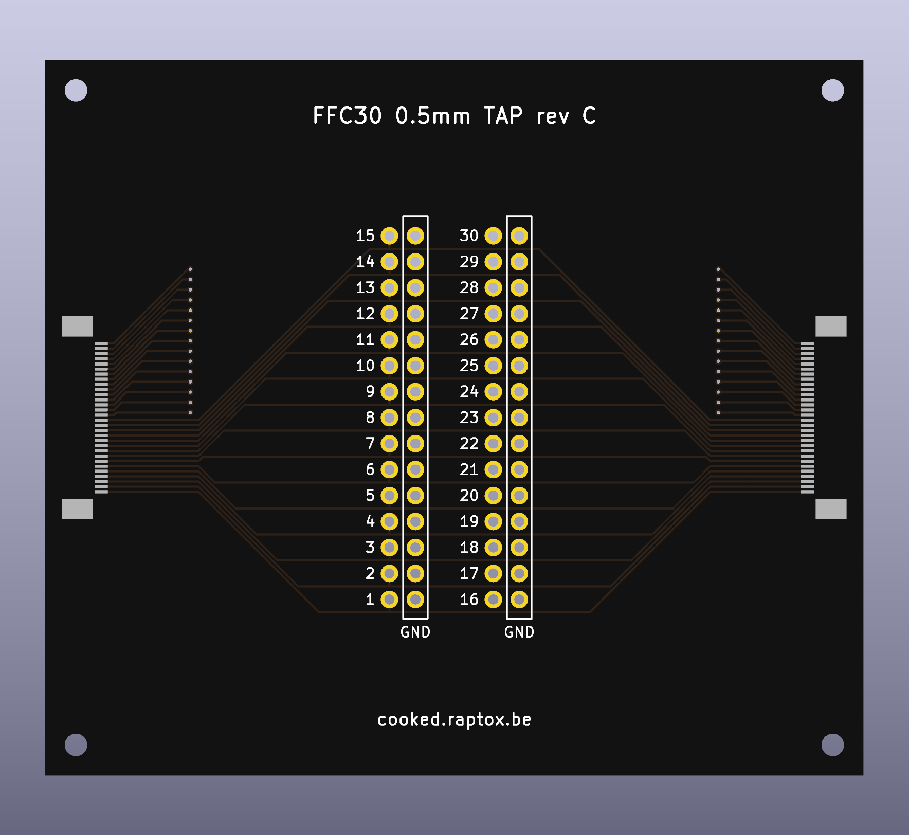

# FFC30 tap, rev C (ordered)

Frozen as sent to JLCPCB on 2026-11-12 (in production since 2026-11-18). Never regenerate it: the current revision is in [../ffc30-tap/](../ffc30-tap/), described in [../README.md](../README.md), which also has the order steps and the JLCPCB part-model corrections (the same for both revisions).

## Rev C
- 80 x 70 mm (JLCPCB's assembly asks for at least 70 x 70 mm), 4 layers, 1.6 mm, black solder mask.
- Two sockets, the same part on both sides: HanElectricity **05A20L30P** (LCSC C5362159), bottom contact, flip lock,
  2.0 mm high, for 0.3 mm FFC. Contacts on one face only, so neither cable can go in upside down (rev A's sockets
  allowed it). Land pattern from HanElectricity's drawing 05A20LXX (rev A, 2015-05-03): signal pads 0.30 x 1.25 mm,
  mounting pads 2.00 x 3.00 mm. The body's front (cable entry) is flush with the board edge (`likely`, within about
  0.2 mm: the drawing gives the depth, the pin tips' place on the pads is estimated).
  The first pick, XKB X05A20L30T (C2880811), was out of stock at JLCPCB; its land pattern is almost the same.
- Two 2x15 headers (LCSC C56496, 2.54 mm, straight). Block 1 = lines 1-15, block 2 = lines 16-30, each line with a
  ground pin beside it. Pin 1 at the bottom of block 1, pin 16 at the bottom of block 2.
- Lines 1-15 run on the top layer, lines 16-30 on the bottom layer (through a via column next to each socket).
  In1 and In2 are solid ground planes that join both ground columns.
- Silkscreen: pin numbers, the ground boxes, the title and cooked.raptox.be. Everything else is in this file.

## Using it
1. **Cables:** both of the same type (contacts on the same side at both ends, "type A"), contacts down into the
   sockets.
2. **The board whose pin numbers you want goes in the LEFT socket.** Header pin n is then its pin n, if its
   connector has bottom contacts and numbers its pins like these sockets (pin 1 on the left, seen from where the
   cable enters). Otherwise header pin n is its pin 31 - n. The lines pass through correctly either way.
   - Anova: the main board's cable (J8) in the left socket, the power board's in the right. Header n = J8 pin n
     (`likely`: J8 has bottom contacts by the cable photos, and its pin 1 position is from the microscope mosaic).
3. **Before power,** with only the left board's cable in, ring a pin you know to the header.
   Anova: header pins 1-6 ring together (the 5 V supply), and so do 10, 11, 17, 19, 22, 23 and 30 (ground).
4. **Ground:** the ground columns float until a jumper cap joins a line that *is* ground to the ground pin beside
   it. One or two caps are enough for slow signals (DreamSourceLab's DSView guide: one common ground below about
   5 MHz). A cap on a supply line shorts the supply. Anova: caps only on 10, 11, 17, 19, 22, 23 or 30, never on 1-6.
5. **Probes:** the signal lead on a line pin, its ground lead on the ground pin beside it.
6. **Mains:** a PC-grounded analyser connects the PC's earth to the board's ground. With a mains-powered board in
   the chain, check that its ground is isolated from mains first (for the cooker:
   [bench setup](../../../docs/hardware/bench-setup.md)).
7. **Underneath:** the header pins stick out about 1.4 mm under the board (3 mm tails through 1.6 mm), plus solder.
   Stand the board on four M2 nylon standoffs, at least 6 mm, in the corner holes, or on a non-conductive surface.
   Never on metal (a bench, a tool, the cooker's housing): it joins pins, and a supply line on ground shorts the
   supply.
