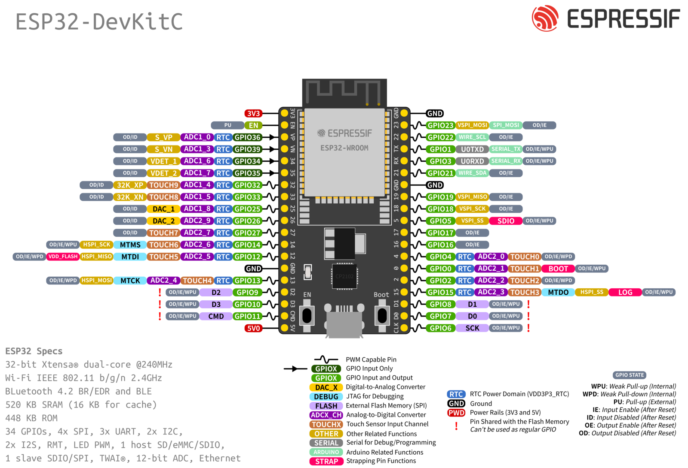

# espserprog: a read-only flash reader on an ESP32

Firmware for a classic ESP32 dev board (ESP32-WROOM-32, the same as `tools/j8probe`) that speaks flashrom's
**serprog** protocol over its USB serial port. flashrom on the PC then reads a SPI NOR flash through it, and
`tools/flashbackup/backup.py` works unchanged:

```
py -3.13 tools/flashbackup/backup.py read --programmer "serprog:dev=COM<n>:921600,spispeed=2M" --out <dir> --name <stem> --expect-chip <part> --expect-size <bytes>
```

Why an ESP32: its I/O runs at **3.3 V** (a 5 V Arduino Uno or Nano would put 5 V on the flash, like the kit's
CH341A), and it is already on the bench. The procedure around it is the
[flash backup handbook](../../docs/flashbackup/index.md).

## What makes it safer than a generic reader
- **Read-only in the firmware.** An SPI operation whose first byte is a write enable (0x06, 0x50), a program, an
  erase, a status-register or lock-bit write, a suspend or a reset is refused (NAK) before anything reaches the chip.
  Without write enable an SPI NOR flash ignores program and erase commands, so the refusal of 0x06/0x50 alone
  would do; the rest are refused as well. flashrom's probes (0x9F, 0x90, 0xAB, 0x05, 0x5A) and reads (0x03, 0x0B)
  pass.
- **Its pins are high-impedance until flashrom asks for them.** From power-up the four SPI pins are inputs (not
  driven). They are driven only after flashrom's "pin drivers on" (S_PIN_STATE 1, at the start of a session), and
  released at "off" (the end of a session), or after 2 s without an operation. So an ESP32 left plugged in doesn't
  drive the lines of a board that is switched off. The handbook's order (board on before the reader is used, reader
  off before the board) still applies, as a habit.
- **Every plain read is verified in the reader**. A READ operation is read from the chip in 1 KiB blocks,
  each block twice (its own command and address each time), again on a mismatch until two reads agree, up to six.
  Only then does the data go out. No agreement means the operation is refused, so flashrom stops instead of
  writing a bad dump. Why: on 2026-11-06 one read of a pattern came back with exactly one 64-byte unit of zeros, the signature of an SPI transfer that didn't complete on the ESP32 (`likely`). Re-reads and failures
  are counted on the live view.
- GPIO2 (the dev board's blue LED) is lit while the pins are driven.

## Pins (the ESP32's VSPI)
| ESP32 | Clip lead | Flash pin |
|---|---|---|
| GPIO5 | CS | 1 CS# |
| GPIO18 | CLK | 6 CLK |
| GPIO23 | MOSI | 5 DI |
| GPIO19 | MISO | 2 DO |
| GND | GND | 4 GND |
| 3V3 | only the loose practice chip | 8 VCC |

Drawing: [fb-reader-esp32](../../images/diagrams/fb-reader-esp32.png). Where those pins sit on a DevKitC-style board:



Source: Espressif Systems, ESP-IDF v5.1 documentation, "ESP32-DevKitC V4 Getting Started Guide" (<https://docs.espressif.com/projects/esp-idf/en/v5.1/esp32/hw-reference/esp32/get-started-devkitc.html>), file `docs/_static/esp32-devkitC-v4-pinout.png` of the ESP-IDF repository, Apache License 2.0; unchanged.

## Build and flash
```
py -3.13 -m platformio run -d tools/espserprog                                   # build
py -3.13 -m platformio run -d tools/espserprog -t upload --upload-port COM<n>    # flash the ESP32 (its own flash)
```
The serial speed is 921 600 baud (set at build time, `SERPROG_BAUD`); the USB bridges of the common dev boards
(CP2102, CH340) all run it. With the verified reads, 8 MiB takes about 160 s per read (the two SPI reads and the
serial transfer run one after the other).

Empty test, nothing on the pins: `flashrom -p serprog:dev=COM<n>:921600` → "No EEPROM/flash device found". If it
says it can't synchronize instead, run it again.

**Opening or closing the port resets the dev board** (`confirmed` on the CP2102 board: the DTR/RTS
auto-reset circuit). Harmless: the firmware comes up with its pins high-impedance and flashrom synchronizes. But
the live view's counters start again with every flashrom call, and its Wi-Fi rejoins within a few seconds.

## The live view (optional, Wi-Fi)
A view-only status page, for watching a read as it happens: the session, the current operation (opcode, name,
address, length), the read progress against the chip's size (from its ID), throughput, bytes read and written,
refused operations, re-reads, and the last 32 operations. No controls: nothing can be started from it.

The network comes from **two environment variables at build time**, never from a file in the repository:
```
$env:ESPSERPROG_SSID = "<network>"; $env:ESPSERPROG_PASS = "<passphrase>"
py -3.13 -m platformio run -d tools/espserprog -t upload --upload-port COM<n>
python -I tools/espserprog/netinfo.py COM<n>     # asks the reader for its address (its own query, 0xF0)
```
Then `http://espserprog.local/` or the address `netinfo.py` prints. Built without the variables, the firmware has
no Wi-Fi at all. The web server runs on the ESP32's other core: serprog's timing doesn't depend on it.
The Wi-Fi keeps its settings in RAM only (`WiFi.persistent(false)`).

**Not for board backups (yet).** Two reads of the LaunchPad stalled on this build while the page was open: the
reader finished an operation, and flashrom then waited for bytes that never came. Seven reads on the
build without Wi-Fi never stalled. Until the mechanism is found: **board backups on the build without Wi-Fi**, the
live view for tests.

## Status
Built 2026-11-06 (PlatformIO, espressif32, Arduino framework; with the live view 18 % RAM, the large app
partition) and **running** on raptox's ESP32-D0WD-V3 dev board (CP2102 bridge) to :
- flashrom 1.8.0's empty test: synchronized, interface version ok, SPI only, read-n 65 536, the SPI clock set to
  exactly 2 MHz, the name `espserprog-ro`, drivers on for the session and "Output drivers disabled" at its end;
  "No EEPROM/flash device found" (nothing on the pins)
- `guard_test.py`: reads accepted (RDID, READ, RDSR), every write-type opcode refused (WREN, EWSR, page program,
  sector erase, both chip erases, WRSR), still in sync afterwards

- the loose practice chip: blank read verified; an 8 MiB pattern written (the `-rw` build) and read back
  equal to the pattern; one read of three had 64 zero bytes, which led to the verified reads

Next: the LaunchPad (handbook page 3).

## The write-capable variant (the loose practice chip only)
A blank chip reads as all `FF`, which proves little. To check that every bit comes back right, a known pattern is
written to the **loose practice chip** and read back (handbook page 2.4). That needs a build without the guard:
```
py -3.13 -m platformio run -d tools/espserprog -e esp32-rw -t upload --upload-port COM<n>   # name espserprog-rw
py -3.13 -m platformio run -d tools/espserprog -t upload --upload-port COM<n>               # back to espserprog-ro
```
flashrom prints the name at every start (`serprog: Programmer name is "espserprog-ro"`), `backup.py` records it in
the manifest and warns if it isn't the `-ro` build. **Before any board: the `-ro` build, and `guard_test.py` passes.**

## Test the guard
```
python -I tools/espserprog/guard_test.py COM<n>      # any Python with pyserial
```

## When flashrom finds no chip
```
python -I tools/espserprog/idprobe.py COM<n> [hz]    # RDID, RES, REMS, RDSR raw (read-only), default 250 kHz
```
`00`/`FF` mixed or all `FF`: nothing drives DO (a jaw off its leg, or the chip unpowered): power off, re-seat. The
right ID at 250 kHz and 2 MHz: go (, the cooker's first try).
